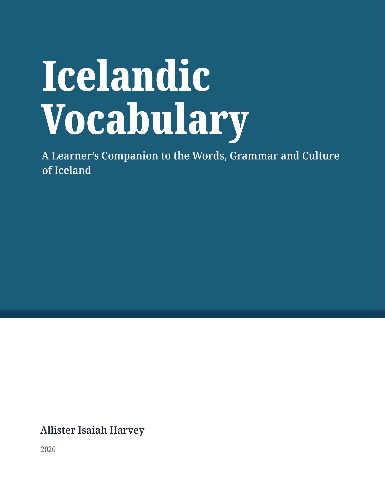

#+TITLE: Von isländischen Notizen zum veröffentlichten Buch: /Icelandic Vocabulary/ 🇮🇸📚
#+DATE: <2026-09-30 Wed>
#+FILETAGS: :icelandic:emacs:org-mode:books:
#+DESCRIPTION: Wie aus einem Stapel isländischer Lernnotizen in Org mode nach und nach ein veröffentlichtes Buch wurde.
#+HERO: banner.png
#+TIMEZONE: America/Port_of_Spain

* Ich habe tatsächlich ein Buch veröffentlicht

Ich hatte nie vor, ein Buch zu schreiben. Ich wollte Isländisch lernen.

Und trotzdem sind wir hier. Mein Buch /Icelandic Vocabulary/ ist jetzt erschienen und bei Amazon erhältlich. Ehrlich gesagt fühlt es sich immer noch etwas seltsam an, das zu schreiben. Eben noch habe ich Notizen für mich gemacht, und im nächsten Moment starrte ich auf eine Seite, auf der „veröffentlicht“ stand.

Das ist die Geschichte, wie es dazu kam.

#+CAPTION: Das fertige Buch

* Warum ich angefangen habe, Isländisch zu lernen

Anfang letzten Jahres habe ich angefangen, Isländisch zu lernen. Nach so vielen Jahren mit Schwedisch wollte ich mehr über dessen Wurzeln erfahren, und ich hatte immer gehört, Isländisch sei die lebende Sprache, die dem Altnordischen am nächsten steht.

Das war eigentlich schon alles. Kein großer Plan, nur Neugier darauf, woher die Sprache kommt, die ich schon kannte.

* Zuerst kamen die Notizen

Ich schreibe Notizen, solange ich Obsidian und Apple Notes benutze. Nach einer Weile fiel mir aber auf, dass ich meine Notizen auf dem Handy kaum anfasste. Wenn ich genauer darüber nachdachte, wollte ich sie dort viel lieber /lesen/ als bearbeiten. Fast alle meine Notizen entstanden sowieso auf dem Laptop.

Also verlegte ich das ganze Notizenschreiben auf den Laptop und blieb bei Obsidian. Das war eine schöne Erfahrung, besonders seit es Bases gibt. Aber beim Schreiben dort vermisste ich ständig meine Meow-Tastenbelegung.

Ja, ja, ich weiß. Sehr viel mehr Leute benutzen Vim-Tastenbelegungen. Ich weiß auch nicht, Meow fühlt sich für mich einfach so viel bequemer an, und der einzige Ort, an dem ich es benutzen kann, ist Emacs. Das hat mich also zurückgezogen.

Warum Org statt Markdown? Hauptsächlich, weil sich meine Notizen so leichter mitnehmen lassen. Markdown wird an vielen Stellen unterstützt, aber es gibt so unglaublich viele /Dialekte/ davon. Soweit ich weiß, gibt es von Org mode nur einen Dialekt, auf dem Erweiterungen aufbauen. Ich kann Org nach Markdown exportieren, wenn ich je möchte, aber nicht umgekehrt. Org kann alles, was ich brauche, also bin ich dabei geblieben.

Irgendwie ist daraus noch ein Emacs-Projekt geworden. 😂

* Warum ich die Notizen zu einem Buch machen wollte

Nach einem Jahr und vier Monaten Isländisch sah ich mir an, wie viele Notizen ich gemacht hatte, und dachte: /Isländisch ist so eine schöne und geschichtsträchtige Sprache. Ich wünschte, mehr Menschen würden sie wirklich lernen./

Da hat es bei mir klick gemacht. Wenn ich ein Buch über isländischen Wortschatz schriebe, könnte ich den Leuten vielleicht nicht nur zeigen, wie schön die Sprache aussieht, sondern auch, wie großartig die Kultur dahinter wirklich ist.

Das hat auch geprägt, was für ein Buch es werden sollte. Als ich mich dem Isländischen zuwandte, hatte ich die Art von Hilfe erwartet, die ich beim Schwedischen hatte: Lehrbücher, Wörterbücher, Lektüren für Lernende. Ich fand eine Handvoll ausgezeichneter Ressourcen, aber kaum etwas, das Wortschatz, Grammatik und Kultur an einem Ort zusammenbrachte. Das hier ist also das Buch, das ich mir zu Beginn gewünscht hätte.

Ich bin kein Linguist für Isländisch, und das Buch ersetzt keine richtige Grammatik und kein Wörterbuch. Es ist ein *Lernender, der für andere Lernende schreibt*: das, was /mir/ geholfen hat, zu verstehen und mir zu merken.

* Die Verbindung zum Schwedischen

Ich lerne Sprachen mit der Leitermethode, bei der man eine Sprache, die man schon kann, als Trittstein zur nächsten benutzt. Schwedisch hat /sehr/ geholfen. Viel germanischer Grundwortschatz ist erkennbar verwandt. Als mir /Ég er heima/ begegnete, sah ich sofort, dass /heima/ zur selben Familie gehört wie schwedisch /hemma/. Genauso bei /vatn/, /hús/, /bók/, /dagur/ und so weiter.

Das geht über einzelne Wörter hinaus. Isländisch /föðurbróðir/ und /móðurbróðir/ sind genau wie schwedisch /farbror/ und /morbror/ gebildet, und /föðursystir/ und /móðursystir/ wie /faster/ und /moster/. Allerdings macht das Schwedische dasselbe auch bei den Großeltern in der Alltagssprache (/farmor/, /mormor/), während Isländer meist einfach /amma/ und /afi/ sagen.

Und dann ist da die Falle. Schwedisch kann dazu verleiten, die isländische Morphologie zu unterschätzen. Das Schwedische hat das alte germanische Kasussystem weitgehend verloren. Das Isländische nicht.

#+begin_example
Ég sé manninn.
I see the man.
#+end_example

#+begin_example
Ég tala við manninn.
I talk to the man.
#+end_example

Und Nomen verändern sich je nach Kasus, Numerus, Genus, Bestimmtheit und mehr. Derselbe Mann wird in einem Satz zu /maðurinn/ und in einem anderen zu /manninn/. Ehrlich gesagt hatte ich etwas erwartet, das dem Schwedischen viel näher käme:

#+begin_example
Jag ser mannen.
Jag pratar med mannen.
#+end_example

Das Schwedische schenkt einem zunächst den Wortschatz und weckt zugleich falsche Erwartungen daran, wie sich dieser Wortschatz grammatisch verhält. Diese Spannung war interessant genug, dass ich ihr einen Platz im Buch gegeben habe: die „Swedish Connection“-Kästen, die zeigen, wo das Schwedische hilft und wo es einen unauffällig ins Stolpern bringt.

* Was mich beim Schreiben überrascht hat

Eine große Überraschung war, wie leicht sich Org gestalten lässt: LaTeX für PDFs und CSS für die Web- und ePub-Versionen. Ich hatte erwartet, viel mehr mit meinen Werkzeugen kämpfen zu müssen, als es tatsächlich nötig war.

Als ich mich zum ersten Mal zur Veröffentlichung entschloss, fing ich in Apple Pages an, weil es kostenlos ist und man den Stil eines Elements ändern kann, sodass er sich überall aktualisiert. Was mich zu Emacs und Org mode wechseln ließ, war viel weniger edel: Ich habe viel nachts am Buch gearbeitet, und der weiße Hintergrund tat mir in den Augen weh, selbst mit eingeschaltetem Night Shift in macOS.

Es ist ein richtig schönes Gefühl, in einem Editor zu schreiben, den man selbst in der Hand hat, und mit Org mode fühle ich mich auch so, als hätte ich den ganzen Prozess in der Hand.

* Wie ich das Buch tatsächlich gebaut habe

Jetzt zum technischen Teil. Das ganze Buch liegt in einem Git-Repository, eine Org-Datei pro Kapitel, zusammengehalten von einer einzigen =book.org= mit =#+include=-Zeilen:

#+begin_src org
,* Getting Started

,#+include: "chapters/pronunciation.org" :minlevel 2
,#+include: "chapters/grammar-at-a-glance.org" :minlevel 2
,#+include: "chapters/greetings-and-everyday-phrases.org" :minlevel 2
#+end_src

Mit =:minlevel 2= wird die oberste Überschrift jedes Kapitels zu einem LaTeX-=\chapter= unter dem jeweiligen =\part=. Es gibt 22 Kapitel in sechs Teilen, und die Tipps, Warnungen, Grammatikhinweise, Kulturhinweise und Swedish-Connection-Kästen sind alle einfach spezielle Org-Blöcke (=#+begin_swedish= und so weiter), die ich in der Präambel und im CSS gestalte.

Die Pipeline sieht so aus:

#+begin_example
                 ┌──→ LaTeX (XeLaTeX) ──→ PDF ──→ KDP
Org files ───────┤
                 └──→ HTML ──→ Pandoc ──→ EPUB
#+end_example

Ein einziger Befehl baut alles:

#+begin_src sh
emacs --batch -l publish.el -f book-publish-all
#+end_src

Außerdem habe ich ein kleines Python-Skript geschrieben, das die Übungen am Ende jedes Kapitels sowie den Lösungsschlüssel und das Glossar direkt aus den Vokabeltabellen der Kapitel erzeugt. So kann ich nicht vergessen, ein neues Wort ins Glossar aufzunehmen. Irgendwie ist daraus noch ein /weiteres/ Emacs-Projekt geworden, und dann noch ein Python-Projekt.

** Die IPA-Saga

Mein einziger echter Ärger war, *IPA* zum Laufen zu bringen. Da wurde es ein bisschen absurd. Am Ende bestand der Trick darin, IPA nicht mehr als Text zu betrachten, sondern als etwas Eigenes. Ich habe einen eigenen Org-Linktyp definiert, sodass ich =[[ipa:ˈθraʊstʏr]]= überall schreiben kann und es in jedes Format richtig exportiert wird:

#+begin_src emacs-lisp
(org-link-set-parameters
 "ipa"
 :export (lambda (path desc backend)
           (cond
            ((org-export-derived-backend-p backend 'latex) (format "\\ipa{%s}" path))
            ((org-export-derived-backend-p backend 'html) (format "%s" path))
            (t path))))
#+end_src

Auf der LaTeX-Seite schaltet =\ipa= einfach auf Doulos SIL um, das die Zeichen enthält, die ich brauchte:

#+begin_src latex
\newfontfamily\ipaFont{DoulosSIL-Regular}[Path=\doulosdir, Extension=.ttf]
\DeclareRobustCommand{\ipa}[1]{{\ipaFont #1}}
#+end_src

Und das andere lästige Detail: Der Textschrift Noto Serif fehlt der Pfeil →, den ich für Formen wie „X → Y“ verwende. Ich musste also eine Ersatzschrift hinzufügen, sonst wäre er im PDF stillschweigend verschwunden. Das sind die winzigen Dinge, die man erst entdeckt, wenn man über einem Probedruck sitzt. Aber irgendwie habe ich es geschafft, dass jedes Zeichen angezeigt wird.

* Die Veröffentlichung war eine andere Erfahrung

Ehrlich gesagt hat Amazon es mir sehr leicht gemacht, zu veröffentlichen. KDP lässt einen sogar wählen, ob man DRM anwendet, sodass niemand sein Buch abschotten muss, wenn das Publikum es lieber herunterladen und nach eigenem Ermessen nutzen soll.

Beim Schreiben des Buches habe ich mich wie ein Autor gefühlt. Beim Klick auf „Veröffentlichen“ wurde mir klar, dass ich tatsächlich ein Buch gemacht hatte.

* Was in /Icelandic Vocabulary/ steckt

/Icelandic Vocabulary: A Learner's Companion to the Words, Grammar and Culture of Iceland/ ist für alle, die Englisch sprechen und einen nützlichen isländischen Wortschatz aufbauen möchten, ob als absolute Anfänger, als Wiedereinsteiger oder weil sie eine Reise nach Island planen. Man muss kein Schwedisch können, aber wer es kann, dem zeigen die Swedish-Connection-Kästen, wie man es nutzen kann.

Es ist in sechs Teile gegliedert:

- *Getting Started*: Aussprache, ein kurzer Überblick über die nötige Grammatik sowie Begrüßungen und Alltagsphrasen
- *People and Everyday Life*: Familie, Arbeit, Schule, Körper und Gesundheit
- *Home and Daily Living*: Zuhause, Kleidung, Essen und Trinken, Zeit, Zahlen und Farben
- *Nature and the Outdoors*: Tiere, Landwirtschaft, Landschaft und die Geschichte Islands
- *Recreation, Culture and Entertainment*: Hobbys, Sport, Feiertage, Kunst und Medien
- *Travel and the Wider World*: Verkehr, Reisen, Länder und Nationalitäten

Jedes Kapitel beginnt mit einer Einführung, stellt den Wortschatz in thematischen Tabellen vor, zeigt die Wörter in Beispielsätzen und einem kurzen Dialog und endet mit Übungen. Hinten finden sich Verbtabellen, Deklinationstabellen, ein Leitfaden zu Präpositionen und Kasus, eine Liste grammatischer Fachbegriffe in einfachem Englisch, ein Lösungsschlüssel und ein Isländisch-Englisch-Glossar.

* Wie geht es weiter?

Mein nächstes Ziel ist, etwas zu bauen, mit dem ich meine Org-Dateien überallhin mitnehmen kann. Emacs wird auf jedem meiner Geräte sein, solange es nur geht. Aber für die Orte, an denen das nicht geht, nun ja … Ich möchte sicherstellen, dass ich trotzdem an meine Notizen komme.

Mir ist auch sehr bewusst, dass ich selbst noch lerne und Fehler bleiben werden. Wenn du einen entdeckst, würde ich mich sehr freuen, davon zu hören, und er kommt in eine künftige Auflage.

Dass das Buch erschienen ist, heißt außerdem nicht, dass ich mit Isländisch fertig bin. Ich lerne es immer noch. Dieses Buch ist einfach eine Aufzeichnung davon, wie weit ich bisher gekommen bin.

* Wo es erhältlich ist

/Icelandic Vocabulary/ ist ab sofort bei Amazon erhältlich.

[[https://www.amazon.com/dp/B0HLLBTCXL][/Icelandic Vocabulary/ kaufen]]

Danke an alle, die mich beim Arbeiten daran ermutigt haben: Lehrerinnen und Lehrer, Freunde, Familie und die vielen anderen Sprachbegeisterten, deren Fragen, Korrekturen und guter Humor diesen Seiten ihre Form gegeben haben. ❤️
