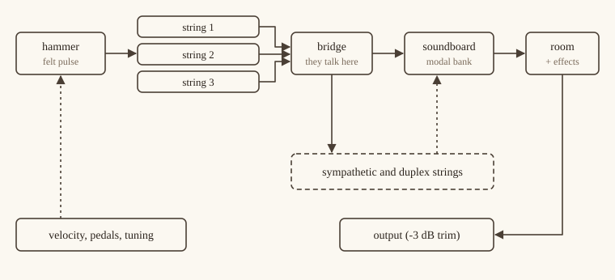
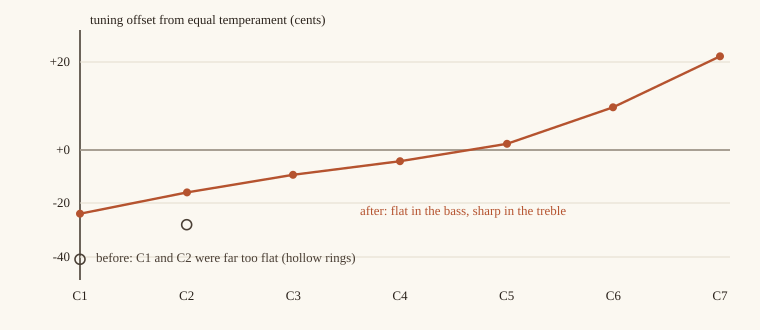
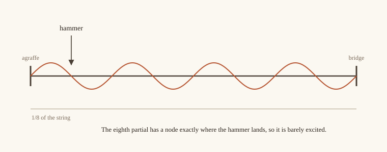
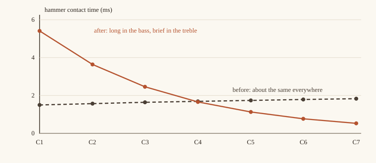
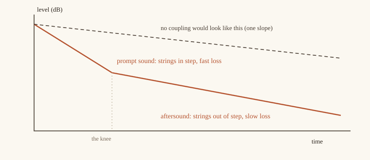

#+TITLE: Að kenna píanói að óma án upptaka
#+DATE: 2026-10-13
#+OPTIONS: toc:nil num:nil ^:{}
#+STARTUP: showall inlineimages

Resonata er píanó án nokkurra upptaka innanborðs. Hver einasti tónn sem þú heyrir er
reiknaður út á staðnum út frá flókahamri, einum til þremur stálstrengjum,
hljómbotni úr tré og herbergi. Það keyrir sem viðbót (plug-in) eða sem sjálfstæður
spilari, og það er ókeypis og með opnum frumkóða.

Þetta er sagan af fyrstu dögunum í að fá það til að hljóma eins og eitthvað. Hún
snýst að mestu um hluti sem ég hafði öfuga og um prófanirnar og mælingarnar sem
sýndu mér það. Ég hef haldið tölunum inni, því seinna vil ég vita hvort ég hafi
skemmt eitthvað.

* Hvað gerist þegar ýtt er á nótu

#+CAPTION: Ein nóta, frá fingri til hátalara. Strikaðar línur eru það sem hlustar eða stýrir.

Hver nóta á litla strengjaþyrpingu: einn streng í bassanum, tvo í tenórnum og
þrjá í diskantinum. Hamar sendir stuttan púls inn í þá. Þeir mætast allir við
brúna, þar sem þeir toga hver í annan, og brúin knýr hljómbotn. Til hliðar bíða
aðrir strengir eftir að óma með af samúð. Eftir það er þetta bara herbergi og þær
brellur sem þú hefur kveikt á.

Ekkert af þessu er nýtt. Julius Smith, Balázs Bank, Vesa Välimäki og fleiri
komust að þessu löngu áður en ég kom til sögunnar, og lesefnið er í lokin. Það sem
ég get lagt til er listi yfir leiðir til að gera þetta vitlaust.

* Strengur er seinkunarlína

Sleginn strengur er bylgja sem hleypur fram og aftur eftir honum. Í tölvunni
verður það að seinkunarlínu sem er jafnlöng einni ferð, með síu í lykkjunni sem
tapar svolítilli orku í hverjum hring. Tónhæðin kemur frá heildarseinkuninni:

\[ f_0 = \frac{f_s}{D} \]

þar sem $f_s$ er sýnatökutíðnin og $D$ er öll seinkun lykkjunnar í sýnum, að
meðtalinni seinkuninni sem síurnar bæta við. Þar rakst ég á vegg. Ég hafði dregið
frá 1,5 sýni til að mæta síunum. Raunveruleg seinkun dreifingarkeðjunnar var um 7.
Við C4 spilaði píanóið 55 sent of lágt, sem er meira en hálfur tónn, og ég uppgötvaði
það aðeins vegna þess að aðlögunartólið sagði mér það. Lausnin var að reikna út nákvæma
fasatöf hverrar síu og láta helmingunaraðferð finna brotahlutann. (Venjuleg
ítrun hoppar bara á milli tveggja svara, og ef brotalið er bætt ofan á er hann
talinn tvisvar og kostar önnur 5 sent. Ég prófaði hvort tveggja.) Stillingarprófið
heldur nú C2, C4 og C7 innan við 5 sent.

** Raunverulegir strengir eru ekki samhljóma

Stífur strengur syngur örlítið of hátt eftir því sem ofar dregur í yfirtónum hans:

\[ f_n = n f_0 \sqrt{1 + B n^2} \]

$B$ er stuðull ósamhljómunar (inharmonicity) og hann /vex/ með tónhæð. Minn fór öfugt:
hár í bassanum og næstum enginn í diskantinum. Útkoman var C4 þar sem yfirtónarnir
voru 4 til 9 sent undir hreinni yfirtónaröð, sem enginn stífur strengur gerir, og C7 sem
var nánast hrein sínusbylgja. Þegar ég snéri ferlinum rétt og stillti síðan
dreifingarsíurnar út frá raunverulegum fasa lykkjunnar urðu yfirtónar C4 2 til 12 sent
of háir, eins og kenningin segir að þeir eigi að vera.

Utanaðkomandi rýnir tók eftir þessu við fyrstu sýn. Það er augljóst þegar maður veit það:
raunverulegur diskanttónn hefur heyranlega teygða yfirtóna, og C7 sem er nánast hrein
sínusbylgja hefur enga.

* Að stilla píanó sem er aldrei hreint stillt

Konsertflyglar eru ekki stilltir í jafnstilltri stillingu. Bassinn er stilltur lágt og
diskanturinn hátt, til að mæta ósamhljóma yfirtónunum á miðri leið. Þetta kallast
teygja (stretch), og píanóstillarar fylgja ferli sem Railsback lýsti.

#+CAPTION: Frávik í stillingu eftir tónsviði, eftir lagfæringuna. Holu hringirnir sýna hvar C1 og C2 voru áður.

Ég hafði notað einn stuðul í báðar áttir og endaði með C1 á -41 senti og C2 á -28. Líkanið
féll nákvæmlega að sínu eigin ferli, sem er sérstaklega pirrandi tegund af villu:
strengurinn var réttur, ferillinn rangur. Fráviðið í endum raunverulegs Railsback-ferils er
svipað að stærð, um það bil 25 til 30 sent, en það eru miklu færri hálftónar fyrir ofan A4
en neðan við það, svo diskanthliðin er brattari á hvern hálftón. Stuðullinn er því nú 0,20
fyrir neðan A4 og 0,35 fyrir ofan. C1 er á -23,9 sentum og C7 á +21,3.

Sama athugun á öllum áttundum leiddi í ljós að efsti hluti píanósins ómaði of lengi. C6 entist
í 2,53 s og C7 í 1,77 s, og ég vildi fá eitthvað nær hálfri til einni sekúndu. Ég lækkaði
neðri mörk dofnunar úr 1,2 í 0,9 s og fékk 2,08 og 1,41. Það er nær, en ég treysti því
ekki enn. Það er á listanum mínum að bera þetta saman við raunverulegt hljóðfæri.

* Hvar hamarinn lendir

Fyrsta útgáfan af örvuninni var hrúga af bráðabirgðalausnum. Hver þeirra skemmdi eitthvað
annað, og afturhvarfspróf sem féll með látum var eina leiðin til að ég tæki eftir þeim.

Fyrst teygði ég stuttan hamarspúls yfir alla lykkjuna. Fyrir 26 sýna púls og 1381 sýnis
bassalykkju spilar það hann um fimmtíu sinnum of hægt, svo litrófið hrundi undir 500 Hz og
háværari nótur urðu dekkri. Því henti ég alveg. Næst setti ég púlsinn í tóma lykkju, sem
skilur úttakið eftir á stafrænu núlli þar til bylgjan kemur aftur hringinn. Við C1 eru
það um 31 ms af alveg nákvæmri þögn í upphafi hverrar nótu (við 44,1 kHz), og maður heyrir
það. Svo kom vandamálið með háværu nóturnar: hvítur púls á fortissimo dreifir fastri orku yfir
22 kHz á meðan lykkjan heldur undir 1 kHz, svo háværa nótan varð hljóðlátari en sú miðlungs.

Útgáfan sem lifði af sprautar kraftpúlsi hamarsins inn á punkt sem er 1/16 af strengslengdinni
á undan staðnum þar sem brúin les strenginn, svo fyrsti tónninn berst á innan við 2 ms jafnvel við C1.
Það er enginn forfylltur hávaði.

#+CAPTION: Yfirtónn 8 hefur hnút þar sem hamar sem slær á áttunda hluta strengsins lendir. Hann örvast varla, og líkanið sker hann viljandi út.

Hvar hamarinn lendir skiptir máli á annan hátt líka. Hamar sem slær við $1/8$ af strengnum
skilur hvern áttunda yfirtón eftir nánast þögulan, því þeir yfirtónar hafa hnút þar. Kambsían
sem gerir þetta var fölsuð í fyrstu tilraun minni: ég tók meðaltal merkisins og afrits af
því sem var seinkað um eitt sýni, sem er mild lágrásasía en ekki skarð. Nú er hún
almennileg framvirk kambsía, með dældum við yfirtóna 8, 16 og 24 og holum toppum á milli.

* Hamarinn laug til um aldur sinn

#+CAPTION: Snertitími við miðlungshraða (0,6), fyrir og eftir endurbyggingu diskantsins.

Flóki hamarsins snertir strenginn í nokkrar millisekúndur, og lengd snertingarinnar ræður
því hvaða yfirtónar örvast. Stutt snerting, bjartur diskant. Ég var með um 1,7 ms við
hverja tónhæð. Það er lágrásasía með nokkurn veginn sama skurðartíðni alls staðar, svo
diskantyfirtónarnir frá þeim þriðja og upp úr voru knúnir af flötum hávaða. Ofan á það var
hörkulögmálið öfugt: harðari hamar ómaði /lengur/.

Nú styttist snertitíminn um stuðulinn $2^{-1/2}$ á hverja áttund, um 4,8 ms við C1 og 0,59 ms við C7
við miðlungshraða (0,6) og hlutlausa hörku. Allt lögmálið eru fimm línur af Rust:

#+begin_src rust
let v = velocity.clamp(0.0, 1.0);
let h = self.hardness.clamp(0.25, 4.0).sqrt();
let base_ms = 3.0 - 2.2 * v;                    // harðara högg, styttri snerting
let register = 2f32.powf(-(f32::from(midi) - 60.0) / 24.0);
let ms = (base_ms / h * register).clamp(0.25, 6.0);
#+end_src

Að deila með $\sqrt{h}$ er hinn helmingur lagfæringarinnar. Gamla lögmálið fór rangt með
hörkuna, og þess vegna ómuðu harðari hamrar lengur.

Púlsformið tók þrjár tilraunir. Haversine hefur núllstöðvar í litrófinu sem átu heila
yfirtóna. Gauss-ferill var of daufur. Sá sem ég hélt er $u e^{1-u}$ með stuttri deyfingu í
lokin, og hann hefur engar núllstöðvar innan heyranlega sviðsins.

Diskantinn þurfti líka nýja lykkjusíu. Hún er nú einskauta sía sem er leyst fyrir hverja
nótu þannig að yfirtónn 8 deyr um það bil þrisvar sinnum hraðar en yfirtónn 1, á meðan
grunntónninn nær samt dofnunartímanum í töflunni. Próf athugar að grunntónninn lendi innan
við 0,2 % og hlutfallið innan við 5 % við C4, C6 og C7.

* Tveir strengir sem eru ósammála

Sláðu nótu með tveimur eða þremur strengjum og þú færð ekki eina dofnun. Þú færð snöggt fall
á meðan þeir hreyfast saman, og svo langan, hljóðlátan hala þegar þeir reka í sundur og
afmá hvor annan við brúna, sem hreyfist þá varla. Píanóleikarar kalla halann eftirhljóm
(aftersound).

#+CAPTION: Skissa, ekki mæling. Samstilltir strengir óma í tveimur þrepum; brúin er það sem tengir þá.

Fyrsta tilraun mín var röng á lærdómsríkan hátt. Ég lét strengina draga hlutfall af
meðaltali sínu frá sjálfum sér, sem tæmdi orku úr samfasa hreyfingunni, þeim hluta sem á
að halda venjulegri dofnun. Strengjapar sem slær hægt helst nálægt því samfasa ástandi í
sekúndur, svo hver einasta nóta dó einfaldlega of hratt. Ég tók aðeins eftir því vegna þess
að ég renderaði sömu nóturnar með fyrri útgáfu. C4 hafði farið úr 6,57 s í 2,64 s.

Útgáfan sem virkar bætir við leiðréttingu í stað þess að taka eina burt:

\[ y_i \leftarrow y_i + \eta\,(y_i - \bar y), \qquad
   1 + \eta = \rho^{\,1/P - 1}, \qquad P = 1 + 3c \]

Hér er $\bar y$ meðaltal strengjanna, $\rho$ er venjulegt lykkjuafl og $c$ er tengingarstigið.
Samfasa hreyfingin heldur sinni venjulegu dofnun og andfasa hlutinn ómar allt að $P$ sinnum
lengur. Með örlítið ósamstilltum samhljóða strengjum hefur fyrsti yfirtónn C4 nú eftirhljóm upp
á 12,2 s á móti 7,3 s þegar tengingin er slökkt. Með fullkomlega stilltum strengjum breytist
ekkert, sem er líka rétt. (Líkanið er frá Weinreich, frá árinu 1977.)

Í kóða eru þetta nokkrar línur. Fyrst aflið, reiknað einu sinni þegar nótan byrjar, með þaki
svo fáránleg stilling geti ekki hlaupið út undan sér:

#+begin_src rust
// Brúartenging: eta = rho^(1/P - 1) - 1, P = 1 + 3c.
let p = 1.0 + 3.0 * coupling.clamp(0.0, 1.0);
let eta = (rho.max(1e-3).powf(1.0 / p - 1.0) - 1.0).clamp(0.0, 0.05);
#+end_src

Síðan er úttak hvers strengs, í hverju sýni, ýtt frá meðaltali allra strengjanna áður en það fer
aftur inn í sína eigin lykkju:

#+begin_src rust
let mean = sum / n;                        // hreyfing brúarinnar
for (s, &v) in strings.iter_mut().zip(&outputs) {
    s.commit_looped(v, v + eta * (v - mean));
}
#+end_src

Þegar strengirnir eru sammála er $y_i - \bar y$ núll og ekkert gerist. Þegar þeir eru ósammála fær
ósamkomulagið örlítið minna tap en samkomulagið.

* Af hverju það hljómaði eins og hljóðgervill

Einu sinni sagði ég að það hljómaði eins og hljóðgervill. Ástæðurnar reyndust litlar og
sértækar.

Hver strengur í kór var stilltur nákvæmlega eins, sem er það stafrænasta sem píanó getur gert.
Ég bætti við mildu, ákvörðunarbundnu flökti fyrir hverja nótu, um 2,4 sent í stillingu og 6 % í
hamarsstyrk, alltaf eins í hvert sinn sem nótan er spiluð. Samhljóða strengir voru líka ósamstilltir
um fastan fjölda senta, svo slögin urðu hraðari með tónhæð. Við C7 var það 3,6 Hz, sem hljómar
eins og supersaw í gegnum chorus-pedala. Ósamstillingin er nú föst slagtíðni upp á um
0,5 Hz. Síðasta lagfæringin var þurrleikinn: ég ýtti sjálfgefnum gildum herbergis og
samúðar aðeins upp (herbergi 0,15 í 0,22, samúð 0,5 í 0,6), því píanó sem blómstrar ekki les sem
hljóðgervill.

Ég uppgötvaði líka, þegar ég eltist við annað vandamál, að lykkjuaflið var reiknað út frá
lengd seinkunarlínunnar en ekki lotu lykkjunnar. Það taldi rangt hversu oft bylgjan fór
hringinn og gerði dofnun við C7 27 % of langa. Þetta er sú tegund af villu sem maður
heyrir ekki sem villu. Maður heyrir hana sem „hmm, eitthvað er skrýtið með toppinn“.

* Ein vél, sjö hljóðfæri

Sama vélbúnaðinn reyndist vera mestur hluti sembals, klavíkords, fortepíanós og hörpu, með
öðrum örvunum og nokkrum aukaregistrum.

- *Sembal:* fjaðurkjuðaplokk í stað hamars, með buff-registri (lúturegistri).
- *Klavíkord:* messingtangent sem helst á strengnum, svo að harðari þrýstingur eftir að
  nótan er hafin hækkar tónhæðina. Það kallast bebung. Við fullan þrýsting beygir það
  tóninn upp um 25 sent.
- *Fortepíanó:* léttir leðurhamrar, deyfir og fagottregistur sem skrölta.
- *Konsertharpa:* fingurplokkaðir strengir sem óma þar til þú stöðvar þá, með flaututónum
  og glissando-pedala.

Rafpíanóin tvö kröfðust nýrrar eðlisfræði. Tindurinn er biti sem er fastur í öðrum endanum og laus í hinum, og sveiflumátar hans
standa í hlutfallinu 1 : 6,267 : 17,547, auk tónstangar. Hann er lesinn af segulmögnuðum
nema. Tungan er sleginn stál sem er lesið af rafstöðuvirkum nema. Þau voru með
gangsetningartopp sem fór með úttakið upp í 16, vegna þess að ég var að diffra flæði sem
byrjaði á núlli í stað hvíldar. Að láta flæðið byrja á hvíldargildi sínu lagaði það.

Allir tíu pedalarnir virka á öllum hljóðfærunum, og hvaða fjórir sem er geta setið á pedulunum
á skjánum. Pedalarnir sem ég fann upp (super sostenuto, glissando) eru skilgreindir í
handbókinni, því það er enginn staðall til að fylgja.

* Rauntími og annað sem maður lærir bara á erfiðan hátt

Hljóðþráðurinn má ekki bíða eftir neinu. Engar læsingar, engin minnisúthlutun, engar skrár. Ég
gerði þetta rangt, eða nálægt því, á þremur stöðum, og komst að hverju þeirra fyrir tilviljun.

- Sjálfstæði spilarinn deildi vélinni sinni á bak við læsingu og bjó til vigur í hverju
  callback-kalli. Nú á hann vélina einn og tekur við MIDI í gegnum hringbuffer.
- Sléttun viðbótarinnar gerði ekkert. Hún las hráa gildið og keyrði svo sléttarana inn í buffer
  sem hún henti. Sérhver hreyfing á hnappi var þrep, svo þú hefðir heyrt rennilásshávaða
  (zipper noise) á hverri breytu. Breytur eru nú sléttaðar fyrir hverja 64 sýna blokk.
- Mælirinn dofnaði allt að 64 sinnum of hægt, því stuðull á hvert sýni var notaður einu sinni á blokk.

Ritillinn hafði sína eigin villu. Mælirinn og ljósin hreyfðust aðeins á meðan bendillinn var yfir
glugganum. Myndræna verkfærasafnið teiknar ramma aðeins þegar atburður vekur það, og kurteisleg
beiðni hljóðþráðarins um endurteikningu er aðeins skoðuð rétt fyrir teikningu, sem enginn kveikir
á. Tímamælir með 15 römmum á sekúndu lagar það.

Hljóðið hefur sinn eigin kostnaðarramma. Versta tilfelli af uppsöfnun (allar 32 raddirnar, með
sustain-pedalann niðri og allar brellur á) keyrir um 11 sinnum hraðar en rauntími á tveggja
kjarna skýjavél. SIMD átti mestan þátt í því: hópar strengja í einni skipun og hljómbotnsmátarnir í
tveimur bönkum með átta hvorum. Óbestuð útgáfa af því prófi er miklu hægari, svo
hraðaprófið keyrir aðeins á útgáfusmíðum.

* Prófin svöruðu fyrir sig

Sum prófin mín voru röng, eða féllu af röngum ástæðum, og þau kenndu mér mest.

- Próf á skerpu diskantyfirtóna stóðst vikum saman. Seinna komst ég að því að það stóðst á hávaða:
  gamla sustainið hafði yfirtóna 3 til 6 alla á um -7 dB, sem er einkenni flats hávaða, og flatt
  litróf hefur eitthvað nálægt hverri væntanlegri tíðni. Þegar hávaðinn fór þurfti prófið að krefjast
  raunverulegrar byggingar.
- Gullskráarprófið ber saman rendering og geymda. Það merkti klippingu sem mónó-toppur faldi: vinstri
  rásin náði +1,05 á meðan hægri sat á +0,59, sem gefur þægilega 0,82 að meðaltali.
- Að mæla seint í nótunni, ekki snemma, var eina leiðin til að sjá nokkuð um pedala. Sleppitransientarnir
  eru háværir í öllum tilvikum og drekkja áhrifunum.
- Próf á verkfærunum skiptu jafn miklu máli og próf á píanóinu. Parabólískur topplesari með
  formerkjavillu færði hverja B-mælingu um 9 sent, og ég hefði verið að stilla píanóið eftir
  bilaðri reglustiku.
- Þegar ég keyrði viðbótina í gegnum sannprófara fann hann tvo staði þar sem klemma hafði mörkin
  öfug við mjög lága sýnatökutíðni, og phaser sem varð óstöðugur þegar tíðni hans fór yfir hálfa
  sýnatökutíðnina. Nú þolir hún allt frá 1 kHz upp í 768 kHz.

* Hlutir sem blekktu mig

Nokkrar mælingar blekktu mig lengur en þær áttu að gera.

Við C6 sýndi greiningin grunntón sem var 19 dB niðri, holu sem var ekki til. Ég hafði sagt
greiningartækinu að búast við fullkomlega stilltum streng, en með eðlilegri teygju píanósins sat
kambmáti herbergisins við 1046,2 Hz 0,3 Hz frá spá minni og stal raufinni. Strengurinn var í lagi.

Kúpa við 2,7 til 3 kHz leit út eins og ómun. Það voru tveir næstum jafnir yfirtónar, annar
langsum og hinn þversum, með 3 til 4 % á milli, sem topplesari rugldi sífellt saman. Hljómbotninn
var saklaus.

Eftir eina endurbyggingu mældist diskantinn eins upp á 0,1 dB. Það var engin lúmsk villa:
viðbótin í hýslinum hafði ekki verið skönnuð upp á nýtt, svo ég var að hlusta á gömlu
tvíundarskrána.

Svo var það minn eigin leikur. Ég bar upptöku af honum saman við viðmiðunarupptöku og
tölurnar voru víðs fjarri: þungamiðja 5251 Hz á móti 730 Hz. Ég gerði ráð fyrir að það væri
hljóðgervillinn. Ég renderaði eina nótu og mældi hana á sama hátt, og hún var í takt við
viðmiðið. Munurinn var ég: ég spilaði um 1,4 sinnum of hratt, ekkert fyrir neðan E4, einn
styrk alla leið, í þurri, þröngri upptöku. Ég breytti engum kóða.

* Afgangurinn af kassanum

Það er meira þarna inni en ég hef pláss til að útskýra almennilega, svo hér kemur stutta útgáfan.

- *Brellur:* tremolo, wah, chorus, flanger, phaser, fuzz, delay, magnaralíking, þjappari og tveir
  tónjafnarar. Hver og ein er bita fyrir bita gegnsæ þegar slökkt er á henni.
- *Herbergi:* léttur innbyggður endurómur, og samfellingarhamur með fjórum gervirýmum eða
  þinni eigin impúlssvörun. Hann bætir engri töf við.
- *Rúmhljóð:* Ambisonics-úttak af fyrstu gráðu og afkóðun í 7.1.2-hljóðsvið.
- *Stilling:* stillingakerfi, Scala-skrár og teygja.
- *Verkfæri:* greiningartæki fyrir upptökur, aðlögunartæki sem lærir hljómblæ af upptöku, og
  rafall fyrir blindprófssíður.
- *Aðlögunartækið:* vélin hefur harða rofa (flóki, deyfar), svo ég gat ekki diffrað hana. Það
  áætlar stigla með því að trufla allar breytur í einu og rendera tvisvar, aðferð sem kallast SPSA. Á
  prófunarmarkmiði lækkar það litrófsfjarlægðina um 20 til 50 % á 40 skrefum.

* Hvernig þetta stenst

| Hvað                                   | Niðurstaða                          |
|----------------------------------------+-------------------------------------|
| Versta tilfelli uppsöfnunar, allar brellur á | 11,2 sinnum rauntími (2 kjarna x86) |
| clap-validator                         | 36 stóðust, 0 féllu, 8 sleppt       |
| Sýnatökutíðni                          | 32 til 96 kHz hljóma eins           |
| Þolir án þess að hrynja                | 1 kHz upp í 768 kHz                 |
| Stök C1 á fullum hraða                 | nær hámarki í 0,77 af fullum skala  |

Síðasta línan er 3 dB lækkun sem ég bætti við í lokin. Lág nóta á fullum hraða fór áður rétt yfir
fullan skala áður en nokkrar brellur komu til.

#+begin_src rust
/// Föst -3 dB aðallækkun, 10^(-3/20), beitt með hljóðstyrkstýringunni.
pub const OUTPUT_TRIM: f32 = 0.707_945_8;
// ...
let vol = self.params.volume * OUTPUT_TRIM;
#+end_src

* Lesefni

Ef þú lest bara fimm hluti:

- Julius O. Smith, /Physical Audio Signal Processing/.
- Bank, Välimäki og samstarfsfólk um píanólíkanagerð: commuted synthesis, hljómbotna,
  dreifingu.
- Chaigne og Askenfelt um tölulega hamar- og strengjalíkön.
- Giordano og Jiang um samspil hamars og strengs.
- Weinreich (1977) um tengda píanóstrengi.
