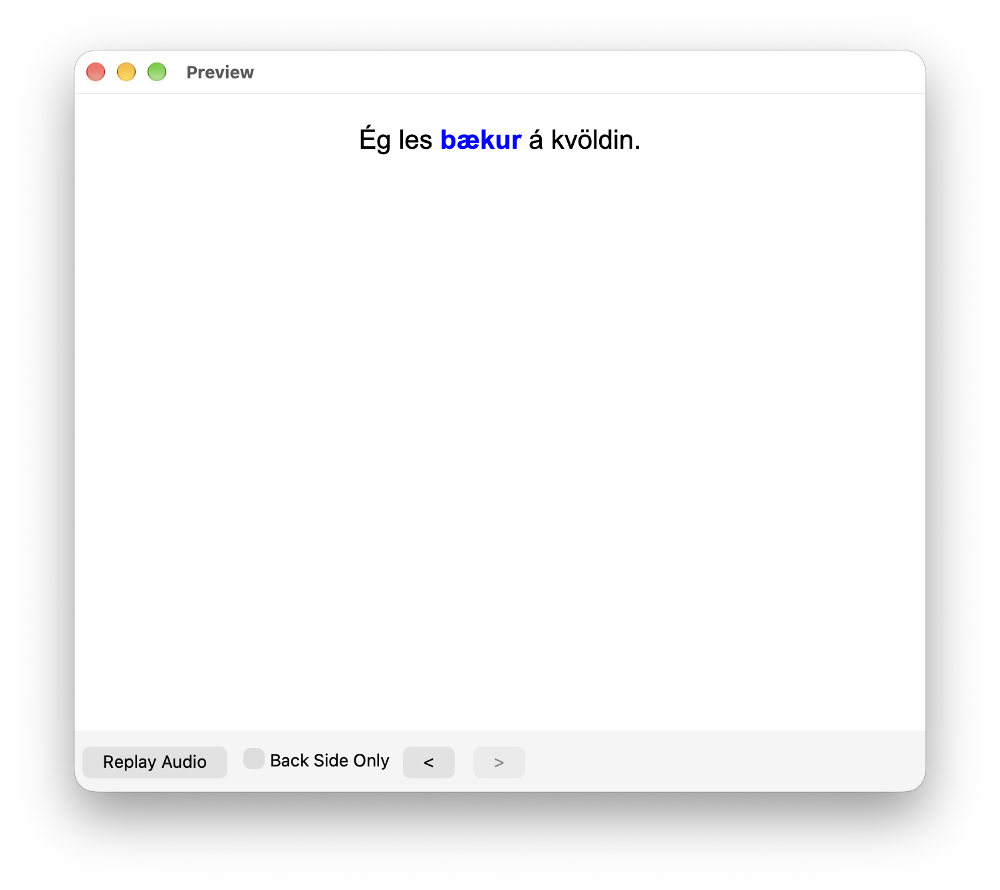

#+title: Flashcards, quizzes, and why I stopped choosing between them
#+date: <2026-10-20 9:00>
#+filetags: :languages:learning:flashcards:spaced_repetition:cloze:quizzes:multiple_choice:matching:writing:speaking:
#+description: What flashcards and quiz-style exercises each do for vocabulary, where each one misleads you, and how I fit them together.
#+timezone: America/Port_of_Spain
#+options: toc:nil num:nil ^:{}
#+startup: showall inlineimages

Language learners tend to split into two camps. One group uses flashcards and a
spaced repetition scheduler, and will tell you their retention rate without
being asked. The other group likes quizzes: multiple choice, matching games,
typing answers, saying things out loud. Each camp thinks the other is wasting
its time.

For a while I assumed I had to join one of them. I've now spent long
enough with both to think the question is the wrong way round. They do
different jobs, and most of the frustration comes from using one to do the work
of the other.

This post is about what each method is actually good for, the ways each one
flatters you, and how I'd combine them. I've been learning Icelandic since the
start of last year, after a long time with Swedish, so the examples lean that
way. The ideas don't depend on the language.

* Two facts about memory

Most of what follows rests on two old findings, so here they are first.

The testing effect says that pulling something out of your head strengthens the
memory more than looking at it again. Roediger and Karpicke ran the well-known
version of this: students who tested themselves on a passage remembered
noticeably more a week later than students who simply re-read it.  The surprise
was that the re-readers /felt/ more confident.

The spacing effect says that reviewing something at growing intervals beats
cramming the same number of repetitions into one evening. Ebbinghaus drew the
forgetting curve in the 1880s, and the finding has held up well ever since.

Flashcards and quizzes are both ways of cashing in on these two facts.  They
just do it differently.

* What a flashcard is for

A flashcard is the simplest retrieval exercise there is. You see a prompt, you
try to answer it, you flip the card, and you decide honestly whether you were
right. Nothing else happens, which is the whole appeal.

** Recall with nothing to lean on

If I show you 'horse' and you have to produce 'hestur' from nothing, no options
and no first letter, that is free recall. It's the hardest kind of retrieval, so
it's the most effective at making a memory last. It's also mildly unpleasant. A
card that feels slightly too hard is usually doing its job.

** The scheduling is the real product

You can do all of this with paper cards and a shoebox. The [[https://en.wikipedia.org/wiki/Leitner_system][Leitner system]] is a
lovely piece of low technology. Software does the bookkeeping better
though. [[https://apps.ankiweb.net][Anki]] records how well you knew each card and picks the next review
date. Easy cards disappear for weeks or months. Cards you keep fumbling come
back within days. You spend your time on what you're about to forget, not on
what you already know cold.

Newer versions of Anki can use a scheduler called [[https://github.com/open-spaced-repetition/fsrs4anki/wiki/ABC-of-FSRS][FSRS]], which fits a memory
model to each card and aims at a retention rate you choose, say 90 %. The older
[[https://super-memory.com/english/ol/sm2.htm][SM-2]] algorithm is still there and works fine. I wouldn't spend an evening
choosing between them.

My own Icelandic deck currently has 2200 cards, I'm on FSRS with the
target set to 90%.

** Cards can be more than a word and a translation

Most people begin with a word on one side and its meaning on the other, and that
is fine for the first few hundred words. After that, cloze cards do far more. A
cloze hides one word in a sentence, so you see:

#+begin_example
Ég les ___ á kvöldin.
#+end_example

and you have to supply 'bækur' (or whatever the sentence wants). You learn the
word, the case it takes, and a bit of rhythm from a real sentence, none of which
an isolated translation will teach you. Audio on the card helps too, and so does
a picture with no text, because it forces you to skip the translation step.

#+CAPTION: A cloze card in Anki: the blank, then the answer.

I switched to cloze cards after about 300 words. If I could give a new learner
one piece of advice about flashcards, it would be to start making them early,
because a single-word deck can't show you which case a noun is wearing.

** Small enough to actually use

A deck lives on your phone, so five minutes in a queue or waiting for the kettle
is a real study session. That sounds trivial and isn't. People who do ten
minutes every day beat people who plan a perfect two-hour session and manage it
twice a month.

* What quizzes add

By quiz-style exercises I mean the things you find in [[https://quizlet.com][Quizlet]]'s Learn and Test
modes, in [[https://www.duolingo.com][Duolingo]] and [[https://www.busuu.com][Busuu]], and in most other apps: multiple choice, matching,
typed answers, written sentences and spoken prompts. It's less one method than a
toolbox, and each tool trains something a little different.

** Multiple choice

Multiple choice is the gentlest of them, because you only have to recognise the
right answer. That makes it a good first meeting with a word, when producing it
cold would just be frustrating.

It has a second use that people overlook. Good wrong answers make you tell
similar things apart. If you're choosing between 'köttur', 'hundur', 'kýr' and
'hestur', the distractors force you to notice what actually separates them. The
weakness is that recognition is much easier than recall. You can pass a multiple
choice test on words you could never say aloud.

** Matching

Matching games, where you pair words with translations against a clock, are
quick and a little addictive. They build fast association between a word and its
meaning, and the time pressure nudges you towards automatic recognition.  I use
them as a warm-up. Pairing ten words in thirty seconds feels like progress and
some of it is real, though it's recognition only, so it's worth less as you
improve.

** Writing

Typing or handwriting an answer is where quizzes get serious. Producing a word
letter by letter exposes every gap, from a missing accent to a wrong ending.
This is the generation effect at work: things you produce yourself tend to stick
better than things you only read.

Writing whole sentences goes further. If you can write two or three sentences
using a new word, you can use it. If you can't, you only know it.  That's a
bigger gap than it sounds.

** Speaking

Saying answers aloud is the exercise people skip most, and the one I'd defend
hardest. It trains the muscle memory of pronunciation, it makes you retrieve at
conversational speed with no time to stall, and over a few weeks it wears down
the fear of opening your mouth. App-based speaking exercises are
imperfect. Voice recognition can be fussy, and comparing yourself with a
recording of a native speaker only goes so far. They still get you making sound,
which beats silent study. A tutor or language partner is better, because
software can't tell you whether you sound natural.

** Variety helps by itself

Mixing formats has a benefit that has nothing to do with any one format.  When
you meet a word seen, heard, typed and spoken, the memory gets several routes
in, and you're more likely to find one of them later. Bjork called effort that
feels harder now and pays off later a 'desirable difficulty', and varied
practice is one of those. It also keeps sessions from going stale.

* How each one flatters you

** Flashcards

Flashcards go on autopilot. After a few hundred reviews you can get faster and
faster at the deck without getting any better at the language. They also isolate
words, which in English is a mild problem and in Icelandic a serious one: a noun
you know only in its dictionary form will turn up in the accusative, the dative
or the genitive wearing a different ending, and you won't recognise your own
flashcard. And a vague card, or one crammed with two facts, gets answered
inconsistently, which the scheduler can't fix. If you hesitate over which answer
a card wants, split it in two.

** A card I had to split

One of mine was a listening card: the audio says /Við töluðum við hvorn annan sí
og æ/, and the back says 'We were talking to each other all the time'. I'd
learnt /hvor/ and /annar/ as dictionary headwords, but here they're in the
accusative as /hvorn annan/, and the idiom /sí og æ/ ('constantly') was squeezed
onto the same card.

Worse, it was one of twelve near-identical cards, each changing a single ending
or moving one word, all with the same English on the back. I could have marked
every one of them 'Good' without noticing which ending I'd heard.

So I split it: one card for /sí og æ/, one for /hvor annan / hvor aðra / hvort
annað/ with the case spelt out, and one sentence kept for listening practice.
The other eleven are suspended.

** Quizzes

Quizzes flatter you in a different way. Multiple choice and matching feel easy,
and that ease hides how much you haven't learnt. Some quiz apps are also weaker
than a proper spaced repetition tool at long-term scheduling, so a word you got
right once can fade quietly with nothing bringing it back. Streaks and points
are motivating, but they can reward turning up over learning. A 400-day streak
made of two-minute sessions is not the same thing as 400 days of progress,
however pleased the little flame looks.

Both can be dull, and dull matters. A method you drop in week three loses to a
worse one you actually enjoy.

* Things that fooled me

A few things looked like evidence of progress for longer than they should have.

A high score in a matching game made me feel I knew a set of words. What it
showed was that I could recognise them in a list of ten, which is a much lower
bar. The test that mattered was whether I could write the word an hour later
with nothing in front of me.

Getting a card right on the day I made it told me almost nothing either. The
scheduler's first few intervals are short for a reason. A card that survives a
month is knowledge. A card that survives ten minutes is short-term memory being
polite.

Reading Icelandic and producing Icelandic also separated more than I expected. I
could follow a sentence and then fail to build the same one. A quiz that only
asked me to choose would never have shown that. Typing the answer did, within a
week. For me it was /Mér leiðist/, 'I'm bored'. I understood it every time I
heard it, but when I had to type it I wrote /Ég er leiður/, which is a perfectly
good sentence that means 'I'm sad'. In Icelandic, boredom happens to you, so the
sentence starts with the dative /mér/ rather than /ég/. Recognising it had never
made me notice that.

* Putting them together

The shortest version I can give: flashcards are storage and quizzes are
training. Spaced repetition makes sure what you learn stays learnt.  Quiz-style
exercises make sure what's in storage can be spelt, pronounced, put into a
sentence and told apart from its lookalikes.

| Method          | Trains                   | Difficulty | Best for                     |
|-----------------+--------------------------+------------+------------------------------|
| Flashcards      | Long-term recall         | High       | Keeping vocabulary for good  |
| Cloze cards     | Recall in context        | High       | Grammar, cases, collocations |
| Multiple choice | Recognition              | Low        | First meeting, similar words |
| Matching        | Speed and association    | Low        | Warm-ups, recent words       |
| Writing         | Spelling, grammar, usage | High       | Accuracy, active vocabulary  |
| Speaking        | Pronunciation, fluency   | High       | Being ready for conversation |

In practice I'd go from easy to hard. Meet a fresh batch of words with multiple
choice or matching, where nothing is at stake. Move the ones you want to keep
into your flashcard tool, preferably as cloze sentences with audio. Review
daily and say your answers out loud. It might feel silly for about a week. But
it's worth it.

Then, every so often, switch to production. Once a week, type the words from
memory and write a few sentences with them. Record yourself now and then.
Finally, go and meet the words somewhere real, in a book, a podcast or a
conversation. That's the step people skip, and it's the one that shows you
which words are yours and which only live in your deck.

If you had about half an hour a day, one version of the week might look like
this. Change it to suit your life.

| When                | Time    | What                                                          |
|---------------------+---------+---------------------------------------------------------------|
| Every weekday       | 10 min  | Flashcard reviews, answers spoken aloud                       |
| Three of those days | +10 min | New words via multiple choice or matching, then into the deck |
| The other two days  | +10 min | Writing: type words from memory, write a few sentences        |
| Weekend             | Longer  | One longer session                                            |

* Mistakes I'd avoid

Adding too many new cards is the classic. Every new card creates a pile of
future reviews. I started with 20 new cards a day, and a month later I was
facing about a hundred reviews every morning and had begun to resent my own
deck. Start with fewer than you think you can handle.

Downloading other people's decks saves time, but you lose much of the benefit of
making the card yourself, because choosing the example sentence is part of the
learning. I downloaded a shared deck, 'Icelandic – 6500 sentences sorted by
ease', and only looked at it closely after I'd imported it. The audio is
computer-generated speech rather than a native speaker. The same English
sentence often has a dozen near-identical Icelandic cards that differ by one
ending, with nothing to say which ending is which. And there are a few mistakes:
/Ég er þreitt/ where it should be /þreytt/, and /einmanna/ for /einmana/. If I'd
made those cards myself, I'd have had to look each word up, and I'd have caught
the mistakes.

And don't treat the app as your whole course. Flashcards and quizzes support
the reading, listening and talking; they can't stand in for them.

* Other platforms

I've named [[https://apps.ankiweb.net][Anki]] and [[https://quizlet.com][Quizlet]] above because they're the two most people have heard
of. [[https://www.memrise.com][Memrise]] mixes cards with short clips of native speakers, which is worth a
look if hearing real voices matters to you. [[https://www.duolingo.com][Duolingo]] and [[https://www.busuu.com][Busuu]] are the obvious names
on the quiz side.

* So, which one?

Both. Flashcards give you durability: with spaced repetition, words stay in
your head for months and years. Quizzes, writing and speaking give you range,
because they turn stored words into things you can do. On their own, each leaves
a gap. A learner who only does flashcards can know thousands of words and
freeze in a conversation. A learner who only does quizzes can feel fluent inside
the app and have forgotten most of it a month later.

The platform matters much less than turning up regularly and making your brain
do the retrieval.

* Reading

- Roediger and Karpicke (2006), 'Test-enhanced learning: taking memory tests
  improves long-term retention'. The testing effect study. [[https://doi.org/10.1111/j.1467-9280.2006.01693.x][DOI]] · [[https://pubmed.ncbi.nlm.nih.gov/16507066/][PubMed]]
- Cepeda and colleagues (2006), a review of the spacing effect. Start here for
  how far apart to space reviews. [[https://doi.org/10.1037/0033-2909.132.3.354][DOI]] · [[https://pubmed.ncbi.nlm.nih.gov/16719566/][PubMed]]
- Slamecka and Graf (1978), the paper that named the generation effect. Why
  typing beats recognising. [[https://doi.org/10.1037/0278-7393.4.6.592][DOI]]
- Bjork and Bjork on desirable difficulties. Why the harder format is often the
  better one. [[https://bjorklab.psych.ucla.edu/wp-content/uploads/sites/13/2016/04/EBjork_RBjork_2011.pdf][PDF from the Bjork Lab]]
- Ebbinghaus (1885), /Über das Gedächtnis/, the original forgetting curve.
  [[https://projekt-gutenberg.org/authors/hermann-ebbinghaus/books/ueber-das-gedaechtnis][Project Gutenberg-DE]] · [[https://archive.org/details/b28111710][Internet Archive scan]]

* What's next?

I'm planning to build my own tool and move away from both Anki and Quizlet,
partly because I want flashcards and varied exercises in one place with one
scheduler behind them. That's another post.
