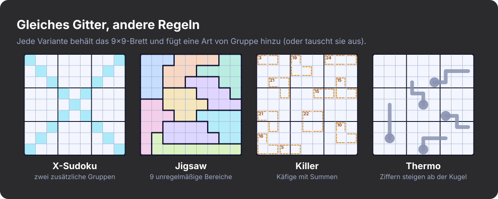
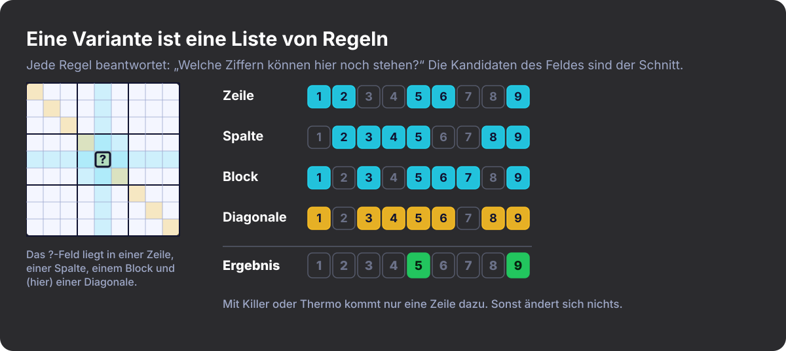
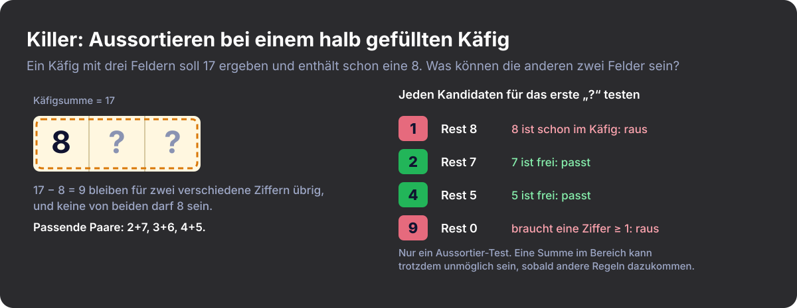
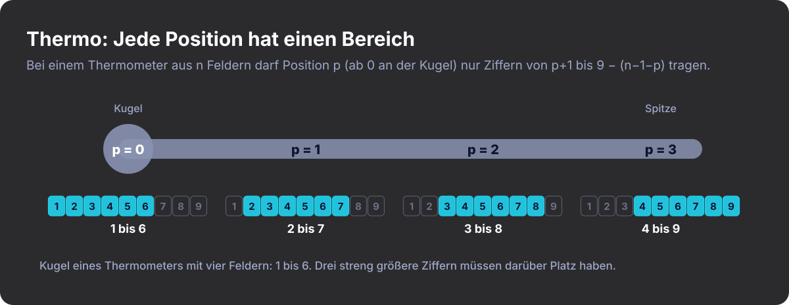
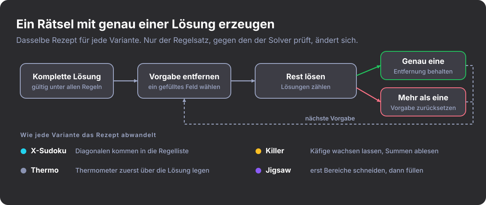

#+title: Sudoku ist nicht gleich Sudoku
#+subtitle: Neue Varianten entdecken
#+date: <2026-10-27 09:00>
#+timezone: America/Port_of_Spain
#+language: de
#+options: toc:nil num:nil
#+description: Wie ich herausgefunden habe, dass es Sudoku in Dutzenden von Regelvarianten gibt, und wie ich einem Rust-Spiel beigebracht habe, sie zu spielen.
#+hero: banner.de.svg
#+filetags: :sudoku:puzzles:gamedev:rust:programming:

* Ich dachte, ich kenne Sudoku

Ich dachte, ich kenne Sudoku. Neun Zeilen, neun Spalten, neun Blöcke, Ziffern
von 1 bis 9, keine Wiederholungen. Ich löse seit Jahren Rätsel, und als ich
beschloss, ein Sudoku-Spiel zu programmieren, nahm ich an, dass die Oberfläche
der schwierige Teil sein würde.

Dann fing ich an zu lesen, wie die Leute tatsächlich spielen. Es gibt Rätsel,
bei denen die Blöcke seltsame Schlangenlinien sind. Rätsel, bei denen man
rechnen muss. Rätsel, bei denen man die kleine Zeichnung eines Thermometers
liest und sich von ihr sagen lässt, welche Ziffern wohin dürfen. Seit
Jahrzehnten erfinden Leute neue Regeln, und ich hatte keine Ahnung.

* Die Varianten, die ich kennengelernt habe

- *X-Sudoku* fügt die beiden langen Diagonalen als zusätzliche Gruppen hinzu.
  Eine Ziffer in der Mitte des Bretts hat jetzt zu allem anderen mehr zu sagen.
- *Jigsaw-Sudoku (unregelmäßiges Sudoku)* wirft die 3×3-Blöcke raus und nimmt
  stattdessen neun zusammenhängende Klumpen aus je neun Feldern. Die Gewohnheit
  des Auges, Blöcke abzusuchen, funktioniert nicht mehr.
- *Killer-Sudoku* streicht die meisten oder alle vorgegebenen Ziffern und
  zeichnet „Käfige“ mit einer Zielsumme. Innerhalb eines Käfigs dürfen sich
  Ziffern nicht wiederholen, und der Käfig muss genau aufgehen. Es fühlt sich an
  wie halb Sudoku, halb Kakuro.
- *Thermo-Sudoku* zeichnet Thermometer ins Gitter. Die Ziffern müssen von der
  Kugel bis zur Spitze streng ansteigen.

Das sind nicht einfach nur schwerere Sudokus. Wer Killer löst, überlegt, welche
Ziffernmengen in drei Feldern 17 ergeben können. Wer Thermo löst, merkt, dass
die Kugel eines Thermometers mit vier Feldern keine höhere Ziffer als 6 tragen
kann.

#+CAPTION: Die vier Varianten nebeneinander: dasselbe 9×9-Brett, andere Regeln.
#+ATTR_HTML: :alt Vier 9×9-Gitter mit X-Sudoku, Jigsaw-, Killer- und Thermo-Sudoku

* Regeln statt Modi

Der naheliegende Weg, mehrere Varianten zu unterstützen, ist eine
=mode=-Einstellung und überall ein =match= darauf: Validierung, Tipps, Lösen,
Generieren, Zeichnen. Das bricht zusammen, sobald jemand Killer mit Diagonalen
verlangt, denn die Zahl der Fälle wächst mit der Zahl der /Kombinationen/.

Eine Variante ist kein Modus. Sie ist eine Liste von Regeln.

Eine Regel muss nur zwei Fragen beantworten: Ist das Brett aus meiner Sicht
zulässig, und welche Ziffern können in dieses Feld noch hinein?

#+begin_src rust
pub trait Constraint {
    fn name(&self) -> &'static str;

    /// True if this rule is not currently violated (ignores empty cells).
    fn is_valid(&self, board: &Board) -> bool;

    /// Digits still allowed in `cell` according to this rule alone.
    fn candidates(&self, board: &Board, cell: CellId) -> CandidateSet;
}
#+end_src

Ein Rätsel ist ein Brett plus ein =Vec<Box<dyn Constraint>>=. Klassisches Sudoku
besteht aus Zeilen, Spalten und Blöcken. X-Sudoku ist dieselbe Liste mit den
Diagonalen dazu. Bei Jigsaw ersetzen andere Bereiche die Blockregel. Killer und
Thermo fügen jeweils eine weitere Regel hinzu. Um herauszufinden, was in ein
Feld passt, bildet man den Schnitt der Kandidaten aus allen Regeln.

#+CAPTION: Jede Regel meldet ihre eigenen Kandidaten; das Feld kann nur enthalten, was alle Regeln erlauben.
#+ATTR_HTML: :alt Kandidatenziffern für ein Feld aus Zeilen-, Spalten-, Block- und Diagonalenregel, im Schnitt 5 und 9

* Die einfachen und die kniffligen

Zeilen, Spalten, Blöcke und Diagonalen haben alle dieselbe Form: eine Gruppe von
Feldern, in der sich keine Ziffer wiederholt. X-Sudoku waren ein paar Dutzend
Zeilen Code, größtenteils die Koordinaten der beiden Diagonalen. Jigsaw war noch
einfacher. Die Blockregel nahm schon eine Liste von Bereichen entgegen, also
konnte ich ihr einfach unregelmäßige geben.

Killer und Thermo waren anders, weil es in ihren Regeln nicht um Duplikate geht.
Es geht darum, was noch erreichbar ist.

*Killer-Käfige.* Ein fertiger Käfig geht entweder auf oder nicht, aber bei einem
halb gefüllten muss man genauer nachdenken. Soll ein Käfig mit drei Feldern 17
ergeben und ich habe eine 8 gesetzt, müssen die anderen beiden Felder zusammen 9
ergeben, mit verschiedenen Ziffern, und keine davon darf 8 sein. Für jeden
Kandidaten tue ich so, als wäre er schon gesetzt, und berechne dann die kleinste
und die größte Summe, die die übrigen Felder mit verschiedenen, noch nicht im
Käfig vorhandenen Ziffern erreichen könnten. Liegt die verbleibende Zielsumme
außerhalb dieses Bereichs, verwerfe ich den Kandidaten. Das ist ein
Aussortier-Test, kein Beweis. Eine Summe kann im Bereich liegen und trotzdem
unmöglich sein, sobald andere Regeln ins Spiel kommen, deshalb hat die Suche des
Solvers das letzte Wort.

#+CAPTION: Aussortieren bei einem Käfig mit drei Feldern, der 17 ergeben soll und schon eine 8 enthält.
#+ATTR_HTML: :alt Ein Käfig mit drei Feldern, in dem eine 8 steht, und eine Tabelle, welche Ziffern ins nächste Feld passen

*Thermometer.* Es reicht nicht zu prüfen, dass jede Ziffer größer ist als die
davor. Bei einem Thermometer mit vier Feldern ist eine 7 in der Kugel schon
unmöglich, weil drei streng größere Ziffern nicht mehr unter die 9 passen. Und
wenn zwei Felder, die zwei Schritte auseinanderliegen, eine 3 und eine 4
enthalten, kann dazwischen keine Ziffer stehen, also ist das Thermometer nicht
erfüllbar. Der Abstand zwischen den Ziffern zweier gefüllter Felder muss also
mindestens so groß sein wie die Zahl der Schritte, die sie trennen. Derselbe
Gedanke gibt jeder Position einen Bereich. Zählt man die Positionen ab null,
kann das Feld an Position /p/ eines Thermometers mit /n/ Feldern nur Ziffern von
/p+1/ bis /9 − (n−1−p)/ enthalten, wobei 9 die größte Ziffer ist. Für die Kugel
eines Thermometers mit vier Feldern ergibt das 1 bis 6, und daher stammt die
Behauptung von vorhin.

#+CAPTION: Erlaubte Ziffern an jeder Position eines Thermometers mit vier Feldern.
#+ATTR_HTML: :alt Ein Thermometer mit vier Feldern und dem erlaubten Ziffernbereich unter jeder Position: 1–6, 2–7, 3–8, 4–9

* Der Solver

Der Solver ist eine Backtracking-Suche, die immer das leere Feld mit den
wenigsten Kandidaten wählt. Vor der Suche läuft ein Propagationsdurchgang, der
erzwungene Züge einträgt: Felder mit nur einer Möglichkeit und Ziffern, die
innerhalb einer Gruppe nur an eine Stelle passen. Von Killer oder Thermo weiß er
nichts. Er fragt jede Regel nach Kandidaten und arbeitet mit dem, was
zurückkommt.

Regeln können außerdem /Einheiten/ (Units) bereitstellen, also Gruppen, in denen
jede Ziffer genau einmal vorkommen muss. Zeilen, Spalten, Blöcke und Diagonalen
tun das. Käfige und Thermometer nicht. Der Propagationsdurchgang nutzt
Einheiten, um Hidden Singles zu finden; eine Variante mit Einheiten bekommt das
also geschenkt, und eine ohne verliert nichts.

* Rätsel generieren

Ein gutes Rätsel hat genau eine Lösung. Das Grundrezept ist für jede Variante
dasselbe: eine vollständige Lösung bauen und dann Vorgaben einzeln entfernen,
wobei man jede Entfernung nur behält, wenn der Solver weiterhin genau eine
Antwort findet. Die Varianten biegen es jeweils ein wenig zurecht.

#+CAPTION: Vorgaben einzeln herausschneiden und jede Entfernung nur behalten, wenn die Lösung eindeutig bleibt.
#+ATTR_HTML: :alt Flussdiagramm: vollständige Lösung, Vorgabe entfernen, lösen, behalten oder zurücksetzen, dazu wie jede Variante das Rezept abwandelt

- *X-Sudoku* brauchte fast nichts Zusätzliches. Es ist dasselbe Herausschneiden,
  nur mit den Diagonalen in der Regelliste.
- *Killer* hat keine vorgegebenen Ziffern, denn die Käfigsummen sind die
  Vorgaben. Ich lasse Käfige über einer fertigen Lösung nach außen wachsen,
  nehme ein Nachbarfeld nur auf, wenn seine Ziffer nicht schon im Käfig steckt,
  und lese jede Summe aus der Lösung ab. Die Eindeutigkeit wird gegen den
  vollständigen Regelsatz geprüft (Zeilen, Spalten, Blöcke und Käfige zusammen),
  und wenn das Layout mehr als eine Lösung hat, werfe ich es weg und versuche es
  noch einmal. Die maximale Käfiggröße ist die wichtigste
  Generierungseinstellung. Kleinere Käfige schränken Ziffern tendenziell
  direkter ein, größere lassen mehr Möglichkeiten offen, die man berücksichtigen
  muss.
- *Thermo* funktioniert am besten als klassisches Rätsel mit wenigen Vorgaben
  und Thermometern obendrauf, weil Thermometer allein selten eine eindeutige
  Lösung festlegen. Jedes Thermometer wird über die fertige Lösung gelegt und
  geht nur zu einem Nachbarn mit größerer Ziffer weiter, sodass es sich immer
  erfüllen lässt. Danach werden Vorgaben entfernt, während die Thermometer
  gelten, die Eindeutigkeit berücksichtigt sie also. Die Zahl der Vorgaben ist
  die wichtigste Generierungseinstellung. Weniger Vorgaben lassen meist mehr zu
  erschließen übrig, aber das ist ein grober Regler und kein Maß für die
  Schwierigkeit: Ich messe nicht, wie viel Arbeit die Thermometer leisten.
- *Jigsaw* dreht die Reihenfolge um. Zuerst wird das Brett in neun
  zusammenhängende Bereiche aus genau je neun Feldern zerlegt, und erst danach
  wird es mit einer gültigen Lösung gefüllt. Dass sich für ein Bereichslayout
  eine gültige Füllung findet, ist nicht garantiert, deshalb bekommt das Füllen
  ein begrenztes Suchbudget, und wenn es scheitert, werfe ich das Layout weg und
  fange von vorn an. Neun Klumpen so zu legen, dass sie das Brett lückenlos und
  gleichmäßig überdecken, entpuppte sich als eigenes Rätsel.

* Was ich mitgenommen habe

Ich hatte jahrelang Sudoku gespielt, ohne zu merken, wie groß die Vielfalt ist.
Seit ich genauer hinschaue, finde ich ständig neue Regeln und neue
Möglichkeiten, sie zu kombinieren. Dadurch, dass ich Varianten als Sammlungen
von Regeln behandle, konnte ich experimentieren, ohne jedes Mal den Solver
umzubauen.

Ich entdecke immer noch Varianten, von denen ich nie gehört hatte, und kann es
kaum erwarten, sie alle zu spielen. Sudoku ist seit Jahren eines meiner liebsten
Hobbys, und diese Varianten machen es spannender denn je.
