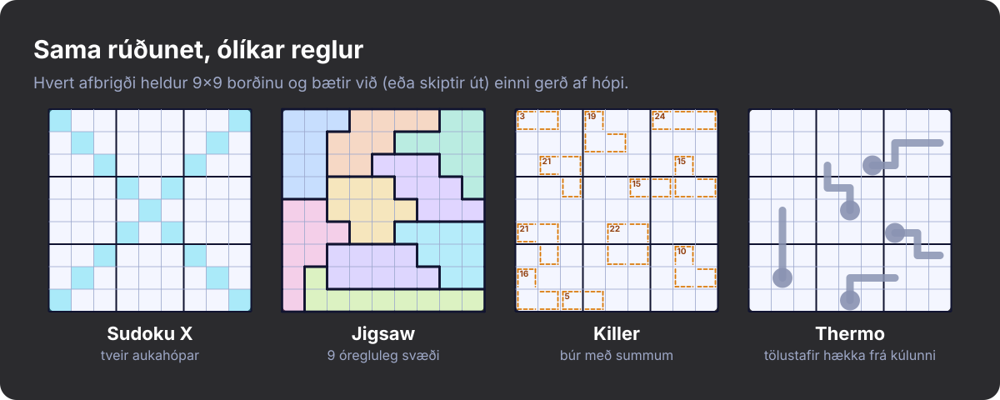
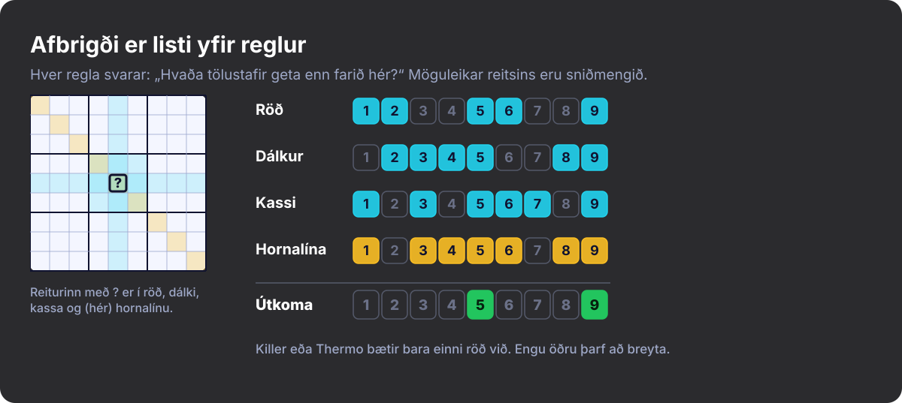
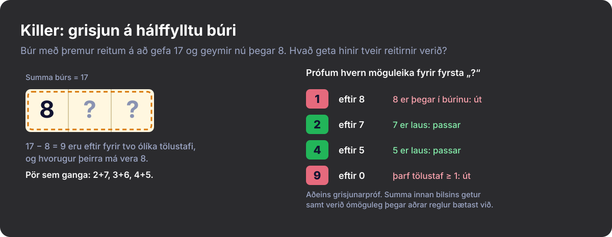
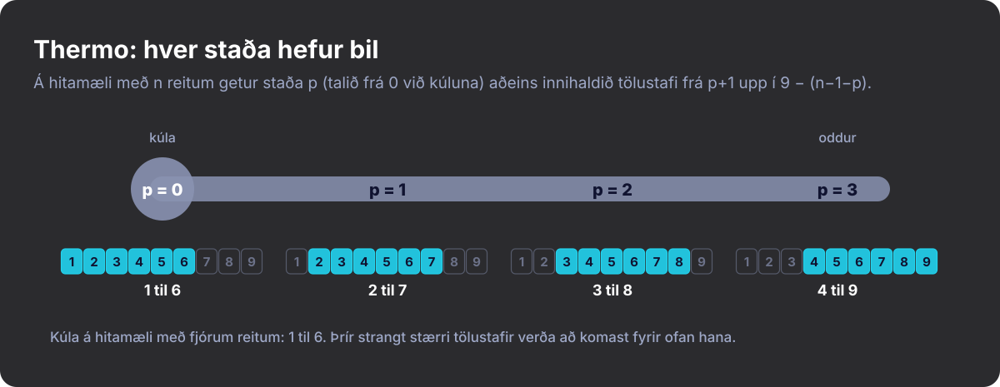
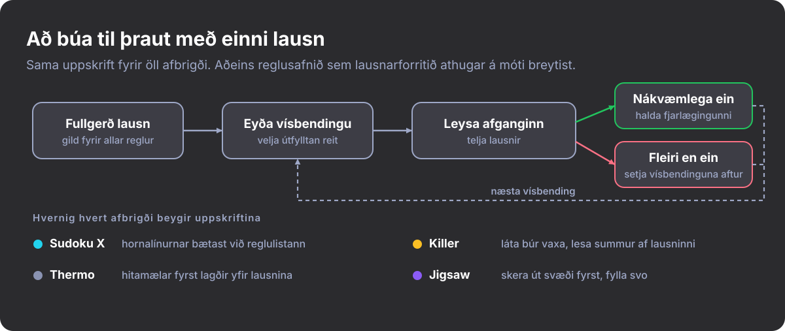

#+title: Sudoku er ekki einn leikur
#+subtitle: Að uppgötva ný afbrigði
#+date: <2026-10-27 09:00>
#+timezone: America/Port_of_Spain
#+language: is
#+options: toc:nil num:nil
#+description: Hvernig ég komst að því að til eru tugir sudoku-afbrigða með ólíkum reglum, og hvernig ég kenndi Rust-leik að spila þau.
#+hero: banner.is.svg
#+filetags: :sudoku:puzzles:gamedev:rust:programming:

* Ég hélt að ég kynni sudoku

Ég hélt að ég kynni sudoku. Níu raðir, níu dálkar, níu kassar, tölustafirnir 1
til 9, engar endurtekningar. Ég hafði leyst þrautir árum saman, svo þegar ég
ákvað að forrita sudoku-leik gerði ég ráð fyrir að erfiðasti hlutinn yrði
viðmótið.

Svo fór ég að lesa um hvernig fólk spilar í raun og veru. Það eru til þrautir
þar sem kassarnir eru einhverjar skrýtnar krullur. Þrautir þar sem maður þarf að
reikna. Þrautir þar sem maður les litla teikningu af hitamæli og lætur hana
segja sér hvaða tölustafir mega fara hvert. Fólk hefur verið að finna upp nýjar
reglur áratugum saman og ég hafði ekki hugmynd um það.

* Afbrigðin sem ég kynntist

- *Sudoku X* bætir báðum löngu hornalínunum við sem aukahópum. Tölustafur í
  miðju borðsins hefur nú meira um allt hitt að segja.
- *Jigsaw-sudoku (óreglulegt sudoku)* hendir 3×3 kössunum og notar í staðinn níu
  samtengda klumpa með níu reitum hver. Sú venja augans að skanna kassa hættir
  að virka.
- *Killer-sudoku* sleppir flestum eða öllum gefnu tölunum og teiknar „búr“ með
  tiltekinni summu. Tölustafir mega ekki endurtaka sig innan búrs og summa
  búrsins þarf að ganga upp nákvæmlega. Það er hálft sudoku og hálft Kakuro.
- *Thermo-sudoku* teiknar hitamæla á borðið. Tölustafirnir verða að hækka í
  hverju skrefi frá kúlunni að oddinum.

Þetta eru ekki bara erfiðari sudoku. Sá sem leysir Killer hugsar um hvaða
tölustafir geta gefið 17 í þremur reitum. Sá sem leysir Thermo tekur eftir því
að kúlan á hitamæli með fjórum reitum getur ekki verið hærri en 6.

#+CAPTION: Afbrigðin fjögur hlið við hlið: sama 9×9 borð, ólíkar reglur.
#+ATTR_HTML: :alt Fjögur 9×9 rúðunet sem sýna Sudoku X, Jigsaw-, Killer- og Thermo-sudoku

* Reglur, ekki hamir

Augljósasta leiðin til að styðja nokkur afbrigði er =mode=-stilling og =match= á
hana alls staðar: í sannprófun, ábendingum, lausn, gerð þrauta og teikningu. Það
gengur ekki upp um leið og einhver biður um Killer með hornalínum, því fjöldi
tilvika vex með fjölda /samsetninga/.

Afbrigði er ekki hamur. Það er listi yfir reglur.

Regla þarf aðeins að svara tveimur spurningum: er borðið löglegt að því leyti
sem mig varðar, og hvaða tölustafir mega enn fara í þennan reit?

#+begin_src rust
pub trait Constraint {
    fn name(&self) -> &'static str;

    /// True if this rule is not currently violated (ignores empty cells).
    fn is_valid(&self, board: &Board) -> bool;

    /// Digits still allowed in `cell` according to this rule alone.
    fn candidates(&self, board: &Board, cell: CellId) -> CandidateSet;
}
#+end_src

Þraut er borð ásamt =Vec<Box<dyn Constraint>>=. Hefðbundið sudoku er raðir,
dálkar og kassar. Sudoku X er sami listinn með hornalínunum í viðbót. Jigsaw
skiptir kassareglunni út fyrir önnur svæði. Killer og Thermo bæta hvort um sig
einni reglu við. Til að finna út hvað getur farið í reit tekur maður sniðmengi
möguleikanna frá öllum reglum.

#+CAPTION: Hver regla skilar sínum eigin möguleikum; reiturinn getur aðeins innihaldið það sem allar reglurnar leyfa.
#+ATTR_HTML: :alt Mögulegir tölustafir fyrir einn reit samkvæmt reglum raðar, dálks, kassa og hornalínu; sniðmengið er 5 og 9

* Þau auðveldu og þau snúnu

Raðir, dálkar, kassar og hornalínur eru allt af sömu gerð: hópur reita þar sem
enginn tölustafur endurtekur sig. Sudoku X kostaði nokkra tugi lína af kóða,
aðallega hnit hornalínanna tveggja. Jigsaw var enn einfaldara. Kassareglan tók
þegar við lista af svæðum, svo ég gat gefið henni óregluleg svæði.

Killer og Thermo voru öðruvísi, því að reglur þeirra snúast ekki um
tvítekningar. Þær snúast um það sem er enn mögulegt að ná.

*Killer-búr.* Útfyllt búr gengur annaðhvort upp eða ekki, en hálffyllt búr
krefst meiri umhugsunar. Ef búr með þremur reitum á að gefa summuna 17 og ég hef
þegar sett 8, verða hinir tveir reitirnir að gefa samtals 9 með ólíkum
tölustöfum og hvorugur þeirra má vera 8. Fyrir hvern möguleika læt ég sem ég
hafi þegar sett hann og reikna svo minnstu og stærstu summu sem hinir reitirnir
gætu náð með ólíkum tölustöfum sem eru ekki þegar í búrinu. Ef summan sem eftir
er fellur utan þessa bils hendi ég möguleikanum. Þetta er grisjunarpróf, ekki
sönnun. Summa getur verið innan bilsins og samt ómöguleg þegar aðrar reglur
bætast við, þannig að leit lausnarforritsins hefur lokaorðið.

#+CAPTION: Grisjun á búri með þremur reitum sem á að gefa 17 og geymir nú þegar 8.
#+ATTR_HTML: :alt Búr með þremur reitum þar sem talan 8 hefur verið sett og tafla yfir hvaða tölustafir passa í næsta reit

*Hitamælar.* Það nægir ekki að athuga að hver tölustafur sé stærri en sá á
undan. Á hitamæli með fjórum reitum er talan 7 í kúlunni þegar ómöguleg, því að
þrír strangt stærri tölustafir komast ekki fyrir undir 9. Og ef tveir reitir með
tvö skref á milli sín innihalda 3 og 4 getur enginn tölustafur verið á milli
þeirra, þannig að hitamælirinn er ómögulegur. Munurinn á tölustöfunum í tveimur
útfylltum reitum þarf því að vera að minnsta kosti jafn mikill og fjöldi
skrefanna sem skilja þá að. Sama hugmynd gefur hverri stöðu bil. Ef stöður eru
taldar frá núlli getur reiturinn í stöðu /p/ á hitamæli með /n/ reitum aðeins
innihaldið tölustafi frá /p+1/ upp í /9 − (n−1−p)/, þar sem 9 er stærsti
tölustafurinn. Fyrir kúluna á hitamæli með fjórum reitum eru það 1 til 6, og
þaðan kemur fullyrðingin hér á undan.

#+CAPTION: Leyfðir tölustafir í hverri stöðu á hitamæli með fjórum reitum.
#+ATTR_HTML: :alt Hitamælir með fjórum reitum og bil leyfðra tölustafa undir hverri stöðu: 1–6, 2–7, 3–8, 4–9

* Lausnarforritið

Lausnarforritið er leit með afturhvarfi (e. backtracking) sem velur alltaf tóma
reitinn með fæstum möguleikum. Áður en það leitar keyrir það útbreiðsluyfirferð
(e. propagation) sem fyllir inn óhjákvæmileg skref: reiti með aðeins einn
möguleika og tölustafi sem passa aðeins á einn stað innan hóps. Það veit ekkert
um Killer eða Thermo. Það spyr hverja reglu um möguleika og vinnur með það sem
kemur til baka.

Reglur geta líka birt /einingar/ (e. units), hópa þar sem hver tölustafur verður
að koma fyrir nákvæmlega einu sinni. Raðir, dálkar, kassar og hornalínur gera
það. Búr og hitamælar gera það ekki. Útbreiðsluyfirferðin notar einingar til að
finna svokölluð hidden singles, þannig að afbrigði með einingum fær það ókeypis
og afbrigði án þeirra tapar engu.

* Gerð þrauta

Góð þraut hefur nákvæmlega eina lausn. Grunnuppskriftin er sú sama fyrir öll
afbrigði: smíða fullgerða lausn og fjarlægja svo vísbendingar hverja á fætur
annarri, og halda hverri fjarlægingu aðeins ef lausnarforritið finnur enn eitt
einasta svar. Hvert afbrigði beygir hana lítillega.

#+CAPTION: Vísbendingar eru fjarlægðar hverja á fætur annarri og hver fjarlæging er aðeins geymd ef lausnin er áfram einstök.
#+ATTR_HTML: :alt Flæðirit: heil lausn, fjarlægja vísbendingu, leysa, halda eða setja aftur, auk þess hvernig hvert afbrigði beygir uppskriftina

- *Sudoku X* þurfti nánast engu við að bæta. Það er sami niðurskurðurinn með
  hornalínunum í reglulistanum.
- *Killer* hefur engar gefnar tölur, því að summur búranna eru vísbendingarnar.
  Ég læt búr vaxa út á við yfir fullgerða lausn, tek aðeins með nágrannareit ef
  tölustafur hans er ekki þegar í búrinu, og les hverja summu af lausninni.
  Hvort lausnin sé einstök er athugað gagnvart öllu reglusafninu (röðum, dálkum,
  kössum og búrum saman), og ef uppsetningin hefur fleiri en eina lausn hendi ég
  henni og reyni aftur. Hámarksstærð búra er helsta stillingin við gerðina.
  Minni búr þrengja yfirleitt beinna að tölustöfunum, en stærri skilja eftir
  fleiri möguleika til að velta fyrir sér.
- *Thermo* virkar best sem hefðbundin þraut með fáum vísbendingum og hitamælum
  ofan á, því að hitamælar einir og sér negla sjaldan niður einstaka lausn. Hver
  hitamælir er lagður yfir fullgerðu lausnina og færist aðeins yfir í
  nágrannareit með stærri tölustaf, þannig að alltaf er hægt að uppfylla hann.
  Vísbendingar eru svo fjarlægðar á meðan hitamælarnir eru í gildi, þannig að
  athugunin á því hvort lausnin sé einstök tekur tillit til þeirra. Fjöldi
  vísbendinga er helsta stillingin við gerðina. Færri vísbendingar skilja
  yfirleitt meira eftir til að álykta um, en þetta er grófur snúningstakki
  frekar en mælikvarði á erfiðleika: ég mæli ekki hversu mikla vinnu
  hitamælarnir leggja af mörkum.
- *Jigsaw* snýr röðinni við. Fyrst er borðinu skipt í níu samtengd svæði með
  nákvæmlega níu reitum hvert, og aðeins þá er það fyllt með gildri lausn. Ekki
  er tryggt að uppsetning svæða hafi gilda útfyllingu, svo útfyllingin fær
  takmarkað leitarsvigrúm, og ef hún mistekst hendi ég uppsetningunni og byrja
  upp á nýtt. Að fá níu klumpa til að þekja borðið jafnt reyndist vera þraut út
  af fyrir sig.

* Það sem ég tók með mér

Ég hafði spilað sudoku árum saman án þess að átta mig á því hversu mikil
fjölbreytnin var. Þegar ég fór að leita fann ég sífellt nýjar reglur og nýjar
leiðir til að sameina þær. Með því að líta á afbrigði sem safn reglna gat ég
gert tilraunir án þess að breyta lausnarforritinu í hvert skipti.

Ég er enn að finna afbrigði sem ég hef aldrei heyrt um og get varla beðið eftir
að spila þau öll. Sudoku hefur verið ein af mínum uppáhaldsdægradvölum árum
saman, og þessi afbrigði gera það meira spennandi en nokkru sinni fyrr.
