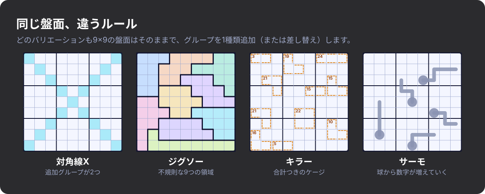
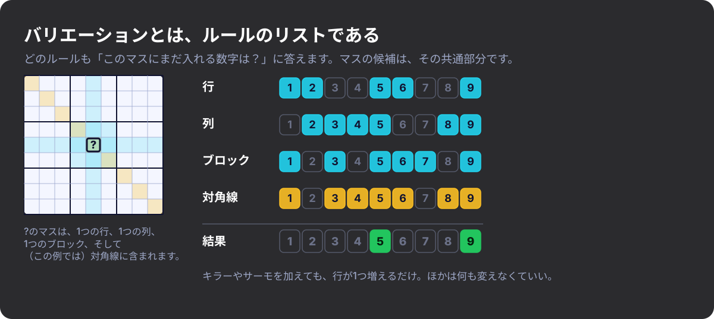
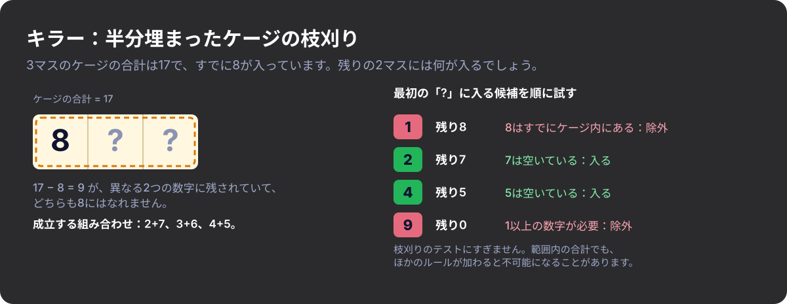
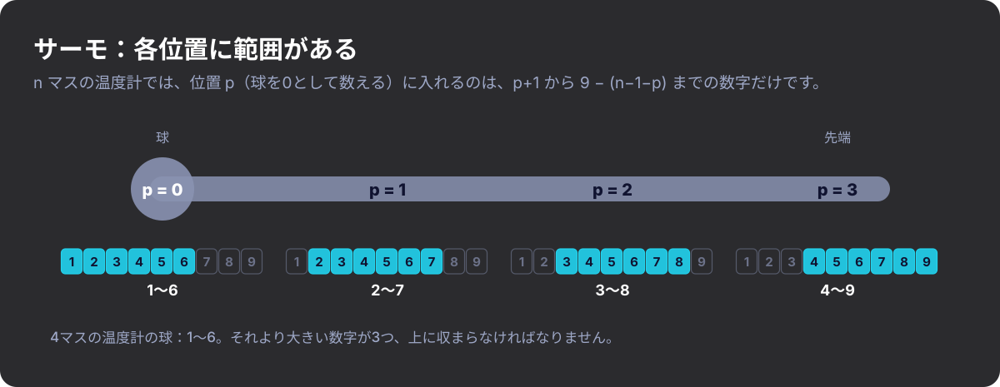
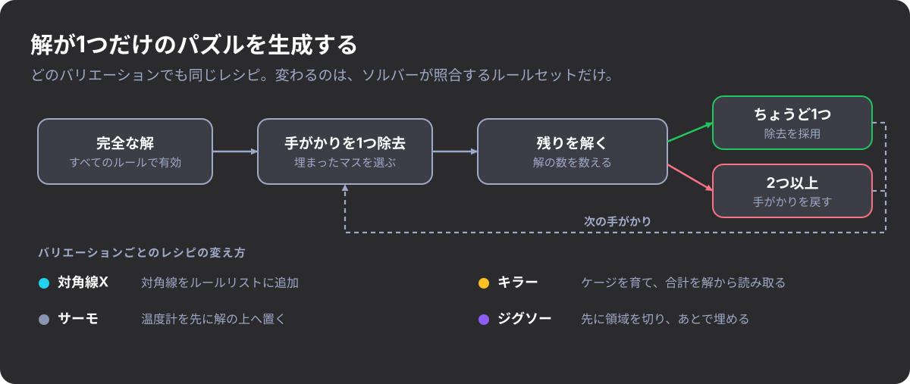

#+title: 数独はひとつのゲームではない
#+subtitle: 新しいバリエーションを発見する
#+date: <2026-10-27 09:00>
#+timezone: America/Port_of_Spain
#+language: ja
#+options: toc:nil num:nil
#+description: 数独には何十種類ものルールのバリエーションがあると知った経緯と、Rust製のゲームでそれらを遊べるようにした方法。
#+hero: banner.ja.svg
#+filetags: :puzzles:gamedev:rust:

* 数独なら知っていると思っていた

数独なら知っていると思っていました。9行、9列、9つのブロック、1から9の数字、重複なし。何年もパズルを解いてきたので、数独ゲームをコードで作ろうと決めたときも、難しいのはインターフェースだろうと思っていました。

ところが、実際にみんながどう遊んでいるのかを調べ始めると、ブロックがくねくねした奇妙な形をしているパズルがありました。計算が必要なパズルもあります。小さな温度計の絵を読んで、どの数字がどこに入るかを教えてもらうパズルもあります。人々は何十年も前から新しいルールを考え出してきたのに、私はまったく知りませんでした。

* 出会ったバリエーション

- *対角線数独（Sudoku X）* は、2本の長い対角線を追加のグループとして加えます。盤面の中央にある数字は、ほかのすべてのマスに、より強く影響するようになります。
- *ジグソー数独（不規則数独）* は、3×3のブロックをやめて、9マスずつがつながった9つのかたまりを使います。ブロックを順に目で追う習慣が通用しなくなります。
- *キラー数独* は、与えられた数字のほとんど、あるいはすべてを取り除き、目標の合計が書かれた「ケージ」を描きます。ケージの中で数字を重複させることはできず、合計もぴったり合わなければなりません。半分は数独、半分はカックロのような感覚です。
- *サーモ数独* は、盤面に温度計を描きます。数字は、球の部分から先端に向かって、一つ進むごとに必ず大きくならなければなりません。

これは単に難しい数独というわけではありません。キラーを解く人は、3マスで17になる数字の組み合わせを考えます。サーモを解く人は、4マスの温度計の球の部分が6より大きくなれないことに気づきます。

#+CAPTION: 4つのバリエーションを並べたところ。同じ9×9の盤面で、ルールだけが違います。
#+ATTR_HTML: :alt 対角線X、ジグソー、キラー、サーモの数独を示す4つの9×9グリッド

* モードではなく、ルール

複数のバリエーションに対応するいちばん素直な方法は、 =mode= という設定を用意して、検証、ヒント、解法、生成、描画のあらゆる場所でそれに対して =match= することです。しかし、誰かが「対角線つきのキラー」を求めた途端に破綻します。ケースの数が、 /組み合わせ/ の数に応じて増えていくからです。

バリエーションはモードではありません。ルールのリストです。

ルールが答えるべき質問は2つだけです。自分の担当する範囲では、盤面は合法か。そして、このマスにはまだどの数字が入れるか。

#+begin_src rust
pub trait Constraint {
    fn name(&self) -> &'static str;

    /// True if this rule is not currently violated (ignores empty cells).
    fn is_valid(&self, board: &Board) -> bool;

    /// Digits still allowed in `cell` according to this rule alone.
    fn candidates(&self, board: &Board, cell: CellId) -> CandidateSet;
}
#+end_src

パズルとは、盤面と =Vec<Box<dyn Constraint>>= を合わせたものです。クラシックな数独は、行、列、ブロックです。対角線数独は、同じリストに対角線を加えたものです。ジグソーは、ブロックのルールを別の領域に差し替えます。キラーとサーモは、それぞれルールをもう1つ追加します。あるマスに何が入れるかを求めるには、すべてのルールが返した候補の共通部分を取ります。

#+CAPTION: 各ルールは自分の候補を返し、マスに入れるのは、すべてのルールが許す数字だけです。
#+ATTR_HTML: :alt 行・列・ブロック・対角線のルールから得た1つのマスの候補数字。共通部分は5と9

* 簡単なものと、厄介なもの

行、列、ブロック、対角線は、どれも同じ形をしています。どの数字も重複しないマスのグループです。対角線数独は、2本の対角線の座標を書くのが大半で、コードにして数十行でした。ジグソーはさらに簡単でした。ブロックのルールはもともと領域のリストを受け取る作りだったので、不規則な領域を渡すだけで済んだからです。

キラーとサーモは別でした。これらのルールが扱うのは重複ではなく、まだ到達できる範囲です。

*キラーのケージ。* 完成したケージは合っているか合っていないかのどちらかですが、半分埋まったケージはもう少し考える必要があります。3マスのケージの合計が17で、すでに8を置いたとすると、残り2マスは異なる数字で合計9にならなければならず、どちらも8にはなれません。各候補について、すでに置いたものとみなし、残りのマスが、ケージにまだない異なる数字を使って作れる最小の合計と最大の合計を求めます。残りの目標値がその範囲の外に出るなら、その候補は捨てます。これは枝刈りのテストであって、証明ではありません。合計が範囲内に収まっていても、ほかのルールが絡むと不可能になることがあるので、最後にものを言うのはソルバーの探索です。

#+CAPTION: 3マスで合計17になるケージに、すでに8が入っている場合の枝刈り。
#+ATTR_HTML: :alt 8が置かれた3マスのケージと、次のマスに入る数字を示す表

*温度計。* 各数字が一つ前より大きいかを確かめるだけでは足りません。4マスの温度計では、球の部分に7が入るのはすでに不可能です。9を超えない範囲で、7より大きい数字を3つ並べることができないからです。また、2歩離れた2つのマスに3と4が入っていると、その間に入れる数字がないので、その温度計は成立しません。つまり、埋まっている2つのマスの数字の差は、少なくともそのマスを隔てる歩数以上でなければなりません。同じ考え方で、各位置に範囲が決まります。位置を0から数えると、 /n/ マスの温度計の位置 /p/ のマスに入れるのは、 /p+1/ から /9 − (n−1−p)/ までの数字だけです。ここで9は最大の数字です。4マスの温度計の球の部分だと、これが1から6になり、先ほどの主張の出どころです。

#+CAPTION: 4マスの温度計の各位置に入れる数字の範囲。
#+ATTR_HTML: :alt 4マスの温度計と、各位置の下に示された入れる数字の範囲：1〜6、2〜7、3〜8、4〜9

* ソルバー

ソルバーはバックトラック探索で、常に候補がいちばん少ない空きマスを選びます。探索の前に、伝播のパスを実行して、確定する手を埋めていきます。候補が1つだけのマスと、グループ内で1か所にしか入らない数字です。ソルバーはキラーもサーモも知りません。すべてのルールに候補を尋ねて、返ってきたものだけで進めます。

ルールは /ユニット（units）/ を公開することもできます。ユニットとは、どの数字もちょうど1回ずつ現れなければならないグループです。行、列、ブロック、対角線はユニットを公開します。ケージと温度計は公開しません。伝播のパスはユニットを使って隠れたシングル（hidden single）を見つけるので、ユニットを持つバリエーションはそれが無料で手に入り、持たないバリエーションも何も失いません。

* パズルの生成

良いパズルには、解がちょうど1つだけあります。基本のレシピは、どのバリエーションでも同じです。完全な解を作り、手がかりを1つずつ取り除いていきます。取り除いたあともソルバーが答えを1つだけ見つける場合に限って、その除去を採用します。バリエーションごとに、このレシピを少しずつ曲げています。

#+CAPTION: 手がかりを1つずつ削り、解が一意のままなら除去を採用する。
#+ATTR_HTML: :alt フローチャート：完全な解、手がかりを1つ除去、解く、採用または元に戻す、さらに各バリエーションがレシピをどう変えるか

- *対角線数独* は、ほとんど何も追加する必要がありませんでした。ルールのリストに対角線が入っているだけで、削り方は同じです。
- *キラー* には最初から与えられた数字がありません。ケージの合計が手がかりだからです。私は、完成した解の上でケージを外側へ広げていきます。隣のマスを取り込むのは、その数字がまだケージにないときだけで、各合計は解から読み取ります。一意性は、完全なルールセット（行、列、ブロック、ケージのすべて）に対して確認し、配置に解が2つ以上あれば捨ててやり直します。主な生成設定は、ケージの最大サイズです。ケージが小さいほど数字を直接的に絞り込みやすく、大きいほど考慮すべき可能性が多く残ります。
- *サーモ* は、手がかりの少ないクラシックなパズルの上に温度計を重ねる形が最も向いています。温度計だけでは一意の解に絞り込めることがめったにないからです。各温度計は完成した解の上に置かれ、より大きな数字を持つ隣のマスにだけ進むので、必ず条件を満たせます。そのあと、温度計が有効な状態で手がかりを取り除くので、一意性の判定には温度計も含まれます。主な生成設定は手がかりの数です。手がかりが少ないほど、推論で埋める部分が多くなる傾向がありますが、これは大まかなダイヤルであって、難易度の尺度ではありません。温度計がどれだけ仕事をしているかは測っていないのです。
- *ジグソー* は順序が逆になります。まず盤面を、ちょうど9マスずつの連結した9つの領域に切り分け、そのあとで有効な解を埋めます。領域の配置に有効な埋め方があるとは限らないので、埋める処理には探索の予算に上限を設けており、失敗したら配置を捨ててやり直します。9つのかたまりで盤面をきれいに敷き詰めること自体が、一つのパズルになってしまいました。

* 得たもの

私は何年も数独を遊んできましたが、これほど多様なバリエーションがあるとは気づいていませんでした。探し始めてみると、新しいルールと、それらを組み合わせる新しい方法が次々に見つかりました。バリエーションをルールの集まりとして扱うことで、そのたびにソルバーを作り直さなくても、いろいろ試せるようになりました。

まだ聞いたこともないバリエーションを見つけ続けていて、全部遊ぶのが待ちきれません。数独は何年も前から私のお気に入りの娯楽のひとつでしたが、これらのバリエーションのおかげで、これまで以上に面白くなっています。
