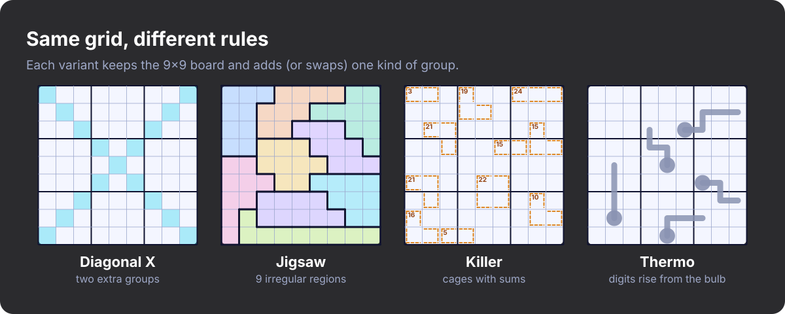
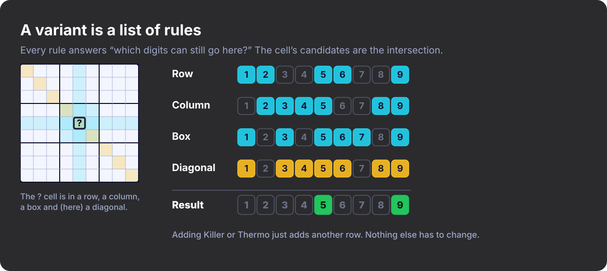
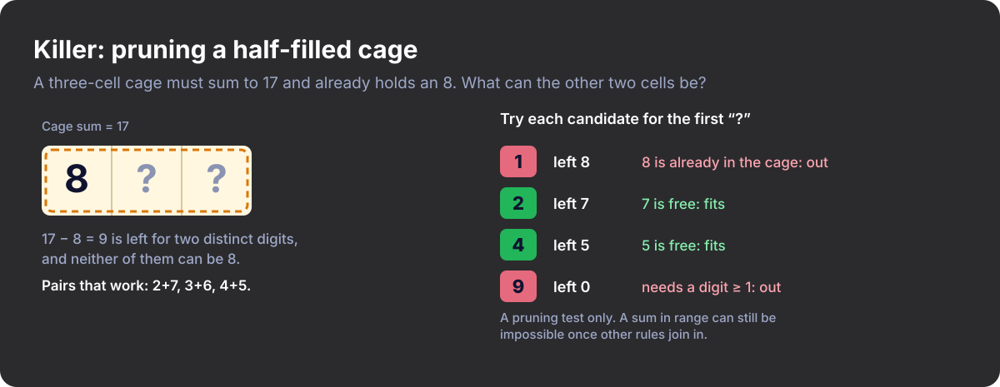
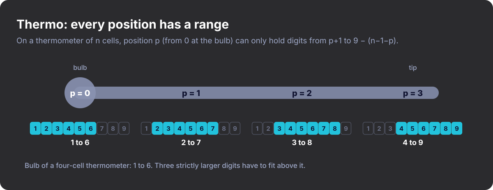
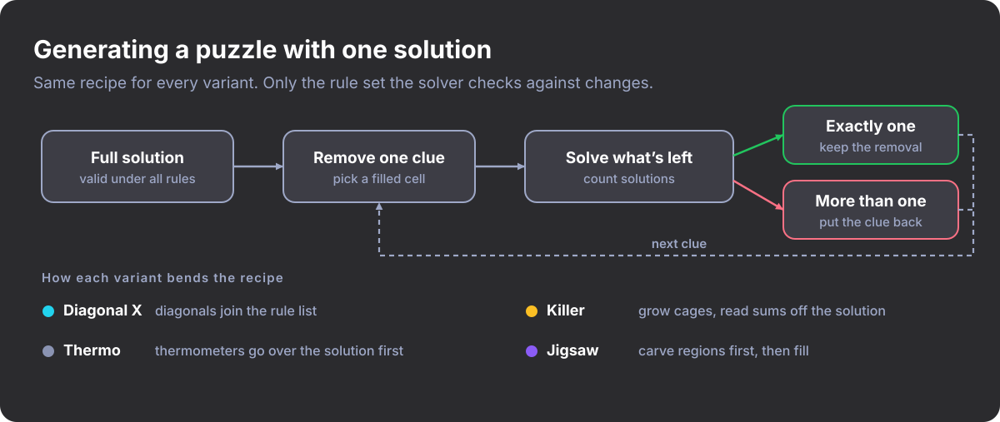

#+title: Sudoku Isn't One Game
#+subtitle: Discovering New Variants
#+date: <2026-10-27 09:00>
#+timezone: America/Port_of_Spain
#+language: en-GB
#+options: toc:nil num:nil
#+description: How I found out Sudoku comes in dozens of rule variants, and how I taught a Rust game to play them.
#+hero: banner.svg
#+filetags: :sudoku:puzzles:gamedev:rust:programming:

* I thought I knew Sudoku

I thought I knew Sudoku. Nine rows, nine columns, nine boxes, digits 1 to 9, no
repeats. I'd been solving puzzles for years, so when I decided to build a Sudoku
game in code I assumed the hard part would be the interface.

Then I started reading about how people actually play. There are puzzles where
the boxes are odd squiggles. Puzzles where you have to do arithmetic. Puzzles
where you read a little drawing of a thermometer and let it tell you which
digits can go where. People have been inventing new rules for decades, and I'd
had no idea.

* The variants I met

- *Sudoku X* adds the two long diagonals as extra groups. A digit in the middle
  of the board now has more to say about everything else.
- *Jigsaw (irregular) Sudoku* throws out the 3×3 boxes and uses nine connected
  blobs of nine cells instead. Your eye's habit of scanning boxes stops working.
- *Killer Sudoku* drops most or all of the given digits and draws "cages" with a
  target sum. Digits can't repeat inside a cage, and the cage has to add up
  exactly. It feels half Sudoku, half Kakuro.
- *Thermo Sudoku* draws thermometers on the grid. Digits must strictly increase
  from the bulb to the tip.

These aren't just harder Sudoku. A Killer solver thinks about which sets of
digits can make 17 in three cells. A Thermo solver notices that the bulb of a
four-cell thermometer can't be higher than a 6.

#+CAPTION: The four variants side by side: same 9×9 board, different rules.
#+ATTR_HTML: :alt Four 9×9 grids showing Diagonal X, Jigsaw, Killer and Thermo Sudoku

* Rules, not modes

The obvious way to support several variants is a =mode= setting and a =match= on
it everywhere: validation, hints, solving, generating, drawing. That falls over
as soon as someone asks for Killer with diagonals, because the number of cases
grows with the number of /combinations/.

A variant isn't a mode. It's a list of rules.

A rule only has to answer two questions: is the board legal as far as I'm
concerned, and which digits can still go in this cell?

#+begin_src rust
pub trait Constraint {
    fn name(&self) -> &'static str;

    /// True if this rule is not currently violated (ignores empty cells).
    fn is_valid(&self, board: &Board) -> bool;

    /// Digits still allowed in `cell` according to this rule alone.
    fn candidates(&self, board: &Board, cell: CellId) -> CandidateSet;
}
#+end_src

A puzzle is a board plus a =Vec<Box<dyn Constraint>>=. Classic Sudoku is rows,
columns and boxes. Sudoku X is the same list with the diagonals added. Jigsaw
swaps in different regions for the box rule. Killer and Thermo each add one more
rule. To work out what can go in a cell, you intersect the candidates from every
rule.

#+CAPTION: Each rule reports its own candidates; the cell can hold only what every rule allows.
#+ATTR_HTML: :alt Candidate digits for one cell from the row, column, box and diagonal rules, intersected to 5 and 9

* The easy ones and the fiddly ones

Rows, columns, boxes and diagonals are all the same shape: a group of cells
where no digit repeats. Sudoku X was a few dozen lines, mostly the coordinates
of the two diagonals. Jigsaw was simpler still. The box rule already took a list
of regions, so I could give it irregular ones.

Killer and Thermo were different, because their rules aren't about
duplicates. They're about what is still reachable.

*Killer cages.* A finished cage either adds up or it doesn't, but a half-filled
one needs more thought. If a three-cell cage needs 17 and I've placed an 8, the
other two cells must sum to 9 using distinct digits, neither of them 8. For each
candidate, I pretend it's already placed, then work out the smallest and largest
sums the remaining cells could reach using distinct digits not already in the
cage. If the remaining target falls outside that range, I discard the
candidate. This is a pruning test, not a proof. A sum can sit inside the range
and still be impossible once other rules get involved, so the solver's search
has the last word.

#+CAPTION: Pruning a three-cell cage that needs 17 and already holds an 8.
#+ATTR_HTML: :alt A three-cell cage with an 8 placed and a table of which digits fit the next cell

*Thermometers.* Checking that each digit is bigger than the one before isn't
enough. On a four-cell thermometer, a 7 in the bulb is already impossible,
because three strictly larger digits won't fit under 9. And if two cells two
steps apart hold a 3 and a 4, no digit can sit between them, so the thermometer
is impossible. So the gap between two filled cells has to be at least the number
of steps separating them. The same idea gives each position a range. Counting
positions from zero, the cell at position /p/ of a thermometer with /n/ cells
can only hold digits from /p+1/ up to /9 − (n−1−p)/, where 9 is the largest
digit. For the bulb of a four-cell thermometer that's 1 to 6, which is where
that earlier claim comes from.

#+CAPTION: Allowed digits at each position of a four-cell thermometer.
#+ATTR_HTML: :alt A four-cell thermometer with the allowed digit range under each position: 1-6, 2-7, 3-8, 4-9

* The solver

The solver is a backtracking search that always picks the empty cell with the
fewest candidates. Before searching, it runs a propagation pass that fills in
forced moves: cells with a single option, and digits that fit in only one place
within a group. It doesn't know about Killer or Thermo. It asks every rule for
candidates and works with what comes back.

Rules can also publish /units/, groups where every digit must appear exactly
once. Rows, columns, boxes and diagonals do. Cages and thermometers don't. The
propagation pass uses units to find hidden singles, so a variant with units gets
that for free and one without loses nothing.

* Generating puzzles

A good puzzle has exactly one solution. The basic recipe is the same for every
variant: build a complete solution, then remove clues one at a time, keeping
each removal only if the solver still finds a single answer. The variants each
bend it a little.

#+CAPTION: Carve clues one at a time, keeping each removal only if the solution stays unique.
#+ATTR_HTML: :alt Flow chart: full solution, remove a clue, solve, keep or restore, plus how each variant bends the recipe

- *Sudoku X* needed almost nothing extra. It's the same carving with the
  diagonals in the rule list.
- *Killer* has no given digits, because the cage sums are the clues. I grow
  cages outwards over a finished solution, only absorbing a neighbouring cell if
  its digit isn't already in the cage, and read each sum off the
  solution. Uniqueness is checked against the full rule set (rows, columns,
  boxes and cages together), and if the layout has more than one solution I
  throw it away and try again. The maximum cage size is the main generation
  setting. Smaller cages tend to constrain digits more directly, while larger
  ones leave more possibilities to consider.
- *Thermo* works best as a lightly clued classic puzzle with thermometers on
  top, because thermometers alone rarely pin down a unique solution. Each
  thermometer is laid over the finished solution, stepping only to a neighbour
  with a larger digit, so it can always be satisfied. Clues are then removed
  with the thermometers in force, so uniqueness accounts for them. The clue
  count is the main generation setting. Fewer clues usually leave more to
  deduce, but it's a rough dial rather than a measure of difficulty: I don't
  measure how much work the thermometers do.
- *Jigsaw* reverses the order. The board is carved into nine connected regions
  of exactly nine cells first, and only then filled with a valid solution. A
  region layout isn't guaranteed to have a valid fill, so the fill gets a
  limited search budget, and if it fails I throw the layout away and start
  again. Getting nine blobs to tile the board evenly turned out to be a puzzle
  in itself.

* What I took away

I'd played Sudoku for years without realising how much variety there was. Once I
started looking, I kept finding new rules and new ways to combine them. Treating
variants as collections of rules meant I could experiment without reworking the
solver each time.

I'm still finding variants I've never heard of, and I can't wait to play them
all. Sudoku has been one of my favourite pastimes for years, and these variants
are making it more exciting than ever.
