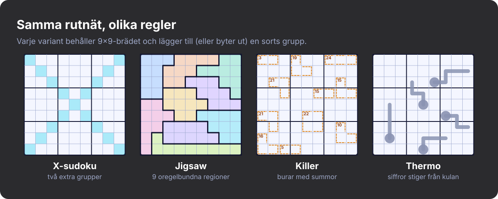
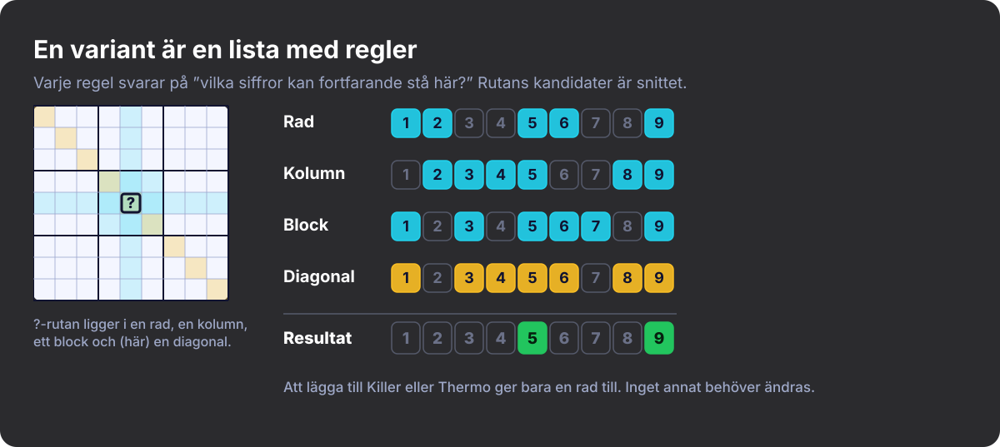
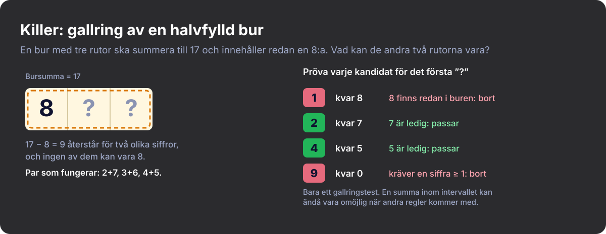
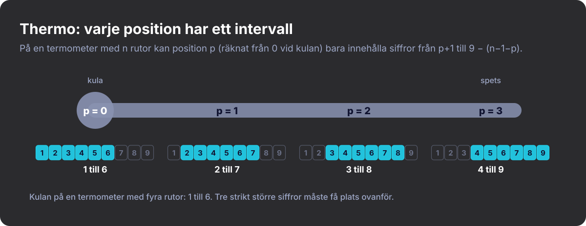
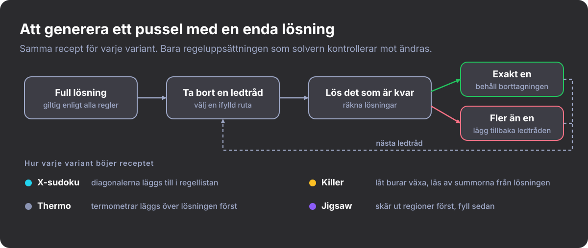

#+title: Sudoku är inte ett enda spel
#+subtitle: Att upptäcka nya varianter
#+date: <2026-10-27 09:00>
#+timezone: America/Port_of_Spain
#+language: sv
#+options: toc:nil num:nil
#+description: Hur jag upptäckte att sudoku finns i dussintals regelvarianter, och hur jag lärde ett Rust-spel att spela dem.
#+hero: banner.sv.svg
#+filetags: :sudoku:puzzles:gamedev:rust:programming:

* Jag trodde att jag kunde sudoku

Jag trodde att jag kunde sudoku. Nio rader, nio kolumner, nio block, siffrorna 1
till 9, inga upprepningar. Jag hade löst pussel i åratal, så när jag bestämde
mig för att bygga ett sudokuspel i kod antog jag att det svåra skulle vara
gränssnittet.

Sedan började jag läsa om hur folk faktiskt spelar. Det finns pussel där blocken
är konstiga slingor. Pussel där man måste räkna. Pussel där man läser en liten
teckning av en termometer och låter den avgöra vilka siffror som får stå var.
Folk har uppfunnit nya regler i decennier, och jag hade ingen aning.

* Varianterna jag stötte på

- *X-sudoku* lägger till de två långa diagonalerna som extra grupper. En siffra
  i mitten av brädet har nu mer att säga om allt annat.
- *Jigsaw-sudoku (oregelbundet sudoku)* slänger ut 3×3-blocken och använder i
  stället nio sammanhängande klumpar med nio rutor vardera. Ögats vana att
  skanna block slutar fungera.
- *Killer-sudoku* tar bort de flesta eller alla givna siffror och ritar ”burar”
  med en målsumma. Siffror får inte upprepas inom en bur, och buren måste
  summera exakt. Det känns som halv sudoku, halv Kakuro.
- *Thermo-sudoku* ritar termometrar i rutnätet. Siffrorna måste öka strikt från
  kulan till spetsen.

Det här är inte bara svårare sudoku. Den som löser Killer tänker på vilka
mängder av siffror som kan ge 17 i tre rutor. Den som löser Thermo märker att
kulan på en termometer med fyra rutor inte kan vara högre än en 6:a.

#+CAPTION: De fyra varianterna sida vid sida: samma 9×9-bräde, olika regler.
#+ATTR_HTML: :alt Fyra 9×9-rutnät som visar X-sudoku, Jigsaw, Killer och Thermo-sudoku

* Regler, inte lägen

Det uppenbara sättet att stödja flera varianter är en =mode=-inställning och en
=match= på den överallt: validering, tips, lösning, generering, ritning. Det
faller så fort någon ber om Killer med diagonaler, eftersom antalet fall växer
med antalet /kombinationer/.

En variant är inte ett läge. Den är en lista med regler.

En regel behöver bara svara på två frågor: är brädet lagligt så långt det rör
mig, och vilka siffror kan fortfarande stå i den här rutan?

#+begin_src rust
pub trait Constraint {
    fn name(&self) -> &'static str;

    /// True if this rule is not currently violated (ignores empty cells).
    fn is_valid(&self, board: &Board) -> bool;

    /// Digits still allowed in `cell` according to this rule alone.
    fn candidates(&self, board: &Board, cell: CellId) -> CandidateSet;
}
#+end_src

Ett pussel är ett bräde plus en =Vec<Box<dyn Constraint>>=. Klassiskt sudoku är
rader, kolumner och block. X-sudoku är samma lista med diagonalerna tillagda.
Jigsaw byter ut blockregeln mot andra regioner. Killer och Thermo lägger var och
en till ytterligare en regel. För att räkna ut vad som kan stå i en ruta tar man
snittet av kandidaterna från alla regler.

#+CAPTION: Varje regel rapporterar sina egna kandidater; rutan kan bara innehålla det som alla regler tillåter.
#+ATTR_HTML: :alt Kandidatsiffror för en ruta enligt rad-, kolumn-, block- och diagonalregeln, där snittet är 5 och 9

* De enkla och de krångliga

Rader, kolumner, block och diagonaler har alla samma form: en grupp rutor där
ingen siffra upprepas. X-sudoku blev några dussin rader kod, mest koordinaterna
för de två diagonalerna. Jigsaw var ännu enklare. Blockregeln tog redan emot en
lista med regioner, så jag kunde bara ge den oregelbundna.

Killer och Thermo var annorlunda, eftersom deras regler inte handlar om
dubbletter. De handlar om vad som fortfarande går att nå.

*Killerburar.* En färdig bur går antingen ihop eller inte, men en halvfylld
kräver mer eftertanke. Om en bur med tre rutor ska summera till 17 och jag har
lagt en 8:a, måste de andra två rutorna summera till 9 med olika siffror, och
ingen av dem får vara 8. För varje kandidat låtsas jag att den redan är placerad
och räknar sedan ut den minsta och den största summa som de återstående rutorna
kan nå med olika siffror som inte redan finns i buren. Om den återstående
målsumman hamnar utanför det intervallet slänger jag kandidaten. Det här är ett
gallringstest, inte ett bevis. En summa kan ligga inom intervallet och ändå vara
omöjlig när andra regler kommer in i bilden, så solverns sökning har sista
ordet.

#+CAPTION: Gallring av en bur med tre rutor som ska summera till 17 och redan innehåller en 8:a.
#+ATTR_HTML: :alt En bur med tre rutor där en 8:a är placerad och en tabell över vilka siffror som passar i nästa ruta

*Termometrar.* Det räcker inte att kontrollera att varje siffra är större än den
förra. På en termometer med fyra rutor är en 7:a i kulan redan omöjlig, eftersom
tre strikt större siffror inte får plats under 9. Och om två rutor som ligger
två steg ifrån varandra innehåller en 3:a och en 4:a kan ingen siffra stå mellan
dem, så termometern är omöjlig. Skillnaden mellan siffrorna i två ifyllda rutor
måste alltså vara minst lika stor som antalet steg som skiljer dem åt. Samma idé
ger varje position ett intervall. Räknar man positioner från noll kan rutan på
position /p/ i en termometer med /n/ rutor bara innehålla siffror från /p+1/ upp
till /9 − (n−1−p)/, där 9 är den största siffran. För kulan på en termometer med
fyra rutor blir det 1 till 6, och det är därifrån det tidigare påståendet
kommer.

#+CAPTION: Tillåtna siffror på varje position i en termometer med fyra rutor.
#+ATTR_HTML: :alt En termometer med fyra rutor och intervallet av tillåtna siffror under varje position: 1–6, 2–7, 3–8, 4–9

* Solvern

Solvern är en backtracking-sökning som alltid väljer den tomma ruta som har
minst antal kandidater. Innan den söker kör den ett propageringssteg som fyller
i tvingade drag: rutor med bara ett alternativ och siffror som bara passar på
ett ställe i en grupp. Den vet ingenting om Killer eller Thermo. Den frågar
varje regel efter kandidater och arbetar med det som kommer tillbaka.

Regler kan också publicera /enheter/ (units), grupper där varje siffra måste
förekomma exakt en gång. Rader, kolumner, block och diagonaler gör det. Burar
och termometrar gör det inte. Propageringssteget använder enheter för att hitta
så kallade hidden singles, så en variant med enheter får det på köpet och en
utan förlorar ingenting.

* Att generera pussel

Ett bra pussel har exakt en lösning. Grundreceptet är detsamma för varje
variant: bygg en komplett lösning och ta sedan bort ledtrådar en i taget, och
behåll varje borttagning bara om solvern fortfarande hittar ett enda svar.
Varianterna böjer det alla lite.

#+CAPTION: Skär bort ledtrådar en i taget och behåll varje borttagning bara om lösningen förblir unik.
#+ATTR_HTML: :alt Flödesschema: full lösning, ta bort en ledtråd, lös, behåll eller återställ, plus hur varje variant böjer receptet

- *X-sudoku* behövde nästan ingenting extra. Det är samma bortskärning med
  diagonalerna i regellistan.
- *Killer* har inga givna siffror, eftersom bursummorna är ledtrådarna. Jag
  låter burar växa utåt över en färdig lösning, tar bara med en angränsande ruta
  om dess siffra inte redan finns i buren, och läser av varje summa från
  lösningen. Unikheten kontrolleras mot hela regeluppsättningen (rader,
  kolumner, block och burar tillsammans), och om layouten har mer än en lösning
  kastar jag bort den och försöker igen. Den maximala burstorleken är den
  viktigaste genereringsinställningen. Mindre burar tenderar att begränsa
  siffrorna mer direkt, medan större lämnar fler möjligheter att ta hänsyn till.
- *Thermo* fungerar bäst som ett klassiskt pussel med få ledtrådar och
  termometrar ovanpå, eftersom termometrar ensamma sällan låser fast en unik
  lösning. Varje termometer läggs över den färdiga lösningen och går bara vidare
  till en granne med större siffra, så den går alltid att uppfylla. Ledtrådar
  tas sedan bort medan termometrarna gäller, så unikheten tar hänsyn till dem.
  Antalet ledtrådar är den viktigaste genereringsinställningen. Färre ledtrådar
  lämnar oftast mer att dra slutsatser om, men det är ett grovt reglage och
  inget mått på svårighet: jag mäter inte hur mycket arbete termometrarna gör.
- *Jigsaw* vänder på ordningen. Först delas brädet upp i nio sammanhängande
  regioner med exakt nio rutor vardera, och först därefter fylls det med en
  giltig lösning. Det finns ingen garanti för att en regionlayout har en giltig
  ifyllning, så ifyllningen får en begränsad sökbudget, och om den misslyckas
  kastar jag layouten och börjar om. Att få nio klumpar att täcka brädet jämnt
  visade sig vara ett pussel i sig.

* Vad jag tog med mig

Jag hade spelat sudoku i åratal utan att inse hur stor variationen var. När jag
väl började leta fortsatte jag hitta nya regler och nya sätt att kombinera dem.
Att behandla varianter som samlingar av regler gjorde att jag kunde
experimentera utan att bygga om solvern varje gång.

Jag hittar fortfarande varianter jag aldrig hört talas om, och jag kan knappt
vänta på att få spela dem alla. Sudoku har varit ett av mina favoritnöjen i
många år, och de här varianterna gör det mer spännande än någonsin.
