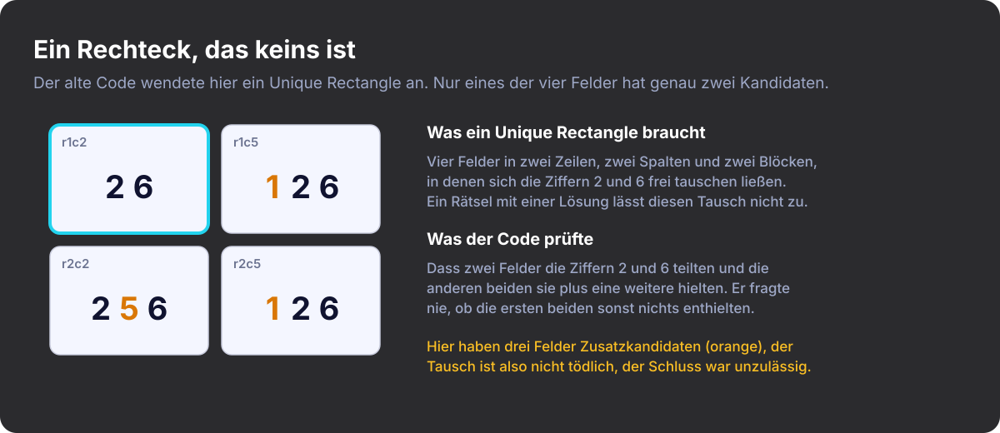
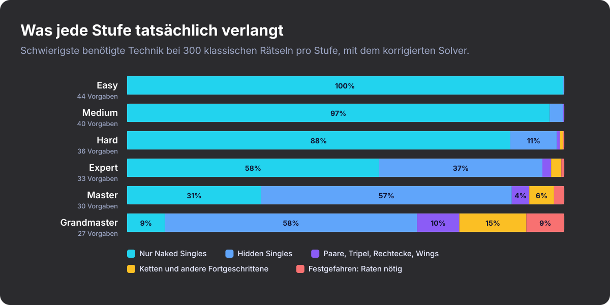
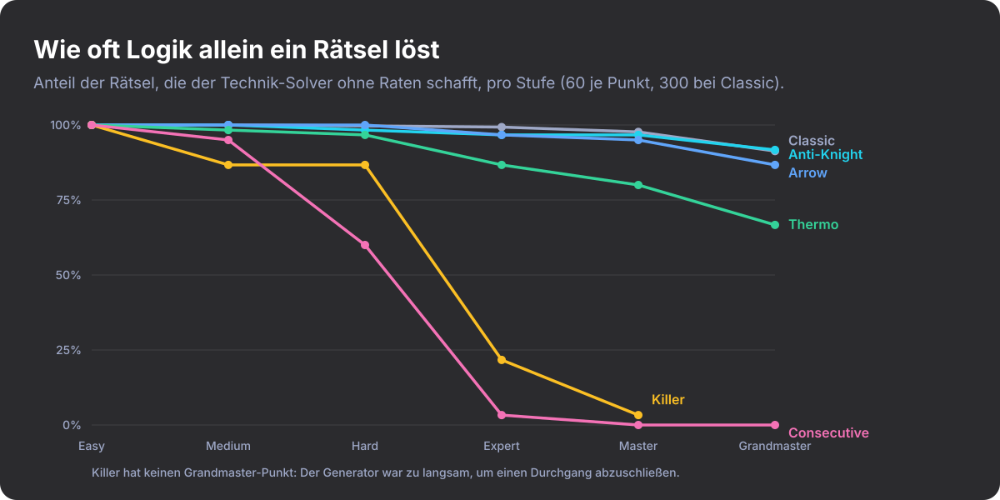

#+title: Sudoku ist nicht gleich Sudoku, Teil zwei
#+subtitle: Der Solver, der falsch lag
#+date: <2026-11-17 09:00>
#+timezone: America/Port_of_Spain
#+language: de
#+options: toc:nil num:nil
#+description: Ich wollte die Schwierigkeit von Sudoku-Rätseln nach den nötigen Techniken bewerten. Die ersten Zahlen waren Unsinn, weil mein Solver falsche Schlüsse zog. Was ich gefunden habe, wie ich es behoben habe und was Vorgaben wirklich über die Schwierigkeit verraten.
#+hero: banner.de.svg
#+hero_alt: Ein Sudoku-Gitter mit vier orange markierten Feldern, daneben der Titel Der Solver lag falsch
#+filetags: :puzzles:sudoku:gamedev:rust:

* Wo ich aufgehört habe

Am Ende [[file:../2026-10-27-sudoku-variants/index.org][des letzten Beitrags]] habe ich etwas zur Schwierigkeit zugegeben. Wenn ich
ein Thermo-Rätsel generiere, ist der wichtigste Regler die Anzahl der vorgegebenen
Ziffern. Weniger Vorgaben bedeuten meistens mehr zu folgern, aber ich sagte, es
sei ein grober Regler und kein Maß, denn ich hatte nicht gemessen, wie viel Arbeit
die Thermometer machen.

Das ließ mich nicht los, und nicht nur aus Ordnungsliebe. Ruta, mein Sudoku-Spiel, hat
sechs Schwierigkeitsstufen, und bei klassischen Rätseln unterscheiden sie sich nur
darin, wie viele Ziffern auf dem Brett stehen. Easy hat 44 Vorgaben, Grandmaster 27.
Das Spiel nennt außerdem bei jedem Tipp die verwendete Technik, und es hat einen
Trainer, der diese Techniken Lektion für Lektion beibringt. Ich besitze also schon etwas
viel Besseres als eine Vorgabenzahl: einen Solver, der wie ein Mensch arbeitet, eine
benannte Technik nach der anderen, und jeden Schritt aufzeichnet.

In diesem Beitrag geht es darum, damit die Schwierigkeit richtig zu messen. Daraus
wurde eine andere Geschichte. Die ersten Zahlen waren Unsinn, weil der Solver
manchmal falsch lag, und den Grund zu finden hat eine Weile gedauert. Zuerst
erkläre ich die Messidee, dann, was schiefging, dann die Zahlen, denen ich jetzt
traue. Ich finde die zweite Hälfte spannender als die erste.

* Ein Solver, der sich erklärt

Das Spiel hat zwei Solver mit unterschiedlichen Aufgaben. Der erste ist die
Backtracking-Suche vom letzten Mal. Sie rät, wenn es nötig ist, und sie prüft, ob
ein generiertes Rätsel genau eine Lösung hat. Der zweite ist
=solve_human=, und der arbeitet ganz anders. Er rät nie. Er geht seine Techniken in
fester Reihenfolge durch, die einfachste zuerst, wendet die erste an, die weiterkommt,
hält fest, was er getan hat, und beginnt von vorn, bis er fertig ist oder keine
Technik mehr greift.

Jeder Schritt ist ein kleiner Datensatz:

#+begin_src rust
pub struct HumanStep {
    pub technique: HumanTechnique,
    pub cells: Vec<CellId>,
    pub digits: Vec<u8>,
    pub placement: Option<(CellId, u8)>,
    pub eliminations: Vec<(CellId, u8)>,
}
#+end_src

Ein Schritt setzt entweder eine Ziffer oder entfernt Kandidaten, und er nennt die
Technik, die das rechtfertigt. Die Technikliste reicht von Naked und Hidden Singles
über Paare, Tripel, Locked Candidates, Fische, Wings und Ketten bis zu Unique
Rectangles und ein paar weiteren Mustern, die darauf bauen, dass ein Rätsel nur
eine Lösung hat. Das Ergebnis kommt mit einem von drei Status zurück:

#+begin_src rust
pub enum HumanSolveStatus {
    Solved,
    Stalled,
    Invalid,
}
#+end_src

=Solved= heißt, jedes Feld wurde nur mit den bekannten Techniken gefüllt.
=Stalled= heißt, keine Technik kam mehr weiter, ein Mensch mit dieser Liste
müsste also raten. Beides ist in Ordnung. Ein schweres Rätsel kann hängen
bleiben, und das heißt nur, dass es etwas braucht, das der Solver nicht kennt.

=Invalid= ist etwas anderes. Es bedeutet, dass der Solver in einer Stellung mit
einem Widerspruch gelandet ist, etwa einem Feld ohne Kandidaten. Das sollte
unmöglich sein. Jedes vom Generator erzeugte Rätsel hat genau eine Lösung, und
eine korrekte Technik entfernt nur Kandidaten, die nicht stimmen können. Wer von
einem gültigen Rätsel ausgeht und korrekt folgert, endet gelöst oder festgefahren,
aber nie in einem Widerspruch. Kommt ein Rätsel je als =Invalid= zurück, hat
irgendeine Technik eine Ziffer entfernt, die dorthin gehört.

Das Spiel nutzt die Technikaufzeichnungen schon für etwas Einfaches. Eine kleine
Funktion ordnet jeder Technik einen Rang von 0 (Naked Single) bis 5 (Ketten und
andere fortgeschrittene Muster) zu, wobei 6 dem Ausprobieren vorbehalten ist, und
die schwerste Technik, die eine Lösung braucht, ist die Bewertung des Rätsels.
So wird die handverlesene Liste für das Rätsel der Woche ausgewählt, und dieselbe
Idee wollte ich auf jede Stufe und jede Variante anwenden.

Zwei weitere Funktionen stützen sich auf dieselben Aufzeichnungen. Die Tipp-Taste
nennt die Technik und hebt die beteiligten Felder hervor. Der Technik-Trainer
spielt ein Rätsel mit einfachen Schritten vor, bis die Technik, die eine Lektion
lehrt, als Nächstes dran ist. Beide verlassen sich darauf, dass =solve_human= recht
hat. Ein falscher Schritt ist dort mehr als eine schlechte Statistik. Er ist ein
Tipp, der einen Spieler auffordert, eine Ziffer zu entfernen, die dorthin gehört,
oder eine Lektion, die ein Muster lehrt, das keins ist.

* Der Plan und die ersten Zahlen

Das Experiment war leicht zu beschreiben. Für jede der sechs Stufen 300 klassische
Rätsel mit dem eigenen Generator des Spiels und der Vorgabenzahl der Stufe erzeugen.
=solve_human= auf jedes anwenden und den Status sowie die schwerste benutzte Technik
festhalten. Wenn die Stufen halten, was ihre Namen versprechen, sollten schwerere
Stufen schwerere Techniken brauchen.

Im Code sind es nur ein paar Zeilen gegen die öffentliche Schnittstelle des
Kern-Crates. Der Generator liefert das Rätsel samt Lösung, und =rank= ist die
kleine Rangfunktion von vorhin:

#+begin_src rust
let (puzzle, solution) = generate_classic_9x9(clues, seed);
let result = solve_human(&puzzle.board, puzzle.constraints());
let hardest = result
    .steps
    .iter()
    .map(|step| step.technique)
    .max_by_key(|t| rank(*t));
#+end_src

Ich ließ es über alle Seeds laufen, und die Spalte =Solved= sah plausibel aus. Die
Spalte =Invalid= nicht:

#+CAPTION: Klassische Rätsel, die mit Invalid endeten, pro Stufe, mit dem Solver in seinem damaligen Zustand. Je 300 Rätsel.
| Stufe       | Vorgaben | Endete Invalid | Anteil |
|-------------+----------+----------------+--------|
| Easy        |       44 |              0 |     0% |
| Medium      |       40 |              0 |     0% |
| Hard        |       36 |              2 |   0,7% |
| Expert      |       33 |              9 |     3% |
| Master      |       30 |             28 |   9,3% |
| Grandmaster |       27 |             83 |  27,7% |

Mehr als ein Viertel der Grandmaster-Rätsel endete in einem Widerspruch. Die Rate
stieg, je spärlicher die Rätsel wurden, und das ergibt Sinn: Spärliche Rätsel
brauchen die raffinierteren Techniken, und die raffinierteren Techniken
haben Fehlschlüsse geliefert.

Zuerst habe ich den naheliegenden Verdächtigen geprüft, den Generator. Vielleicht
hatten einige Rätsel mehr als eine Lösung, und eine Technik, die Eindeutigkeit
voraussetzt, wurde in die Irre geführt. Ich habe die Eindeutigkeitsprüfung auf alle
900 Rätsel der drei schwersten Stufen angewendet. Jedes hatte genau eine Lösung,
die Rätsel waren also in Ordnung.

Als Nächstes wollte ich wissen, welche Technik zuerst danebenlag. Zu jedem Rätsel
gibt es die bekannte Lösung, ich konnte also die Schritte des Solvers abspielen und
beim ersten anhalten, der eine Ziffer entfernte, die in der Lösung tatsächlich
steht. Von den 120 Fehlern in diesen 900 Rätseln waren:

- 82 *Unique Rectangle Typ 3B*.
- 28 *Simple Colouring*.
- 10 *Unique Rectangle Typ 2*.

Alle waren Eliminationen, und jede entfernte eine richtige Ziffer. Der Solver hatte
also nicht einfach Pech. Drei Techniken waren unzulässig.

* Das Rechteck, das keins war

Unique Rectangles sind die heikelste Technik der Liste, also fing ich dort an. Die
Idee ist wie ein Widerspruchsbeweis, der nichts kostet. Man nimmt vier Felder, die
ein Rechteck bilden, in genau zwei Zeilen, zwei Spalten und zwei Blöcken. Angenommen,
sie könnten am Ende alle nur die Ziffern 2 und 6 enthalten. Dann ließen sich die 2en
und 6en vertauschen, und man bekäme eine zweite gültige Lösung, und ein Rätsel mit
genau einer Lösung lässt das nicht zu. Also muss mindestens eines dieser Felder
etwas anderes sein, und das erlaubt es, Kandidaten zu entfernen.

Der Haken ist, dass das Argument nur funktioniert, wenn das Muster wirklich
tödlich ist. Hier ist die Stellung, die den alten Code zu Fall brachte, aus einem
echten Rätsel:

#+CAPTION: Eine Stellung, in der der alte Code ein Unique Rectangle anwendete. Nur das blau umrandete Feld hat genau zwei Kandidaten.
#+ATTR_HTML: :alt Vier Felder in einem Rechteck mit den Kandidaten 2 6, 1 2 6, 2 5 6 und 1 2 6, die zusätzlichen Kandidaten in Orange

Drei der vier Felder haben einen dritten Kandidaten (die orangen Ziffern). Damit
das Tauschargument trägt, müssen die „Boden“-Felder genau das Paar sein, ohne etwas
anderes, das sie halten könnten. Können sie andere Ziffern halten, erzeugt das
Vertauschen von 2 und 6 keine Lösung neu, und nichts ist bewiesen. Der alte Code
prüfte nur, dass zwei der Felder die Ziffern 2 und 6 teilten. Er prüfte nie, dass
sie nichts sonst enthielten. Aus diesem unbewiesenen Muster entfernte er dann eine
1 aus dem Feld in Zeile 2, Spalte 3, und die Lösung hat dort eine 1.

Im selben Block steckte ein zweites Problem. Wenn die beiden „Dach“-Felder
unterschiedliche Zusatzziffern tragen, sagen wir eine 1 im einen und eine 5 im
anderen, wirken sie zusammen wie ein einzelnes Feld mit {1, 5}. Das erlaubt nur
dann, 1 und 5 aus dem Rest der Zeile zu entfernen, wenn ein anderes Feld der Zeile
genau {1, 5} ist, was ein Naked Pair ergibt. Der Code übersprang diese Bedingung
und entfernte die Ziffern aus der ganzen Zeile.

Ich habe beides behoben, und die Fehler sanken von 120 auf 119. Einer. Das ist ein
demütigendes Ergebnis. Die Erklärung war, dass die Funktion denselben Logikblock
zweimal enthält. Es sieht nach einer Kopie aus einer früheren Änderung aus: eine
=if let=-Version und eine =let ... else=-Version stehen hintereinander, und ich
hatte nur die erste repariert. Die Reparatur der zweiten Kopie beseitigte alle
Unique-Rectangle-Fehler. Die Korrektur besteht aus zwei kleinen Teilen: Der Boden
muss genau das Paar sein, und unterschiedliche Zusatzziffern brauchen einen
passenden Partner.

#+begin_src rust
// The floor must be exactly {a, b}: otherwise swapping a and b is
// not a deadly pattern and the deduction is unsound.
if pair_cells
    .iter()
    .any(|cell| candidates[cell.index(size)].len() != 2)
{
    continue;
}
#+end_src

* Färben mit erfundenen Verbindungen

Simple Colouring war als Nächstes dran, und es hatte zwei getrennte Fehler. Die
Technik betrachtet jeweils eine Ziffer. Wo die Ziffer in einer Zeile, Spalte oder
einem Block in genau zwei Feldern stehen kann, sind diese beiden Felder verbunden:
In einem steht die Ziffer, im anderen nicht. Folgt man den Verbindungen, kann man
die Felder in zwei abwechselnden Farben einfärben. Genau eine Farbe ist die wahre.

Daraus ergeben sich zwei Arten zu eliminieren. Sehen sich zwei Felder derselben
Farbe, kann diese Farbe nicht die wahre sein, weil zwei Exemplare einer Ziffer in
derselben Gruppe stünden. Also wird die Ziffer aus jedem Feld dieser Farbe entfernt.
Und sieht ein ungefärbtes Feld beide Farben, verliert es die Ziffer, egal welche
Farbe wahr ist.

Der alte Code baute die Verbindungen so: Für jede Gruppe nahm er die Felder, in
denen die Ziffer stehen konnte, und verband sie mit =chunks(2)= paarweise. Das ist
richtig, wenn es genau zwei Kandidaten gibt, und erfindet Verbindungen, wenn es
drei oder vier sind. Eine Gruppe mit vier Kandidatenfeldern liefert keine starke
Verbindung, denn die Ziffer könnte in jedem davon stehen. Außerdem entfernte der
Code bei den Eliminationen die Ziffer aus den /anderen/ Feldern der Gruppe, nicht
aus der Farbe, die widerlegt worden war. Diese anderen Felder schlossen Felder der
wahren Farbe ein.

Nach der Reparatur der Rechtecke scheiterten noch 90 der 900 Rätsel, und 89 davon
waren Simple Colouring. Ich habe die Funktion um die beiden obigen Regeln herum neu
geschrieben. Die wichtige Zeile ist die Prüfung der Kandidatenzahl:

#+begin_src rust
// Strong links: units where the digit fits in exactly two cells.
let inside: Vec<usize> = unit
    .iter()
    .filter_map(|c| position.get(c).copied())
    .collect();
if inside.len() == 2 {
    adjacency[inside[0]].push(inside[1]);
    adjacency[inside[1]].push(inside[0]);
}
#+end_src

Der vorhandene Unit-Test für diese Technik musste weg. Er setzte die Ziffer 1 als
einzigen Kandidaten in vier Felder derselben Zeile, was auf einem echten Brett nicht
vorkommen kann, und erwartete die fehlerhafte Elimination. Ein Test, der auf einer
falschen Antwort besteht, ist schlimmer als gar kein Test. Ich habe ihn durch einen
ersetzt, der die Technik an echten Rätseln laufen lässt und jede Elimination gegen
die bekannte Lösung prüft.

* Noch eine, und dann ein Test mit echten Rätseln

Nach dem Umschreiben des Färbens scheiterten noch 12 der 900 Rätsel, und alle 12
betrafen die Technik namens Remote Pair. Der Code baut ein Pivotfeld mit zwei Feldern,
die es beide sehen, und entfernt eine Ziffer aus Feldern, die von zwei davon gesehen
werden. Er wählte die falschen zwei. Die Ziffer steht in einem der äußeren Felder,
also sind die Felder zu räumen, die /beide äußeren Felder/ sehen. Der Code nahm
stattdessen das Pivotfeld und ein äußeres Feld. Die Korrektur war eine einzige Zeile:
=&[second, third]= wurde zu =&[*first, third]=.

Danach habe ich dieselbe Prüfung über 1.800 Rätsel der drei schwersten Stufen laufen
lassen: Kein Rätsel endete =Invalid=, und kein Schritt entfernte eine richtige Ziffer.
Die Prüfung ist jetzt ein dauerhafter Test. Für 60 Seeds löst er ein klassisches und
ein Consecutive-Rätsel und prüft bei jedem Schritt zweierlei: Eine gesetzte Ziffer
stimmt mit der Lösung überein, und keine entfernte Ziffer tut es. Ich habe ihn
zuerst gegen den alten Code laufen lassen, um sicherzugehen, dass er dort
fehlschlägt, und das tut er.

#+begin_src rust
for &(cell, digit) in &step.eliminations {
    assert_ne!(
        solution.get(cell),
        Some(digit),
        "{:?} removed the true digit",
        step.technique
    );
}
#+end_src

* Warum die Varianten schlimmer waren

Das Consecutive-Rätsel im Test hat einen Grund. Klassische Rätsel waren nur ein Teil
des Bildes, und die Varianten waren viel schlimmer:

#+CAPTION: Rätsel, die mit Invalid endeten, beim alten und beim reparierten Solver. 60 pro Zeile.
| Variante und Stufe       | Alter Solver | Repariert |
|--------------------------+--------------+-----------|
| Consecutive, Hard        |          43% |        0% |
| Consecutive, Expert      |          92% |        0% |
| Killer, Expert           |          72% |        0% |
| Killer, Master           |          92% |        0% |
| Sudoku X, Grandmaster    |          15% |        0% |
| Arrow, Grandmaster       |          12% |        0% |
| Anti-Knight, Grandmaster |           8% |        0% |

Consecutive-Rätsel der Stufe Expert endeten mit dem alten Solver in 92% der Fälle in
einem Widerspruch. Das meiste davon waren dieselben drei Fehler, nur viel häufiger
getroffen. Variantenrätsel haben weniger Ziffern, mit denen man arbeiten kann, also
greift der Solver früher zu seinen fortgeschrittenen Techniken, und genau die waren
kaputt. Die Reparatur der klassischen Techniken beseitigte fast alles davon.

Fast, aber nicht alles. Ich habe den reparierten Solver auf je 40 Rätsel pro Stufe
bei drei Varianten laufen lassen, ohne sonst etwas zu ändern. Etwa jedes vierzigste
Rätsel bei Anti-Knight und bei Killer auf der Stufe Expert endete noch in einem
Widerspruch. Das war ein viertes Problem, und zwar ein konzeptionelles, kein
Tippfehler. Einen Anti-Knight-Fehler führte ich auf BUG+1 zurück und einen
Killer-Fehler auf Unique Rectangle.

Unique Rectangles und BUG+1 beruhen auf einer Annahme: dass das Vertauschen zweier
Ziffern innerhalb eines Musters ein weiteres gültiges Gitter ergibt. Im klassischen
Sudoku stimmt das, denn die einzigen Regeln sind Zeilen, Spalten und Blöcke, und ein
Tausch innerhalb von zwei Zeilen, zwei Spalten und zwei Blöcken verletzt keine davon.
In einer Variante stimmt es nicht. Vertauscht man zwei Ziffern in einem Killer-Käfig,
kann die Käfigsumme brechen. Vertauscht man zwei Ziffern in einem Anti-Knight-Gitter,
kann sich nun ein Springerzug wiederholen. Das Muster ist nicht mehr tödlich, weil die
zusätzliche Regel das getauschte Gitter ausschließt, und der Schluss „dieses Rätsel
kann nicht zwei Lösungen haben“ folgt nicht mehr.

Die Eindeutigkeitstechniken sind also nur sicher, wenn jede Regel eine Gruppe ist,
in der jede Ziffer einmal vorkommt. Ich habe =solve_human= das vor dem Start prüfen
lassen und diese beiden Techniken sonst überspringen lassen:

#+begin_src rust
let uniqueness_safe = constraints
    .iter()
    .all(|c| matches!(c.name(), "row" | "column" | "region"));
#+end_src

Das ist bewusst konservativ. Sudoku X hat zum Beispiel wahrscheinlich viele Rechtecke,
die in Ordnung wären, aber eine Diagonale ist eine weitere Regel, die ein Tausch
brechen kann, und ich verliere lieber eine Technik, als eine unzulässige zu behalten.
Mit dieser Sperre endete in keinem der Durchläufe, die ich gemacht habe, ein
Variantenrätsel in einem Widerspruch.

* Wie Schwierigkeit wirklich aussieht

Mit einem Solver, dem ich trauen konnte, habe ich das Experiment gemacht, das ich von
Anfang an wollte: 300 klassische Rätsel pro Stufe, und für jedes die schwerste nötige
Technik festhalten.

#+CAPTION: Die schwerste Technik, die zum Lösen von 300 klassischen Rätseln pro Stufe nötig war. Prozente sind Anteile der 300.
#+ATTR_HTML: :alt Gestapelte Balken für sechs Schwierigkeitsstufen mit dem Anteil der Rätsel, die nur Naked Singles, Hidden Singles, Paare und Rechtecke, Ketten brauchen oder festgefahren sind

Das nehme ich daraus mit.

*Die Vorgabenzahl funktioniert als Regler.* Die Balken bewegen sich stetig in die
richtige Richtung. Fast jedes Easy-Rätsel fällt allein durch Naked Singles, und bis
Grandmaster hat sich die Mischung zu Hidden Singles verschoben, mit einem Schwanz
schwererer Muster. Nichts an den Stufen steht auf dem Kopf.

*Die Stufen überlappen stark.* Bei Grandmaster mit 27 Vorgaben brauchen 26 der 300
Rätsel (9%) nichts als Naked Singles. Sie sind so leicht zu beenden wie ein
typisches Easy-Rätsel, wer also Grandmaster wegen der Herausforderung wählte, bekam
davon sehr wenig. Bei Expert brauchen 58% der Rätsel nur Naked Singles. Das ist
dieselbe Technik, die fast jedes Easy-Rätsel löst.

*Der Anstieg besteht meist im Wechsel von Naked zu Hidden Singles.* Zwischen Medium
und Grandmaster ändert sich am meisten, wie oft man ein Hidden Single statt eines
Naked Single braucht. Nur etwa ein Viertel der Grandmaster-Rätsel braucht mehr als
Hidden Singles, und weitere 9% besiegen den Solver ganz, brauchen also Techniken,
die er nicht hat, oder Raten. Ein Stufenname suggeriert eine Leiter aus Techniken,
und was die Daten zeigen, sind meist dieselben zwei Techniken in anderen
Anteilen.

*Die unterste Stufe verbirgt eine große Streuung.* Grandmaster umfasst alles von
Rätseln, die nicht mehr als Naked Singles brauchen, bis zu Rätseln, die der Solver
nicht beenden kann. So verhält sich eine Vorgabenzahl: Sie steuert, wie viel gedruckt ist,
und was das Rätsel verlangt, ergibt sich daraus, wo die Vorgaben zufällig liegen.

Für jemanden, der viel Sudoku löst, ist nichts davon eine Überraschung. Trotzdem ist
es etwas anderes, die Form davon zu sehen. Ich hatte vermutet, dass die Stufen grob
stimmen, und im Durchschnitt tun sie das. Das Problem ist die Streuung innerhalb
jeder Stufe.

* Die Arbeit zählen, nicht nur die Technik

Die schwerste Technik ist ein grobes Maß, denn zwei Rätsel, die beide bei Hidden
Singles enden, können in Länge und Gefühl sehr verschieden sein. In den
Schrittaufzeichnungen steckt eine zweite Zahl, die ich aussagekräftiger finde. Der
Solver eliminiert Kandidaten nur, wenn er keine Ziffer setzen kann, ein
eliminierender Schritt ist also ein Moment, in dem eine gerade Folge von Setzungen
versiegt ist. Diese Momente zu zählen sagt, wie oft ein Solver aufhören muss zu
setzen und anfangen muss zu überlegen.

#+CAPTION: Von den klassischen Rätseln, die der Solver je Stufe beendete: wie viele brauchten überhaupt eine Elimination.
| Stufe       | Vorgaben | Ohne Eliminationen gelöst | Meiste Eliminationen in einem Rätsel |
|-------------+----------+---------------------------+--------------------------------------|
| Easy        |       44 |                      100% |                                    0 |
| Medium      |       40 |                    99,7% |                                    1 |
| Hard        |       36 |                    98,7% |                                    6 |
| Expert      |       33 |                    95,6% |                                    6 |
| Master      |       30 |                    90,1% |                                    6 |
| Grandmaster |       27 |                    72,6% |                                   12 |

Das Muster ist deutlich. Bei Master lassen sich neun von zehn Rätseln lösen, indem
man eine Ziffer nach der anderen setzt, ganz ohne Überlegungen zu Bleistiftnotizen.
Selbst bei Grandmaster sind es fast drei von vier. In diesen Rätseln besteht die
Schwierigkeit darin, die nächste Setzung zu entdecken, und die Setzungen sind immer
da, um gefunden zu werden. Im restlichen Viertel muss der Solver über Kandidaten
nachdenken, und dort schwankt die Arbeit stark, von einer einzigen Elimination
bis zu einem Dutzend.

Ich denke, eine Bewertung, die beide Zahlen kombiniert, wäre viel besser als jede
einzelne. Die schwerste Technik sagt, was ein Rätsel auf seinem Höhepunkt von einem
verlangt, und die Eliminationszahl sagt, wie oft es das verlangt. Ein Rätsel, das
ein X-Wing braucht, ist ein anderer Abend als eines, das sechs Eliminationen
verschiedener Art braucht.

* Festgefahren heißt nicht schwer

Dasselbe Experiment mit den Varianten war interessanter. Ich habe pro Stufe 60 Rätsel
je Variante laufen lassen und gezählt, wie oft der Solver ohne Raten fertig wurde:

#+CAPTION: Anteil der Rätsel, die der Technik-Solver ohne Raten beendet, pro Stufe. 60 Rätsel pro Punkt, 300 bei Classic.
#+ATTR_HTML: :alt Liniendiagramm des Anteils der durch Logik gelösten Rätsel über sechs Stufen für Classic, Anti-Knight, Arrow, Thermo, Killer und Consecutive

Classic, Anti-Knight und Arrow verhalten sich ähnlich: In den niedrigen Stufen wird
fast alles gelöst, bei Grandmaster fällt der Wert sanft. Thermo fällt schneller, bis
Grandmaster auf zwei Drittel. Killer und Consecutive stürzen ab. Bei Expert wird nur
etwa jedes fünfte Killer-Rätsel gelöst, und bei Consecutive nur zwei von 60. Bei
Master bleibt Consecutive jedes Mal hängen.

Man könnte das leicht so lesen: „Consecutive Master ist viel schwerer als Classic
Master“. Ich glaube nicht, dass es das sagt. Die Techniken des Solvers handeln alle
von Kandidaten und Gruppen, in denen eine Ziffer einmal vorkommt. Ein
Consecutive-Balken sagt, dass sich zwei Nachbarn um eins unterscheiden. Der Solver
kann das nur nutzen, wenn eines der beiden Felder schon eine Ziffer enthält; ein
Balken zwischen zwei leeren Feldern sagt ihm nichts. Ein Killer-Käfig ist dasselbe,
mit Summen. Consecutive Master hat etwa 4 Vorgaben, und die Balken tragen die meiste
Information, der Solver hat also sehr wenig, womit er arbeiten kann, und bleibt
hängen.

=Stalled= bedeutet bei diesen Varianten also nicht, dass das Rätsel für einen
Menschen schwer ist. Es bedeutet, dass das Rätsel Techniken braucht, die nicht in der
Liste stehen. Ein guter Killer-Löser weiß, dass ein Käfig aus zwei Feldern mit Summe 3
{1, 2} sein muss und dass drei Felder mit Summe 24 {7, 8, 9} sein müssen. Das sind
die Techniken der Variante, und ich habe sie noch nicht geschrieben. Bis dahin
heißt „braucht Raten“ bei Killer und Consecutive eigentlich „außerhalb dessen, was
der Solver kennt“.

Das ist dieselbe Lehre wie die Bemerkung zu den Thermometern vom letzten Mal, nur
schärfer. Eine Schwierigkeitszahl gehört zu einem Solver, nicht zu einem Rätsel.
Die Technikliste eines Solvers bestimmt, was er sehen kann, und alles außerhalb der
Liste erscheint als „schwer“. Die Ränge für Classic sind vertrauenswürdig, weil die
Technikliste für Classic lang und gut getestet ist. Die Ränge für Killer würden
vor allem messen, wie viel der Solver nicht weiß.

* Was die Reparatur mit den handverlesenen Listen machte

Ruta führt 75 handverlesene Rätsel: die Liste für das Rätsel der Woche und vier
Sätze für unterschiedlich viel Zeit. Jedes ist mit der schwersten Technik
beschriftet, die es braucht, und ein Test prüft, dass sich jeder Eintrag allein
durch Logik lösen lässt. Ich wollte wissen, was die Reparatur mit ihnen gemacht
hat, und habe also jeden Eintrag durch den korrigierten Solver laufen lassen.

Achtundsechzig der 75 kamen genau wie beschriftet heraus. Alle Einträge mit Naked
Single, Hidden Single und Naked Pair hielten. Die sieben, die sich änderten, waren
alle mit „Unique rectangle“ beschriftet, und dieses Etikett erwies sich als
unzuverlässig: Von 18 Einträgen, die es tragen, bleiben nur 11 bestehen. Vier der
anderen brauchen eine andere Technik, und drei lassen sich gar nicht mehr durch
Logik beenden, man müsste also raten.

Das ist ein unangenehmes Ergebnis, denn diese Listen sollen etwas versprechen:
Dieses Rätsel braucht eine benannte Technik und nie Raten. Bei sieben Rätseln
beruhte das Versprechen auf Schlüssen, die nicht gültig waren. Die Tabelle wird
von einem vorhandenen Test erzeugt, das Neuerzeugen ist also Routine, und die
Prüfung, dass jeder Eintrag rein logisch lösbar ist, bedeutet jetzt etwas, das sie
vorher nicht bedeutete.

* Wie ich die nächste Technik testen würde

Die Lehre, die ich behalten würde, betrifft die Frage, wie ein Test für eine Technik
aussehen sollte. Drei Gewohnheiten hätten jeden der obigen Fehler gefunden.

Die erste ist, gegen die Wahrheit zu testen, nicht gegen den Code. Generierte Rätsel
bringen ihre Lösungen mit, also lässt sich jede Setzung und jede Elimination gegen
die echte Antwort prüfen. Diese eine Behauptung fand alle vier Probleme. Ein Test,
der von Hand aus der Beschreibung der Technik geschrieben ist, kann nur bestätigen,
dass der Code tut, was sein Autor für richtig hielt.

Die zweite ist, echte Stellungen zu verwenden. Die alte Fixture für Simple Colouring
setzte eine Ziffer in vier Felder einer Zeile, eine Stellung, die kein Rätsel
erreichen kann. Stellungen aus echten Lösungen sind immer erreichbar, und sie
enthalten die kniffligen Fälle, die handgezeichnete Fixtures auslassen, etwa ein
Rechteck, in dem nur einige der Felder zwei Kandidaten haben.

Die dritte ist, zu prüfen, dass die Technik tatsächlich läuft. Ein Korrektheitstest,
der die Technik nie auslöst, besteht trivial. Der neue Test für Simple Colouring
schlägt fehl, wenn kein Rätsel seines Stapels die Technik nutzt, die Prüfung kann
also nicht stillschweigend aufhören zu prüfen.

Eine vierte würde ich für Varianten ergänzen: jede Technik gegen jede Variante im
Spiel laufen lassen, nicht nur gegen Classic. Das ist die, die die
Eindeutigkeitsannahme am ersten Tag gefunden hätte.

* Wie weit man diesen Zahlen trauen sollte

Ein paar ehrliche Grenzen. Die Stichproben sind bescheiden: 300 Rätsel pro
klassischer Stufe und 60 pro Variantenstufe, aus einem einzigen Lauf aufeinander
folgender Seeds. Die Prozentwerte in den Diagrammen könnten sich mit anderen Seeds
um ein paar Punkte verschieben, und die kleinen, wie die 0,3% hier und da, sind
einzelne Rätsel. Killer hat keinen Grandmaster-Punkt, weil das Erzeugen dieser
Rätsel zu langsam war, um einen Durchgang zu beenden. Sudoku X, Jigsaw, Hyper und
die anderen Varianten fehlen in den Diagrammen ganz.

Der Generator schneidet außerdem bis auf eine exakte Vorgabenzahl herunter, nicht
bis zu einem minimalen Rätsel, die Vorgaben einer Stufe sind also ein Richtwert.
Und jede Aussage über „festgefahren“ oder „braucht Raten“ bezieht sich auf die
Technikliste dieses Solvers. Eine größere Liste würde den Anteil der Festgefahrenen
senken, und bei den Varianten würde eine Liste mit den passenden Techniken ihn
drastisch senken. Diese Zahlen beschreiben den Solver, wie er jetzt ist, und ich
erwarte, dass sie sich ändern, wenn er wächst.

* Was ich als Nächstes tun würde

Es gibt hier eine klare Reihenfolge. Erstens den Korrektheitstest behalten und auf
jede Variante des Spiels ausdehnen. Ein Fehler wie diese, in einer Technik, ist
lautlos: Der Tipp sagt etwas Selbstsicheres und Falsches, und der Spieler verliert
das Vertrauen in das Spiel, ohne zu wissen, warum. Die einzige verlässliche
Verteidigung ist, jeden Schritt gegen eine bekannte Lösung zu prüfen, und da der
Generator eine gratis liefert, gibt es keinen Grund, es nicht zu tun.

Zweitens dem Solver die Varianten beibringen. Die Regeln für Killer-Käfige und
Consecutive-Balken sind gute erste Ziele, weil diese beiden Varianten am frühesten
hängen bleiben. Jede neue Technik sollte von Anfang an ihre eigene
Korrektheitsprüfung mitbringen.

Drittens, erst dann ändern, wie die Schwierigkeit gewählt wird. Die Idee, die mir
gefällt: die Vorgabenzahl zum Erzeugen der Rätsel wie bisher zu behalten, aber jedes
erzeugte Rätsel nach der schwersten Technik zu bewerten, die es braucht, und Rätsel,
die außerhalb ihrer Stufe landen, zu verwerfen oder neu zu würfeln. Ein
Grandmaster-Rätsel, das durch Naked Singles fällt, würde zurückgeschickt. Das Spiel
tut so etwas für die handverlesenen Listen schon, wo jeder Eintrag als rein logisch
lösbar verifiziert wird. Das auf das Tagesrätsel auszudehnen, ist der natürliche
nächste Schritt.

* Was ich mitgenommen habe

*Ein Solver, der sich erklärt, ist ein Solver, den man prüfen kann.* Die
Aufzeichnungen jedes Schritts haben mir erlaubt, das Problem zu finden. Hätte
=solve_human= nur ein Urteil zurückgegeben, hätte ich gewusst, dass etwas nicht
stimmt, aber nicht, welche Technik, und würde immer noch raten. Der Status =Invalid=
fing die falschen Schlüsse, die zu einem Widerspruch führten. Die, die das nicht
taten, waren vermutlich auch da, aber unsichtbar.

*Das Messwerkzeug messen.* Ich wollte Rätsel messen und habe am Ende den Solver
gemessen. Die erste Zahlenreihe sah vernünftig aus, bis ich auf die Spalte schaute,
die mich nicht interessierte. Es lohnt sich, die Spalten zu prüfen, die man nicht
lesen wollte.

*Tests sollten die Wahrheit abbilden, nicht den Code.* Der alte Test für Simple
Colouring bestand die ganze Zeit, weil er beschrieb, was der Code tat, und was der
Code tat, war falsch. Der neue Test vergleicht jeden Schritt mit einer bekannten
Lösung. Das ist ein viel schwerer zu täuschender Test.

*Annahmen lassen sich schlecht von einer Variante auf die andere übertragen.* Das Eindeutigkeitsargument ist im
klassischen Sudoku wunderschön und bei Killer stillschweigend falsch. Dasselbe wird
jeder Technik passieren, die ich hinzufüge: Jede macht Annahmen über die Regeln, und
ich muss diese Annahmen aufschreiben und prüfen.

Ich finde immer noch Varianten, von denen ich nie gehört habe, und ich will sie
immer noch alle spielen. Ich hoffe nur, dass die nächste einen Solver bekommt, dem
ich glauben kann.
