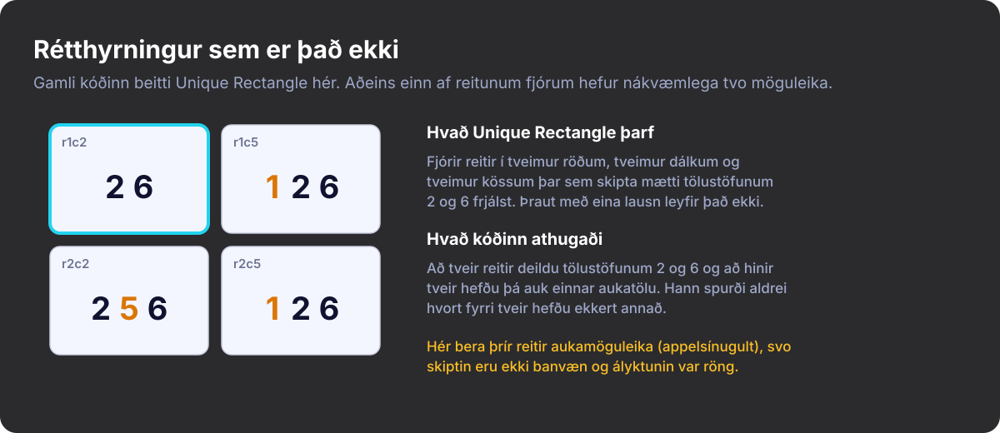
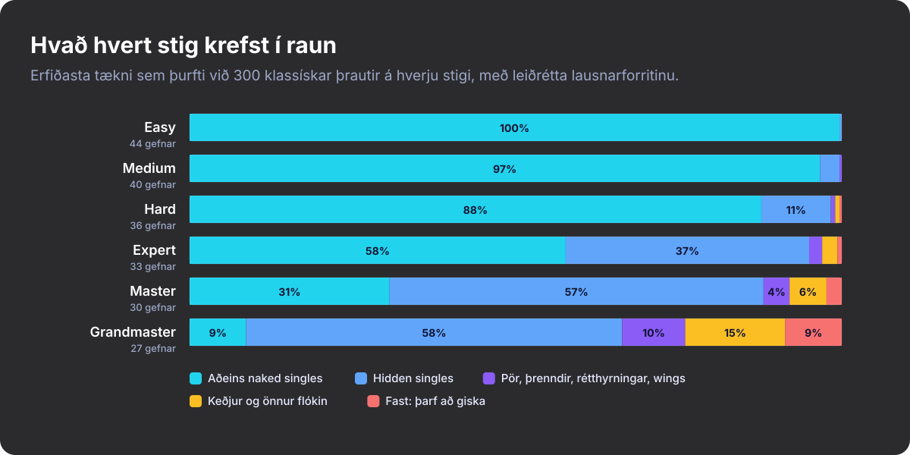
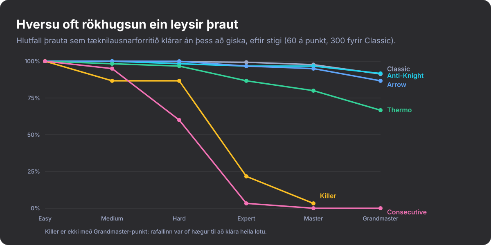

#+title: Sudoku er ekki einn leikur, annar hluti
#+subtitle: Lausnarforritið sem hafði rangt fyrir sér
#+date: <2026-11-17 09:00>
#+timezone: America/Port_of_Spain
#+language: is
#+options: toc:nil num:nil
#+description: Ég reyndi að meta erfiðleika sudoku-þrauta eftir því hvaða tækni þær krefjast. Fyrstu tölurnar voru della, því lausnarforritið mitt dró rangar ályktanir. Hvað ég fann, hvernig ég lagaði það og hvað fjöldi gefinna talna segir í raun.
#+hero: banner.is.svg
#+hero_alt: Sudoku-rist með fjórum appelsínugulum reitum, við hliðina á titlinum Lausnarforritið hafði rangt fyrir sér
#+filetags: :puzzles:sudoku:gamedev:rust:

* Þar sem ég hætti

Í lok [[file:../2026-10-27-sudoku-variants/index.org][síðustu færslu]] viðurkenndi ég dálítið um erfiðleika. Þegar ég bý til
Thermo-þraut er helsti stillirinn fjöldi gefinna talna. Færri gefnar tölur þýða
oftast meira að álykta, en ég sagði að þetta væri grófur stillir en ekki mælikvarði,
því ég hafði ekki mælt hversu mikla vinnu hitamælarnir unnu.

Þetta nagaði mig, og ekki bara af snyrtimennsku. Ruta, sudoku-leikurinn minn, hefur sex
erfiðleikastig, og í klassískum þrautum greinir ekkert þau að nema hversu margar
tölur eru prentaðar á borðið. Easy hefur 44 gefnar og Grandmaster 27. Leikurinn
nefnir líka tæknina sem vísbending notar, og hann er með þjálfara sem kennir
tæknina eina kennslustund í einu. Ég á því nú þegar eitthvað miklu betra en fjölda
gefinna talna: lausnarforrit sem vinnur eins og manneskja, eina nefnda tækni í einu,
og skráir hvert skref.

Þessi færsla fjallar um að nota það til að mæla erfiðleika almennilega. Úr því varð
önnur saga. Fyrstu tölurnar voru della, því lausnarforritið hafði stundum rangt fyrir
sér, og það tók tíma að finna út hvers vegna. Ég fer fyrst yfir mæliaðferðina, svo hvað
fór úrskeiðis, og svo tölurnar sem ég treysti núna. Mér finnst seinni helmingurinn
áhugaverðari en sá fyrri.

* Lausnarforrit sem útskýrir sig

Leikurinn hefur tvö lausnarforrit með ólík hlutverk. Hið fyrra er bakrakningarleitin
frá síðast. Hún giskar þegar hún þarf og það er hún sem athugar að búin til þraut
hafi nákvæmlega eina lausn. Hið síðara er =solve_human=, sem gerir allt annað. Það
giskar aldrei. Það fer í gegnum tæknina í fastri röð, þá einföldustu fyrst, beitir
fyrstu sem kemst áfram, skráir hvað það gerði og byrjar upp á nýtt, þar til það
klárar eða tæknin þrýtur.

Hvert skref er lítil færsla:

#+begin_src rust
pub struct HumanStep {
    pub technique: HumanTechnique,
    pub cells: Vec<CellId>,
    pub digits: Vec<u8>,
    pub placement: Option<(CellId, u8)>,
    pub eliminations: Vec<(CellId, u8)>,
}
#+end_src

Skref annaðhvort setur tölu eða fjarlægir möguleika, og það nefnir tæknina sem
réttlætir það. Tæknilistinn nær frá naked og hidden singles um pör, þrenndir, locked
candidates, fiska, wings og keðjur til unique rectangles og nokkurra annarra mynstra
sem byggja á því að þraut hafi aðeins eina lausn. Niðurstaðan kemur til baka með
einni af þremur stöðum:

#+begin_src rust
pub enum HumanSolveStatus {
    Solved,
    Stalled,
    Invalid,
}
#+end_src

=Solved= þýðir að hver reitur var fylltur með aðeins þeirri tækni sem það kann.
=Stalled= þýðir að engin tækni komst áfram, svo manneskja með þennan lista þyrfti að
giska. Hvort tveggja er í lagi. Erfið þraut getur fest sig, og það þýðir bara að
hún krefst einhvers sem lausnarforritið hefur ekki.

=Invalid= er annað. Það þýðir að lausnarforritið komst í stöðu með mótsögn, til dæmis
reit án möguleika. Það ætti að vera ómögulegt. Sérhver þraut sem rafallinn býr til
hefur nákvæmlega eina lausn, og rétt tækni fjarlægir aðeins möguleika sem geta ekki
staðist. Ef maður byrjar á gildri þraut og beitir réttri röksemdafærslu getur maður
endað leystur eða fastur, en aldrei í mótsögn. Ef þraut kemur einhvern tíma til baka
sem =Invalid= hefur einhver tækni fjarlægt tölu sem á heima þar.

Leikurinn notar nú þegar tækniskrárnar í eitthvað einfalt. Lítið fall raðar hverri
tækni frá 0 (naked single) upp í 5 (keðjur og önnur flókin mynstur), þar sem 6 er
frátekið fyrir tilraunir og villur, og erfiðasta tæknin sem lausn krefst er einkunn
þrautarinnar. Þannig er handvalinn listi Þraut vikunnar valinn, og sömu hugmynd vildi
ég beita á hvert stig og hvert afbrigði.

Tveir aðrir eiginleikar byggja á sömu skrám. Vísbendingarhnappurinn nefnir tæknina
og dregur fram reitina sem taka þátt. Tækniþjálfarinn spilar þraut áfram með
einföldum skrefum þar til tæknin sem kennslustund kennir er næst á dagskrá. Báðir
treysta því að =solve_human= hafi rétt fyrir sér. Rangt skref þar er meira en slæm
tölfræði. Það er vísbending sem biður spilara að fjarlægja tölu sem á heima þar, eða
kennslustund sem kennir mynstur sem er það ekki.

* Áætlunin og fyrstu tölurnar

Tilraunina var auðvelt að lýsa. Fyrir hvert stiganna sex bjó ég til 300 klassískar þrautir með
rafli leiksins sjálfs og fjölda gefinna talna stigsins. Keyra =solve_human= á hverja,
og skrá stöðuna og erfiðustu tæknina sem var notuð. Ef stigin þýða það sem nöfn þeirra
segja ættu erfiðari stig að krefjast erfiðari tækni.

Í kóðanum eru þetta aðeins nokkrar línur gegn opinberu viðmóti kjarnapakkans. Rafallinn
skilar þrautinni og lausn hennar, og =rank= er litla röðunarfallið frá því áðan:

#+begin_src rust
let (puzzle, solution) = generate_classic_9x9(clues, seed);
let result = solve_human(&puzzle.board, puzzle.constraints());
let hardest = result
    .steps
    .iter()
    .map(|step| step.technique)
    .max_by_key(|t| rank(*t));
#+end_src

Ég keyrði þetta yfir öll fræ, og dálkurinn =Solved= leit eðlilega út. Dálkurinn
=Invalid= gerði það ekki:

#+CAPTION: Klassískar þrautir sem enduðu Invalid, eftir stigi, með lausnarforritinu eins og það var þá. 300 þrautir hvert.
| Stig        | Gefnar | Endaði Invalid | Hlutfall |
|-------------+--------+----------------+----------|
| Easy        |     44 |              0 |       0% |
| Medium      |     40 |              0 |       0% |
| Hard        |     36 |              2 |     0,7% |
| Expert      |     33 |              9 |       3% |
| Master      |     30 |             28 |     9,3% |
| Grandmaster |     27 |             83 |    27,7% |

Meira en fjórðungur Grandmaster-þrauta endaði í mótsögn. Hlutfallið hækkaði eftir því
sem þrautirnar urðu strjálli, sem er skiljanlegt: strjálar þrautir þurfa flóknari
tækni, og það var flóknari tæknin sem fór út af sporinu.

Ég athugaði fyrst augljósa grunaða, rafallinn. Kannski höfðu sumar þrautir fleiri en
eina lausn, og tækni sem gerir ráð fyrir einkvæmni var leidd afvega. Ég keyrði
einkvæmnisathugunina á allar 900 þrautir þriggja erfiðustu stiganna. Hver og ein hafði
nákvæmlega eina lausn, svo þrautirnar voru í lagi.

Næst vildi ég finna hvaða tækni fór fyrst úrskeiðis. Hver þraut kemur með þekktri
lausn sinni, svo ég gat spilað skref lausnarforritsins og stöðvað við það fyrsta sem
fjarlægði tölu sem lausnin inniheldur í raun. Af þeim 120 villum í þessum 900
þrautum voru:

- 82 *Unique Rectangle Type 3B*.
- 28 *Simple Colouring*.
- 10 *Unique Rectangle Type 2*.

Allar voru útilokanir, og hver og ein fjarlægði rétta tölu. Lausnarforritið var því
ekki bara óheppið. Þrjár aðferðir voru ógildar.

* Rétthyrningurinn sem var það ekki

Unique Rectangles eru viðkvæmasta tæknin á listanum, svo ég byrjaði þar. Hugmyndin er
dálítið eins og mótsagnarsönnun sem kostar ekkert. Tökum fjóra reiti sem mynda
rétthyrning, í nákvæmlega tveimur röðum, tveimur dálkum og tveimur kössum. Segjum að
þeir gætu allir endað með aðeins tölurnar 2 og 6. Þá mætti skipta 2-unum og 6-unum og
fá aðra gilda lausn, og þraut með eina lausn leyfir það ekki. Því hlýtur að minnsta kosti
einn þessara reita að vera eitthvað annað, og það leyfir manni að fjarlægja möguleika.

Gallinn er sá að röksemdin virkar aðeins þegar mynstrið er raunverulega banvænt. Hér er
staðan sem felldi gamla kóðann, tekin úr raunverulegri þraut:

#+CAPTION: Staða þar sem gamli kóðinn beitti Unique Rectangle. Aðeins reiturinn með bláa útlínu hefur nákvæmlega tvo möguleika.
#+ATTR_HTML: :alt Fjórir reitir í rétthyrningi með möguleikana 2 6, 1 2 6, 2 5 6 og 1 2 6, aukamöguleikarnir í appelsínugulu

Þrír af fjórum reitum hafa þriðja möguleika (tölurnar í appelsínugulu). Til að
skiptiröksemdin haldi verða „gólf“-reitirnir að vera nákvæmlega parið, án nokkurs
annars sem þeir gætu geymt. Geti þeir geymt aðrar tölur býr það að skipta 2 og 6 ekki
til lausn á ný, og ekkert er sannað. Gamli kóðinn athugaði aðeins að tveir reitir
deildu tölunum 2 og 6. Hann athugaði aldrei að þeir geymdu ekkert annað. Út frá þessu
ósannaða mynstri fjarlægði hann síðan 1 úr reitnum í röð 2, dálki 3, og lausnin hefur
1 þar.

Annað vandamál var í sömu blokk. Þegar tveir „þak“-reitirnir bera ólíkar aukatölur,
segjum 1 í öðrum og 5 í hinum, virka þeir saman eins og einn reitur með {1, 5}. Það
leyfir aðeins að fjarlægja 1 og 5 úr restinni af röðinni ef einhver annar reitur í
röðinni er nákvæmlega {1, 5}, sem myndar naked pair. Kóðinn sleppti þessari kröfu og
fjarlægði tölurnar úr allri röðinni.

Ég lagaði hvort tveggja, og villurnar fóru úr 120 í 119. Ein. Það er auðmýkjandi
niðurstaða. Skýringin var sú að fallið inniheldur sömu rökfræðiblokkina tvisvar. Það
lítur út eins og afrit eftir fyrri breytingu, þar sem =if let=-útgáfa og =let ... else=-útgáfa
standa hvor á eftir annarri, og ég hafði aðeins lagað þá fyrri. Þegar seinna afritið
var lagað hurfu allar unique rectangle-villur. Lagfæringin er tveir litlir hlutar:
gólfið verður að vera nákvæmlega parið, og ólíkar aukatölur þurfa samsvarandi maka.

#+begin_src rust
// The floor must be exactly {a, b}: otherwise swapping a and b is
// not a deadly pattern and the deduction is unsound.
if pair_cells
    .iter()
    .any(|cell| candidates[cell.index(size)].len() != 2)
{
    continue;
}
#+end_src

* Litun með tilbúnum tengslum

Simple Colouring var næst, og það hafði tvo aðskilda galla. Tæknin skoðar eina tölu í
einu. Þar sem talan getur verið í nákvæmlega tveimur reitum í röð, dálki eða kassa eru
þessir tveir reitir tengdir: í öðrum er talan og í hinum ekki. Fylgi maður tengslunum
má lita reitina í tveimur litum sem skiptast á. Nákvæmlega einn liturinn er sá rétti.

Það gefur tvær leiðir til að útiloka. Ef tveir reitir í sama lit sjá hvor annan getur sá
litur ekki verið sá rétti, því tvö eintök af tölu væru í sama hópi. Þá er talan fjarlægð
úr hverjum reit þess litar. Og ef ólitaður reitur sér báða litina, þá missir reiturinn
töluna, sama hvor liturinn er réttur.

Gamli kóðinn byggði tengslin svona: fyrir hvern hóp tók hann reitina þar sem talan gat
verið og tengdi þá í pörum með =chunks(2)=. Það er rétt þegar möguleikarnir eru
nákvæmlega tveir, og býr til tengsl þegar þeir eru þrír eða fjórir. Hópur með fjórum
mögulegum reitum gefur engin sterk tengsl, því talan gæti verið í hverjum þeirra. Þá
fjarlægði kóðinn við útilokanirnar töluna úr /hinum/ reitum hópsins, ekki úr litnum sem
hafði verið hrakinn. Meðal hinna reitanna voru reitir í rétta litnum.

Eftir að rétthyrningarnir voru lagaðir féllu enn 90 af 900 þrautum, og 89 þeirra voru
Simple Colouring. Ég endurskrifaði fallið í kringum reglurnar tvær hér að ofan. Mikilvæga
línan er athugunin á fjölda möguleika:

#+begin_src rust
// Strong links: units where the digit fits in exactly two cells.
let inside: Vec<usize> = unit
    .iter()
    .filter_map(|c| position.get(c).copied())
    .collect();
if inside.len() == 2 {
    adjacency[inside[0]].push(inside[1]);
    adjacency[inside[1]].push(inside[0]);
}
#+end_src

Núverandi einingapróf fyrir þessa tækni þurfti að fara. Það setti töluna 1 sem eina
möguleikann í fjóra reiti í sömu röð, sem getur ekki gerst á raunverulegu borði, og
það bjóst við rangri útilokun. Próf sem krefst rangs svars er verra en ekkert próf.
Ég skipti því út fyrir próf sem keyrir tæknina á raunverulegum þrautum og athugar
hverja útilokun gegn þekktri lausn.

* Ein í viðbót, og svo próf með alvöru þrautum

Eftir endurskrifun litunarinnar féllu enn 12 af 900 þrautum, og allar 12 voru tæknin
Remote Pair. Kóðinn byggir snúningsreit með tveimur reitum sem báðir sjá hann, og
fjarlægir tölu úr reitum sem tveir þeirra sjá. Hann valdi ranga tvo. Talan er í öðrum
ytri reitanna, svo reitirnir sem á að hreinsa eru þeir sem sjá /báða ytri reitina/.
Kóðinn notaði snúningsreitinn og einn ytri reit í staðinn. Lagfæringin var ein lína:
=&[second, third]= varð =&[*first, third]=.

Eftir það keyrði ég sömu athugun yfir 1.800 þrautir þriggja erfiðustu stiganna: engin
þraut endaði =Invalid= og ekkert skref fjarlægði rétta tölu. Athugunin er nú varanlegt
próf. Fyrir 60 fræ leysir það klassíska þraut og Consecutive-þraut og fullyrðir tvennt
í hverju skrefi: sett tala passar við lausnina, og engin fjarlægð tala gerir það. Ég
keyrði það fyrst gegn gamla kóðanum til að ganga úr skugga um að það falli þar, og það
gerir það.

#+begin_src rust
for &(cell, digit) in &step.eliminations {
    assert_ne!(
        solution.get(cell),
        Some(digit),
        "{:?} removed the true digit",
        step.technique
    );
}
#+end_src

* Hvers vegna afbrigðin voru verri

Consecutive-þrautin í prófinu er þar ekki að ástæðulausu. Klassískar þrautir voru aðeins hluti
myndarinnar, og afbrigðin voru miklu verri:

#+CAPTION: Þrautir sem enduðu Invalid með gamla lausnarforritinu og því lagaða. 60 í hverri línu.
| Afbrigði og stig         | Gamalt | Lagað |
|--------------------------+--------+-------|
| Consecutive, Hard        |    43% |    0% |
| Consecutive, Expert      |    92% |    0% |
| Killer, Expert           |    72% |    0% |
| Killer, Master           |    92% |    0% |
| Sudoku X, Grandmaster    |    15% |    0% |
| Arrow, Grandmaster       |    12% |    0% |
| Anti-Knight, Grandmaster |     8% |    0% |

Consecutive-þrautir á stiginu Expert enduðu í mótsögn í 92% tilvika með gamla
lausnarforritinu. Mest af því voru sömu þrjár villurnar, bara miklu oftar rekist á þær.
Afbrigðisþrautir hafa færri tölur að vinna með, svo lausnarforritið grípur fyrr til
flóknari tækni, og hún var biluð. Lagfæring klassísku tækninnar fjarlægði nánast allt
þetta.

Nánast, en ekki allt. Ég keyrði lagaða lausnarforritið á 40 þrautir á stig fyrir þrjú
afbrigði án þess að breyta neinu öðru. Um ein þraut af hverjum fjörutíu, í Anti-Knight
og í Killer á stiginu Expert, endaði enn í mótsögn. Það var fjórða vandamálið, og það
er hugtakalegt frekar en innsláttarvilla. Ég rakti Anti-Knight-villu til BUG+1 og
Killer-villu til Unique Rectangle.

Unique Rectangles og BUG+1 hvíla á einni forsendu: að skipti á tveimur tölum innan
mynsturs gefi aðra gilda rist. Í klassísku sudoku stenst það, því einu reglurnar eru
raðir, dálkar og kassar, og skipti innan tveggja raða, tveggja dálka og tveggja kassa
brýtur enga þeirra. Í afbrigði stenst það ekki. Skipti maður á tveimur tölum í
Killer-búri getur búrsumman brotnað. Skipti maður á tveimur tölum í Anti-Knight-rist
getur riddaraleikur nú endurtekið sig. Mynstrið er ekki lengur banvænt, því aukareglan
útilokar skiptu ristina, og ályktunin „þessi þraut getur ekki haft tvær lausnir“ fylgir
ekki.

Einkvæmnistæknin er því aðeins örugg þegar sérhver regla er hópur þar sem hver tala
kemur einu sinni fyrir. Ég lét =solve_human= athuga þetta áður en það byrjar, og sleppa
þessum tveimur aðferðum ella:

#+begin_src rust
let uniqueness_safe = constraints
    .iter()
    .all(|c| matches!(c.name(), "row" | "column" | "region"));
#+end_src

Það er viljandi varfærið. Sudoku X hefur til dæmis sennilega marga rétthyrninga sem
væru í lagi, en hornalína er enn ein regla sem skipti getur brotið, og ég tapa heldur
tækni en held ógildri. Með þessa hindrun á sínum stað endaði engin afbrigðisþraut í
nokkurri keyrslu sem ég gerði í mótsögn.

* Hvernig erfiðleiki lítur í raun út

Með lausnarforrit sem ég gat treyst gerði ég tilraunina sem ég vildi allan tímann: 300
klassískar þrautir á stig, og skráði erfiðustu tæknina sem hver þarf.

#+CAPTION: Erfiðasta tæknin sem þurfti til að leysa 300 klassískar þrautir á hverju stigi. Prósentur eru hlutföll af þeim 300.
#+ATTR_HTML: :alt Staflaðir súlur fyrir sex erfiðleikastig sem sýna hlutfall þrauta sem þurfa aðeins naked singles, hidden singles, pör og rétthyrninga, keðjur, eða festast

Þetta tek ég úr því.

*Fjöldi gefinna talna virkar sem stillir.* Súlurnar hreyfast jafnt og þétt í rétta átt.
Nánast hver Easy-þraut fellur á naked singles einum, og í Grandmaster hefur blandan
færst yfir í hidden singles, með hala af erfiðari mynstrum. Ekkert við stigin er á
hvolfi.

*Stigin skarast mikið.* Í Grandmaster, með 27 gefnar, þurfa 26 af 300 þrautum (9%)
ekkert nema naked singles. Þær eru jafn auðveldar að klára og dæmigerð Easy-þraut, svo
spilari sem valdi Grandmaster til að fá áskorun fékk mjög lítið af henni. Á Expert
þurfa 58% þrauta aðeins naked singles. Það er sama tækni og leysir nánast hverja
Easy-þraut.

*Mest af klifrinu er frá naked til hidden singles.* Milli Medium og Grandmaster er það
sem breytist mest hversu oft maður þarf hidden single í stað naked. Aðeins um
fjórðungur Grandmaster-þrauta þarf eitthvað umfram hidden singles, og önnur 9% sigra
lausnarforritið algjörlega, svo þær þurfa tækni sem það hefur ekki, eða að giska.
Stigsheiti gefur til kynna stiga tækni, og gögnin sýna aðallega sömu tvær aðferðirnar í
ólíku hlutfalli.

*Neðsta stigið felur mikla dreifingu.* Grandmaster nær yfir allt frá þrautum sem þurfa
ekki meira en naked singles til þrauta sem lausnarforritið getur ekki klárað. Það er
það sem fjöldi gefinna talna gerir: hann stýrir því hversu mikið er prentað, og það sem
þrautin krefst ræðst af því hvar gefnu tölurnar lenda af tilviljun.

Ekkert af þessu kemur þeim á óvart sem leysir mikið sudoku. Samt er það annað að sjá
lögun þess. Ég hafði giskað á að stigin væru nokkurn veginn rétt, og það eru þau að
meðaltali. Vandinn er dreifingin innan hvers stigs.

* Að telja vinnuna, ekki bara tæknina

Erfiðasta tæknin er grófur mælikvarði, því tvær þrautir sem báðar ná hámarki við hidden singles
geta samt verið mjög ólíkar að lengd og tilfinningu. Í skrefaskránum er önnur tala sem
mér finnst segja meira. Lausnarforritið útilokar möguleika aðeins þegar það getur ekki sett
tölu, svo skref sem útilokar er stund þar sem bein röð innsetninga hefur þornað upp.
Að telja þær stundir segir hversu oft lausnarforrit neyðist til að hætta að setja og
byrja að rökhugsa.

#+CAPTION: Af klassísku þrautunum sem lausnarforrit hvers stigs kláraði: hversu margar þurftu yfirleitt einhverja útilokun.
| Stig        | Gefnar | Þurftu engar útilokanir | Flestar útilokanir í einni þraut |
|-------------+--------+-------------------------+----------------------------------|
| Easy        |     44 |                    100% |                                0 |
| Medium      |     40 |                   99,7% |                                1 |
| Hard        |     36 |                   98,7% |                                6 |
| Expert      |     33 |                   95,6% |                                6 |
| Master      |     30 |                   90,1% |                                6 |
| Grandmaster |     27 |                   72,6% |                               12 |

Mynstrið er skýrt. Í Master má klára níu þrautir af tíu með því að setja eina tölu á
eftir annarri, án nokkurrar rökhugsunar um blýantsmerkingar. Jafnvel í Grandmaster má
það í næstum þremur af fjórum. Í þeim þrautum felst erfiðleikinn í að koma auga á
næstu innsetningu, og innsetningarnar eru alltaf þar til að finna. Í fjórðungnum sem
eftir er þarf lausnarforritið að rökhugsa um möguleika, og þar er vinnan mjög breytileg,
frá einni útilokun upp í tylft.

Ég held að einkunn sem sameinar tölurnar tvær væri miklu betri en hvor um sig.
Erfiðasta tæknin segir hvað þraut krefst af manni á hátindinum, og fjöldi útilokana
segir hversu oft hún krefst þess. Þraut sem þarf einn X-Wing er önnur kvöldstund en sú
sem þarf sex útilokanir af ýmsu tagi.

* Fast er ekki það sama og erfitt

Sama tilraun á afbrigðunum var áhugaverðari. Ég keyrði 60 þrautir á stig fyrir hvert
og taldi hversu oft lausnarforritið kláraði án þess að giska:

#+CAPTION: Hlutfall þrauta sem tæknilausnarforritið klárar án þess að giska, eftir stigi. 60 þrautir á punkt, 300 fyrir Classic.
#+ATTR_HTML: :alt Línurit yfir hlutfall þrauta leystra með rökhugsun yfir sex stig fyrir Classic, Anti-Knight, Arrow, Thermo, Killer og Consecutive

Classic, Anti-Knight og Arrow haga sér svipað: nánast allt er leyst á lægri stigunum,
með vægu falli í Grandmaster. Thermo fellur hraðar, niður í tvo þriðju í Grandmaster.
Killer og Consecutive hrapa. Á Expert er aðeins um ein Killer-þraut af fimm leyst, og
aðeins tvær af 60 Consecutive-þrautum. Á Master festist Consecutive í hvert einasta
skipti.

Það væri auðvelt að lesa þetta sem „Consecutive Master er miklu erfiðara en Classic
Master“. Ég held að það sé ekki það sem þetta segir. Tækni lausnarforritsins snýst öll um
möguleika og hópa þar sem tala kemur einu sinni fyrir. Consecutive-strik segir að tveir
nágrannar séu einum frábrugðnir. Lausnarforritið getur aðeins nýtt það þegar annar
reiturinn geymir nú þegar tölu; strik milli tveggja tómra reita segir því ekkert.
Killer-búr er eins, með summum. Consecutive Master hefur um það bil 4 gefnar, og strikin
bera mest af upplýsingunum, svo lausnarforritið hefur mjög lítið að vinna með, og festist.

=Stalled= í þessum afbrigðum þýðir því ekki að þrautin sé erfið fyrir manneskju. Það
þýðir að þrautin þarf tækni sem er ekki á listanum. Góður Killer-lausnari veit að búr
með tveimur reitum og summu 3 hlýtur að vera {1, 2}, og að þrír reitir með summu 24
hljóta að vera {7, 8, 9}. Þetta er tækni afbrigðisins, og ég hef ekki skrifað hana enn.
Þar til ég geri það þýðir „þarf að giska“ fyrir Killer og Consecutive í raun „utan þess
sem lausnarforritið þekkir“.

Þetta er sami lærdómur og athugasemdin um hitamæla frá síðast, í skarpari mynd.
Erfiðleikatala tilheyrir lausnarforriti, ekki þraut. Tæknilisti lausnarforrits skilgreinir
hvað það getur séð, og allt utan listans birtist sem „erfitt“. Einkunnirnar fyrir Classic
eru áreiðanlegar því tæknilistinn fyrir Classic er langur og vel prófaður. Einkunnirnar
fyrir Killer myndu aðallega mæla hversu mikið lausnarforritið veit ekki.

* Hvað lagfæringin gerði við handvöldu listana

Ruta geymir 75 handvaldar þrautir: lista Þrautar vikunnar og fjögur sett fyrir mislangan
tíma. Hver er merkt erfiðustu tækninni sem hún þarf, og próf athugar að hægt sé að leysa
hverja færslu með rökhugsun einni. Ég vildi vita hvað lagfæringin gerði við þær, svo ég
keyrði hverja færslu aftur í gegnum leiðrétta lausnarforritið.

Sextíu og átta af 75 komu út nákvæmlega eins og merkt var. Allar færslur með naked
single, hidden single og naked pair héldu. Þær sjö sem breyttust voru allar merktar
„Unique rectangle“, og sú merking reyndist óáreiðanleg: af 18 færslum sem bera hana
lifa aðeins 11. Fjórar hinna þurfa aðra tækni, og þrjár er ekki lengur hægt að klára með
rökhugsun, svo þær þyrftu að giska.

Þetta er óþægileg niðurstaða, því þessir listar eru til að lofa einhverju: þessi þraut
þarf nefnda tækni og aldrei ágiskun. Fyrir sjö þrautir hvíldi loforðið á ályktunum sem
voru ekki gildar. Taflan er búin til af núverandi prófi, svo að búa hana til aftur er
venjubundið, og athugunin að hver færsla sé eingöngu rökleg þýðir nú eitthvað sem hún
þýddi ekki áður.

* Hvernig ég myndi prófa næstu tækni

Lærdómurinn sem ég myndi halda snýst um hvernig próf fyrir tækni ætti að líta út. Þrír
siðir hefðu fundið allar villurnar hér að ofan.

Sá fyrsti er að prófa gegn sannleikanum, ekki gegn kóðanum. Búnar til þrautir koma með
lausnum sínum, svo hægt er að athuga hverja innsetningu og útilokun gegn raunverulega
svarinu. Þessi eina fullyrðing fann öll fjögur vandamálin. Próf skrifað í höndunum út
frá lýsingu tækninnar getur aðeins staðfest að kóðinn geri það sem höfundur hans hélt
að hann ætti að gera.

Sá annar er að nota raunverulegar stöður. Gamla fixtúran fyrir Simple Colouring setti
tölu í fjóra reiti einnar raðar, stöðu sem engin þraut getur náð. Stöður úr raunverulegum
lausnum er alltaf hægt að ná, og þær innihalda erfiðu tilvikin sem handteiknaðar fixtúrur
sleppa, eins og rétthyrning þar sem aðeins sumir reitirnir hafa tvo möguleika.

Sá þriðji er að fullyrða að tæknin keyri í raun. Réttleikapróf sem kveikir aldrei á
tækninni stenst léttvægt. Nýja prófið fyrir Simple Colouring fellur ef engin þraut í
lotu þess notar tæknina, svo athugunin getur ekki hljóðlaust hætt að athuga.

Fjórða myndi ég bæta við fyrir afbrigði: keyra hverja tækni gegn hverju afbrigði í
leiknum, ekki bara Classic. Það er sú sem hefði fundið einkvæmnisforsenduna fyrsta
daginn.

* Hversu mikið á að treysta þessum tölum

Nokkur heiðarleg takmörk. Úrtökin eru hófleg: 300 þrautir á klassískt stig og 60 á
afbrigðisstig, úr einni keyrslu raðfræja. Prósenturnar í myndritunum gætu hreyfst um
nokkur stig með öðrum fræjum, og þau smáu, eins og 0,3% hér og þar, eru stakar þrautir.
Killer hefur engan Grandmaster-punkt, því of hægt var að búa til þær þrautir til að
klára lotu. Sudoku X, Jigsaw, Hyper og hin afbrigðin eru alls ekki í myndritunum.

Rafallinn sker auk þess niður í nákvæman fjölda gefinna talna, ekki í lágmarksþraut, svo
gefnar tölur stigs eru markmið. Og hver fullyrðing um „fast“ eða „þarf að giska“ er
afstæð við tæknilista þessa lausnarforrits. Stærri listi myndi lækka hlutfall fastra, og
fyrir afbrigðin myndi listi með réttu tækninni lækka það stórlega. Þessar tölur lýsa
lausnarforritinu eins og það er núna, og ég býst við að þær breytist þegar það vex.

* Hvað ég myndi gera næst

Hér er skýr röð verka. Fyrst: halda réttleikaprófinu og útvíkka það til allra afbrigða
sem leikurinn býður. Villa eins og þessar, í tækni, er hljóðlaus: vísbendingin segir
eitthvað sjálfsöruggt og rangt, og spilarinn missir traust á leiknum án þess að vita
hvers vegna. Eina áreiðanlega vörnin er að athuga hvert skref gegn þekktri lausn, og
úr því rafallinn lætur eina í té ókeypis er engin ástæða til að gera það ekki.

Í öðru lagi: kenna lausnarforritinu afbrigðin. Reglurnar fyrir Killer-búr og
Consecutive-strik eru góð fyrstu markmið, því þessi tvö afbrigði festast fyrst. Hver ný
tækni ætti að koma með sína eigin réttleikaathugun frá fyrsta degi.

Í þriðja lagi, og fyrst þá, breyta því hvernig erfiðleiki er valinn. Hugmyndin sem mér
líkar er að halda fjölda gefinna talna til að búa til þrautir, eins og nú, en meta hverja
búna þraut eftir erfiðustu tækninni sem hún þarf, og hafna þrautum sem
lenda utan síns stigs, og búa til nýjar í staðinn. Grandmaster-þraut sem fellur á naked singles yrði send til baka.
Leikurinn gerir nú þegar eitthvað svipað fyrir handvöldu listana, þar sem hver færsla er
staðfest sem leysanleg með rökhugsun einni. Að útvíkka það til dagsþrautarinnar er
náttúrulega næsta skref.

* Hvað ég tók með mér

*Lausnarforrit sem útskýrir sig er lausnarforrit sem hægt er að athuga.* Skrárnar um hvert
skref gerðu mér kleift að finna vandamálið. Hefði =solve_human= aðeins skilað dómi hefði
ég vitað að eitthvað væri að en ekki hvaða tækni, og væri enn að giska. Staðan =Invalid=
greip röngu ályktanirnar sem leiddu til mótsagnar. Þær sem gerðu það ekki voru
væntanlega líka til staðar, en ósýnilegar.

*Mældu mælitækið.* Ég lagði af stað til að mæla þrautir og endaði á að mæla
lausnarforritið. Fyrsta talnaröðin leit eðlilega út þar til ég skoðaði dálkinn sem ég hafði
ekki áhuga á. Það borgar sig að athuga dálkana sem maður ætlaði ekki að lesa.

*Próf eiga að fela í sér sannleikann, ekki kóðann.* Gamla prófið fyrir Simple Colouring
stóðst allan tímann, því það lýsti því sem kóðinn gerði, og það sem kóðinn gerði var rangt.
Nýja prófið ber hvert skref saman við þekkta lausn. Það er miklu erfiðara að blekkja það.

*Forsendur ferðast illa milli afbrigða.* Einkvæmnisröksemdin er yndisleg í Classic og
hljóðlaust röng í Killer. Hið sama mun henda hverja tækni sem ég bæti við: hver gerir
forsendur um reglurnar, og ég þarf að skrifa þær niður og athuga þær.

Ég finn enn afbrigði sem ég hef aldrei heyrt um, og ég vil enn spila þau öll. Ég vona
bara að það næsta fái lausnarforrit sem ég get trúað.
