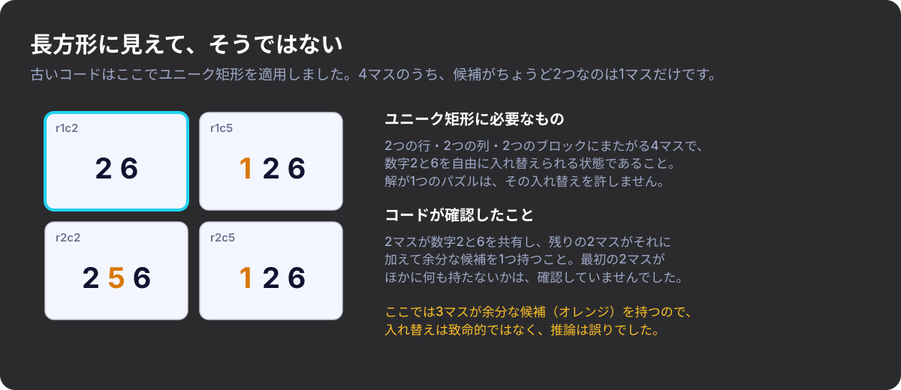
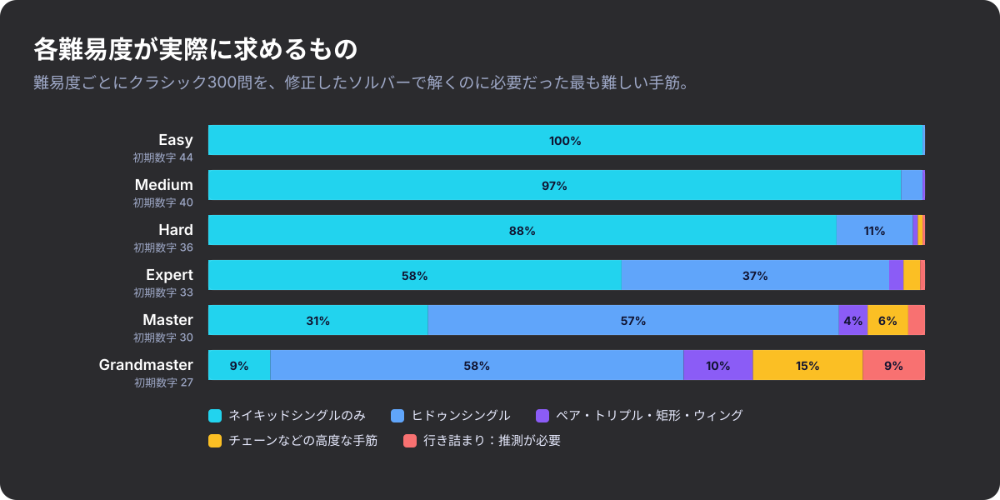
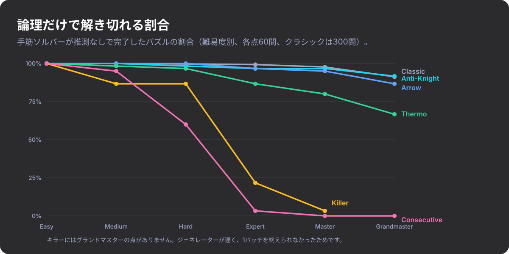

#+title: 数独は一つのゲームではない、パート2
#+subtitle: 間違っていたソルバー
#+date: <2026-11-17 09:00>
#+timezone: America/Port_of_Spain
#+language: ja
#+options: toc:nil num:nil
#+description: 数独の難易度を、パズルが必要とする手筋で評価しようとしました。最初の数字はでたらめでした。私のソルバーが誤った推論をしていたからです。何を見つけ、どう直したのか、そして初期数字の数が本当は何を語るのか。
#+hero: banner.ja.svg
#+hero_alt: 4マスがオレンジで強調された数独の盤面と、「ソルバーは間違っていた」というタイトル
#+filetags: :puzzles:sudoku:gamedev:rust:

* 前回の続き

[[file:../2026-10-27-sudoku-variants/index.org][前回の記事]]の終わりで、難易度について一つ認めたことがあります。Thermoパズルを生成するとき、主なつまみは初期数字の数です。初期数字が少ないほど、たいてい推論すべきことは増えますが、これは大まかなつまみであって尺度ではない、と書きました。温度計がどれだけ仕事をしているかを測っていなかったからです。

これが気になって仕方がありませんでした。単なる几帳面さからではありません。私の数独ゲーム Ruta には6つの難易度があり、クラシックのパズルでは、盤面に印刷されている数字の数だけがそれらを分けています。Easy は初期数字44個、Grandmaster は27個です。ゲームはヒントが使う手筋の名前も表示しますし、手筋を1レッスンずつ教えるトレーナーもあります。つまり、初期数字の数よりずっと良いものをすでに持っているのです。人間のように、名前のついた手筋を一つずつ使って解き、各ステップを記録するソルバーです。

この記事は、それを使って難易度をきちんと測る話です。結果として、別の物語になりました。最初の数字はでたらめで、ソルバーが時々間違っていたからです。理由を突き止めるのにはしばらくかかりました。まず測定の考え方を説明し、次に何が間違っていたか、そして今信頼できる数字を紹介します。後半のほうが前半より面白いと思います。

* 自分を説明するソルバー

ゲームには役割の違う2つのソルバーがあります。1つ目は前回のバックトラッキング探索です。必要なら推測し、生成したパズルの解がちょうど1つであることの確認に使われます。2つ目は =solve_human= で、これはまったく違うことをします。決して推測しません。手筋を決まった順序、簡単なものから順に試し、進展があった最初のものを適用し、何をしたかを記録して、解き終わるか手筋が尽きるまで繰り返します。

各ステップは小さなレコードです。

#+begin_src rust
pub struct HumanStep {
    pub technique: HumanTechnique,
    pub cells: Vec<CellId>,
    pub digits: Vec<u8>,
    pub placement: Option<(CellId, u8)>,
    pub eliminations: Vec<(CellId, u8)>,
}
#+end_src

ステップは数字を置くか、候補を消すかのどちらかで、それを正当化する手筋を明記します。手筋の一覧は、ネイキッドシングルとヒドゥンシングルから、ペア、トリプル、ロックトキャンディデイト、フィッシュ、ウィング、チェーンを経て、ユニーク矩形や、パズルの解が1つだけであることに頼るいくつかのパターンまで続きます。結果は3つの状態のどれかで返ります。

#+begin_src rust
pub enum HumanSolveStatus {
    Solved,
    Stalled,
    Invalid,
}
#+end_src

=Solved= は、知っている手筋だけですべてのマスが埋まったことを意味します。=Stalled= は、どの手筋でも進めなくなったことを意味し、この一覧を使う人は推測するしかありません。どちらも問題のない結果です。難しいパズルは行き詰まることがあり、それはソルバーが持っていないものが必要だというだけのことです。

=Invalid= は別です。候補が一つも残っていないマスのように、矛盾を含む局面にソルバーが到達したことを意味します。これは起こり得ないはずです。ジェネレーターが作るパズルはどれも解がちょうど1つで、正しい手筋は成り立ち得ない候補だけを消します。有効なパズルから正しい論理で進めば、解き終わるか行き詰まるかはあっても、矛盾に至ることは決してありません。パズルが =Invalid= で返ってきたなら、どこかの手筋が本来そこにある数字を消したということです。

ゲームはすでに手筋の記録を簡単な用途に使っています。小さな関数が各手筋を0（ネイキッドシングル）から5（チェーンなどの高度なパターン）までランク付けし、6は試行錯誤用にとってあります。解くのに必要な最も難しい手筋が、そのパズルの評価です。今週のパズルの手選びリストはこうして選ばれており、同じ考えをすべての難易度とバリエーションに適用したかったのです。

ほかの2つの機能も同じ記録に頼っています。ヒントボタンは手筋の名前を示し、関係するマスを強調します。手筋トレーナーは、レッスンで教える手筋が次に来るまで、簡単なステップでパズルを進めます。どちらも =solve_human= が正しいことを前提にしています。そこで間違ったステップが出るのは、悪い統計以上のことです。本来そこにある数字を消すようプレイヤーに告げるヒントであり、パターンでないものをパターンとして教えるレッスンです。

* 計画と最初の数字

実験は説明しやすいものでした。6つの難易度それぞれについて、ゲーム自身のジェネレーターで、その難易度の初期数字数のクラシックパズルを300問生成します。それぞれに=solve_human= を実行し、状態と使われた最も難しい手筋を記録します。難易度が名前のとおりなら、難しい難易度ほど難しい手筋を必要とするはずです。

コードでは、コアクレートの公開インターフェースに対するほんの数行です。ジェネレーターはパズルとその解を返し、=rank= は先ほどの小さなランク関数です。

#+begin_src rust
let (puzzle, solution) = generate_classic_9x9(clues, seed);
let result = solve_human(&puzzle.board, puzzle.constraints());
let hardest = result
    .steps
    .iter()
    .map(|step| step.technique)
    .max_by_key(|t| rank(*t));
#+end_src

すべてのシードで実行したところ、=Solved= の列はもっともらしく見えました。=Invalid=の列はそうではありませんでした。

#+CAPTION: 当時のソルバーで Invalid に終わったクラシックパズル（難易度別）。各300問。
| 難易度      | 初期数字 | Invalid | 割合  |
|-------------+----------+---------+-------|
| Easy        |       44 |       0 |    0% |
| Medium      |       40 |       0 |    0% |
| Hard        |       36 |       2 |  0.7% |
| Expert      |       33 |       9 |    3% |
| Master      |       30 |      28 |  9.3% |
| Grandmaster |       27 |      83 | 27.7% |

Grandmaster のパズルの4分の1以上が矛盾に終わりました。パズルが疎になるほど割合が上がります。これは納得できます。疎なパズルは高度な手筋を必要とし、誤作動していたのはその高度な手筋だったのです。

まず、一番怪しいジェネレーターを疑いました。解が複数あるパズルがあって、解の一意性を仮定する手筋が惑わされたのかもしれません。難しい3つの難易度の900問すべてに一意性チェックをかけました。どれも解はちょうど1つで、パズルに問題はありませんでした。

次に、どの手筋が最初に間違えたのかを調べました。各パズルには既知の解があるので、ソルバーのステップを再生し、解に実際に含まれる数字を最初に消したステップで止めることができます。この900問での120件の失敗の内訳は次のとおりです。

- 82件が *ユニーク矩形タイプ3B*。
- 28件が *Simple Colouring*。
- 10件が *ユニーク矩形タイプ2*。

すべて候補の消去で、どれも正しい数字を消していました。ソルバーは運が悪かったのではありません。3つの手筋が不健全だったのです。

* 矩形ではなかった矩形

ユニーク矩形は一覧の中で最も繊細な手筋なので、そこから始めました。考え方は、コストのかからない背理法のようなものです。ちょうど2つの行、2つの列、2つのブロックにまたがる、長方形をなす4マスを取ります。それらが最終的にすべて数字2と6だけを保持できるとします。すると2と6を入れ替えて別の有効な解が得られてしまいますが、解が1つのパズルはそれを許しません。したがって、少なくとも1マスは別のものでなければならず、そこから候補を消せます。

落とし穴は、この論証がパターンが本当に致命的なときにしか成り立たないことです。古いコードをつまずかせた局面を、実際のパズルから紹介します。

#+CAPTION: 古いコードがユニーク矩形を適用した局面。青く縁取られたマスだけが、ちょうど2つの候補を持つ。
#+ATTR_HTML: :alt 長方形に並ぶ4マスの候補が2 6、1 2 6、2 5 6、1 2 6で、余分な候補がオレンジ色で示されている

4マスのうち3マスが3つ目の候補（オレンジの数字）を持っています。入れ替えの論証が成り立つには、「床」のマスがちょうどそのペアでなければならず、ほかに入り得る数字があってはなりません。ほかの数字が入り得るなら、2と6を入れ替えても解は再現されず、何も証明されません。古いコードは、2マスが数字2と6を共有していることしか確認していませんでした。ほかに何も持っていないことは確認していなかったのです。その証明されていないパターンから、行2・列3のマスの1を消しましたが、解ではそこに1が入ります。

同じブロックに2つ目の問題がありました。2つの「屋根」のマスが異なる余分な数字を持つとき、たとえば一方が1、他方が5なら、2つ合わせて {1, 5} を持つ1マスのように働きます。それが許すのは、行の別のマスがちょうど {1, 5} である（ネイキッドペアになる）場合に限り、行のほかのマスから1と5を消すことです。コードはその条件を飛ばし、行全体から数字を消していました。

両方を直したところ、失敗は120件から119件になりました。1件だけです。これは反省させられる結果でした。理由は、関数の中に同じロジックのブロックが2つあったからです。以前の編集で残った複製のようで、=if let= 版と =let ... else= 版が続けて並んでおり、私は最初のほうしか直していませんでした。2つ目の複製を直すと、ユニーク矩形の失敗がすべてなくなりました。修正は2つの小さな部分です。床はちょうどペアでなければならないこと、そして異なる余分な数字には対応するパートナーが必要なことです。

#+begin_src rust
// The floor must be exactly {a, b}: otherwise swapping a and b is
// not a deadly pattern and the deduction is unsound.
if pair_cells
    .iter()
    .any(|cell| candidates[cell.index(size)].len() != 2)
{
    continue;
}
#+end_src

* 作り出されたリンクによる色分け

次は Simple Colouring で、これには2つの別々の欠陥がありました。この手筋は一度に1つの数字を見ます。行・列・ブロックの中で、その数字がちょうど2マスにしか入らないとき、その2マスはリンクされます。一方に数字が入り、もう一方には入りません。リンクをたどると、マスを交互の2色に塗り分けられます。正しい色はちょうど1つです。

これで2通りの消去ができます。同じ色の2マスが互いに見えているなら、その色は正しい色ではありえません。同じグループに数字が2つ入ってしまうからです。したがって、その色のすべてのマスから数字を消せます。また、色のついていないマスが両方の色を見ているなら、どちらの色が正しくても、そのマスはその数字を失います。

古いコードは、次のようにリンクを作っていました。各グループで数字が入り得るマスを取り、=chunks(2)= で2つずつリンクします。候補がちょうど2つなら正しいのですが、3つや4つあるとリンクを作り出してしまいます。候補マスが4つあるグループは強いリンクを与えません。数字はそのどれにでも入り得るからです。さらに、消去の際、コードは反証された色ではなく、グループの/ほかの/マスから数字を消していました。そのほかのマスには、正しい色のマスが含まれていました。

矩形を直した後も、900問のうち90問が失敗し、そのうち89問が Simple Colouring でした。上の2つのルールを軸に関数を書き直しました。重要なのは候補の数を確認する行です。

#+begin_src rust
// Strong links: units where the digit fits in exactly two cells.
let inside: Vec<usize> = unit
    .iter()
    .filter_map(|c| position.get(c).copied())
    .collect();
if inside.len() == 2 {
    adjacency[inside[0]].push(inside[1]);
    adjacency[inside[1]].push(inside[0]);
}
#+end_src

この手筋の既存のユニットテストは捨てることになりました。同じ行の4マスで数字1だけが候補になっていましたが、実際の盤面ではあり得ず、しかも誤った消去を期待していたからです。間違った答えに固執するテストは、テストがないよりたちが悪いものです。代わりに、実際のパズルで手筋を実行し、すべての消去を既知の解と照合するテストに置き換えました。

* もう一つ、そして実際のパズルでのテスト

色分けの書き直しの後も900問のうち12問が失敗し、12問すべてが Remote Pair という手筋でした。コードが作るのは、ピボットのマスと、それを見ている2つのマスで、そのうちの2マスから見えるマスから数字を消します。選ぶ2マスを間違えていました。数字は外側のどちらかのマスにあるので、消すべきは/外側の両方のマス/から見えるマスです。コードは代わりにピボットと外側の1マスを使っていました。修正は1行で、=&[second, third]= を=&[*first, third]= に変えるだけでした。

その後、難しい3つの難易度の1,800問で同じチェックを実行しました。=Invalid= で終わるパズルはなく、正しい数字を消したステップもありませんでした。このチェックは今では恒久的なテストです。60個のシードについて、クラシックと Consecutive のパズルを解き、すべてのステップで2つを検証します。置かれた数字は解と一致すること、そして消された数字は解と一致しないことです。まず古いコードで実行して失敗することを確かめました。実際に失敗します。

#+begin_src rust
for &(cell, digit) in &step.eliminations {
    assert_ne!(
        solution.get(cell),
        Some(digit),
        "{:?} removed the true digit",
        step.technique
    );
}
#+end_src

* バリエーションはなぜもっと悪かったのか

テストに Consecutive のパズルがあるのには理由があります。クラシックのパズルは全体の一部にすぎず、バリエーションはもっとひどい状態でした。

#+CAPTION: 古いソルバーと修正後のソルバーで Invalid に終わったパズル。各行60問。
| バリエーションと難易度   | 古いソルバー | 修正後 |
|--------------------------+--------------+--------|
| Consecutive, Hard        |          43% |     0% |
| Consecutive, Expert      |          92% |     0% |
| Killer, Expert           |          72% |     0% |
| Killer, Master           |          92% |     0% |
| Sudoku X, Grandmaster    |          15% |     0% |
| Arrow, Grandmaster       |          12% |     0% |
| Anti-Knight, Grandmaster |           8% |     0% |

Expert の Consecutive パズルは、古いソルバーでは92%が矛盾に終わりました。大半は同じ3つのバグが、はるかに頻繁に当たったものです。バリエーションのパズルは使える数字が少ないため、ソルバーは高度な手筋に早く手を伸ばし、その手筋が壊れていました。クラシックの手筋を直すと、ほとんどが消えました。

ほとんど、ですが、すべてではありません。ほかは何も変えずに、修正後のソルバーを3つのバリエーションで各難易度40問ずつ実行しました。Anti-Knight と、Expert の Killer で、およそ40問に1問がまだ矛盾に終わりました。これが4つ目の問題で、タイプミスではなく概念上のものです。Anti-Knight の失敗は BUG+1 に、Killer の失敗はユニーク矩形に、それぞれたどれました。

ユニーク矩形と BUG+1 は一つの仮定に基づいています。パターン内で2つの数字を入れ替えると、別の有効な盤面になるという仮定です。クラシックでは成り立ちます。ルールは行・列・ブロックだけで、2つの行・2つの列・2つのブロックの内側での入れ替えはそのどれも壊さないからです。バリエーションでは成り立ちません。Killer のケージ内で2つの数字を入れ替えるとケージの合計が崩れるかもしれません。Anti-Knight の盤面で2つの数字を入れ替えると、ナイトの動きで数字が重複するかもしれません。追加のルールが入れ替え後の盤面を排除するので、パターンはもはや致命的ではなく、「このパズルが2つの解を持つことはない」という推論は成り立ちません。

したがって、一意性の手筋は、すべてのルールが各数字が一度だけ現れるグループである場合にしか安全ではありません。=solve_human= に開始前にこれを確認させ、そうでなければその2つの手筋を飛ばすようにしました。

#+begin_src rust
let uniqueness_safe = constraints
    .iter()
    .all(|c| matches!(c.name(), "row" | "column" | "region"));
#+end_src

これはあえて保守的にしています。たとえば Sudoku X には問題のない矩形がおそらく多くありますが、対角線は入れ替えが壊しうるルールがもう1つ増えることなので、不健全な手筋を残すくらいなら手筋を失うほうを選びます。このゲートを入れてから、私が行ったどのバッチでも、矛盾に終わったバリエーションのパズルはありませんでした。

* 難易度は本当はどう見えるか

信頼できるソルバーを手に入れて、最初から望んでいた実験を行いました。難易度ごとにクラシックのパズル300問、それぞれが必要とする最も難しい手筋を記録します。

#+CAPTION: 各難易度のクラシックパズル300問を解くのに必要だった最も難しい手筋。割合は300問に対するものです。
#+ATTR_HTML: :alt 6つの難易度について、ネイキッドシングルのみ、ヒドゥンシングル、ペアと矩形、チェーン、行き詰まりが必要なパズルの割合を示す積み上げ棒グラフ

ここから私が読み取ったことです。

*初期数字の数は、つまみとして機能します。* 棒は着実に正しい方向へ動きます。Easy のほぼすべてのパズルはネイキッドシングルだけで解け、Grandmaster では構成がヒドゥンシングルへ移り、難しいパターンが尾を引きます。難易度に逆転は見られません。

*難易度は大きく重なります。* 初期数字27個の Grandmaster では、300問中26問（9%）がネイキッドシングルだけで解けます。典型的な Easy と同じくらい簡単に終わるので、挑戦を求めて Grandmaster を選んだプレイヤーは、ほとんど挑戦を得られませんでした。Expert では58%のパズルがネイキッドシングルだけで足ります。それは、ほぼすべての Easyを解くのと同じ手筋です。

*上昇の大半はネイキッドからヒドゥンシングルへの移行です。* Medium から Grandmasterにかけて最も変わるのは、ネイキッドではなくヒドゥンシングルが必要になる頻度です。Grandmaster のうちヒドゥンシングルを超える手筋が必要なのは約4分の1にすぎず、さらに9%はソルバーを完全に負かします。つまり、ソルバーが持たない手筋か、推測が必要です。難易度名は手筋の梯子を思わせますが、データが示すのは、ほぼ同じ2つの手筋が割合を変えているだけという姿です。

*最上位の難易度は大きな幅を隠しています。* Grandmaster は、ネイキッドシングルまでで済むパズルから、ソルバーが終えられないパズルまでを含みます。初期数字の数が決めるのは印刷される量だけで、パズルが何を要求するかは、初期数字がたまたまどこに落ちるかで決まります。

たくさん数独を解く人には驚きではないでしょう。それでも、その形を実際に見るのは別のことです。難易度はおおむね正しいだろうと推測していましたし、平均的には正しいのです。問題は各難易度の中のばらつきです。

* 手筋だけでなく、作業量も数える

最も難しい手筋は大雑把な尺度です。どちらもヒドゥンシングルが頂点のパズルでも、長さや手応えはまったく違いえます。ステップの記録にはもう一つ、より示唆的だと思う数字があります。ソルバーは数字を置けないときにだけ候補を消すので、消去を行うステップは、置くだけで進める流れが途切れた瞬間です。その瞬間を数えれば、ソルバーが置くのをやめて推論を始めなければならない頻度がわかります。

#+CAPTION: 各難易度のソルバーが解き終えたクラシックパズルのうち、消去を一度でも必要としたものの数。
| 難易度      | 初期数字 | 消去不要 | 1問での最大消去数 |
|-------------+----------+----------+-------------------|
| Easy        |       44 |     100% |                 0 |
| Medium      |       40 |    99.7% |                 1 |
| Hard        |       36 |    98.7% |                 6 |
| Expert      |       33 |    95.6% |                 6 |
| Master      |       30 |    90.1% |                 6 |
| Grandmaster |       27 |    72.6% |                12 |

パターンは際立っています。Master では10問中9問が、数字を次々に置くだけで、鉛筆メモの推論なしに終わります。Grandmaster でも、4問中ほぼ3問がそうです。それらのパズルでは、難しいのは次の置き場所を見つけることで、置き場所は必ず見つかります。残りの4分の1では、ソルバーは候補について推論しなければならず、そこでは作業量が1回の消去から十数回まで大きくばらつきます。

2つの数字を組み合わせた評価のほうが、どちらか1つよりずっと良いと思います。最も難しい手筋は、パズルが頂点でどれだけを要求するかを示し、消去回数は、どれくらいの頻度で要求するかを示します。X-Wing が1回必要なパズルと、さまざまな種類の消去が6回必要なパズルとでは、費やす夜が違います。

* Stalled は難しいという意味ではない

同じ実験をバリエーションでやると、もっと面白くなりました。各バリエーションで難易度ごとに60問を実行し、ソルバーが推測せずに解き終える頻度を数えました。

#+CAPTION: 手筋ソルバーが推測なしで解き終えたパズルの割合（難易度別）。各点60問、クラシックは300問。
#+ATTR_HTML: :alt Classic、Anti-Knight、Arrow、Thermo、Killer、Consecutive の6難易度について、論理で解けたパズルの割合を示す折れ線グラフ

Classic、Anti-Knight、Arrow は似た挙動を示します。低い難易度ではほぼすべて解け、Grandmaster で緩やかに下がります。Thermo はもっと速く下がり、Grandmaster で3分の2になります。Killer と Consecutive は断崖のように落ちます。Expert で解けるのはKiller のパズルが5問に約1問、Consecutive は60問中わずか2問です。Master ではConsecutive は毎回行き詰まります。

これを「Consecutive の Master は Classic の Master よりずっと難しい」と読むのは簡単です。でも、そうは言っていないと思います。ソルバーの手筋はすべて、候補と、数字が一度だけ現れるグループについてのものです。Consecutive のバーは、隣り合う2マスが1だけ違うことを示します。ソルバーがそれを使えるのは、2マスの一方がすでに数字を持っているときだけで、空の2マスの間のバーは何も教えてくれません。Killer のケージも同じで、合計に置き換わるだけです。Consecutive の Master は初期数字が約4個で、情報の大半をバーが担っているため、ソルバーが使える材料はごくわずかで、行き詰まります。

したがって、これらのバリエーションでの =Stalled= は、パズルが人間にとって難しいという意味ではありません。一覧にない手筋が必要だという意味です。優れた Killer の解き手は、合計3の2マスのケージは {1, 2} でなければならず、合計24の3マスは{7, 8, 9} でなければならないと知っています。これらはバリエーションの手筋で、まだ書いていません。書くまでは、Killer と Consecutive での「推測が必要」は、実際には「ソルバーの知識の外」という意味です。

これは前回の温度計についての発言と同じ教訓を、より鋭くしたものです。難易度の数字はパズルではなくソルバーに属します。ソルバーの手筋一覧が見えるものを決め、一覧の外にあるものは「難しい」と映ります。クラシックのランクが信頼できるのは、クラシックの手筋一覧が長く、よくテストされているからです。Killer のランクが測るのは、主にソルバーが何を知らないかになるでしょう。

* 修正が手選びリストに与えた影響

Ruta には手選びのパズルが75問あります。今週のパズルのリストと、所要時間別の4つのセットです。それぞれ必要な最も難しい手筋のラベルが付いており、すべての項目が論理だけで解けることをテストが確認しています。修正が何をもたらしたかを知りたくて、すべての項目を修正後のソルバーに通し直しました。

75問のうち68問は、ラベルどおりの結果でした。ネイキッドシングル、ヒドゥンシングル、ネイキッドペアの項目はすべて保たれました。変わった7問は、すべて「ユニーク矩形」とラベルされたもので、このラベルは当てにならないことがわかりました。それを持つ18項目のうち、残るのは11項目だけです。ほかの4項目は別の手筋が必要で、3項目はもう論理では解き切れず、推測が必要になります。

これは気まずい結果です。それらのリストは、このパズルは名前のついた手筋を必要とし、推測は決して必要としない、という約束をするためにあるからです。7問では、その約束が有効でない推論の上に成り立っていました。表は既存のテストが生成するので、再生成は日常の作業で、すべての項目が論理のみで解けるというチェックは、以前にはなかった意味を持つようになりました。

* 次の手筋をどうテストするか

私が持ち帰る教訓は、手筋のテストがどうあるべきかということです。次の3つの習慣があれば、上のバグはすべて見つかっていました。

1つ目は、コードではなく正解に対してテストすることです。生成されたパズルには解が付いてくるので、すべての配置と消去を本当の答えと照合できます。この一つの検証が4つの問題すべてを見つけました。手筋の説明から手で書いたテストは、コードが作者の思ったとおりに動くことを確認できるだけです。

2つ目は、実際の局面を使うことです。古い Simple Colouring のフィクスチャは、1行の4マスに数字を置いていましたが、どのパズルにも到達できない局面です。実際の解答過程から取った局面は常に到達可能で、手で描いたフィクスチャが落とす厄介なケース、たとえば一部のマスだけが候補2つの矩形を含んでいます。

3つ目は、手筋が実際に動いていることを検証することです。手筋を一度も発動しない健全性テストは、自明に通ってしまいます。新しい Simple Colouring のテストは、バッチのどのパズルもその手筋を使わなければ失敗するので、チェックが黙って機能を止めることはありません。

バリエーションにはもう一つ加えます。Classic だけでなく、ゲームのすべてのバリエーションですべての手筋を実行することです。一意性の仮定を初日に見つけたのは、これでした。

* この数字をどこまで信頼するか

いくつかの正直な限界があります。サンプルサイズは控えめです。クラシックの難易度ごとに300問、バリエーションの難易度ごとに60問で、連続したシードの1回の実行から取ったものです。グラフのパーセンテージは、別のシードなら数ポイント動く可能性があり、あちこちの0.3%のような小さな値は、1問分です。Killer には Grandmaster の点がありません。それらのパズルの生成が遅すぎて、バッチを終えられなかったからです。Sudoku X、Jigsaw、Hyper などのバリエーションは、グラフにまったく含まれていません。

また、ジェネレーターは最小のパズルではなく、正確な初期数字数まで削ります。したがって難易度の初期数字は目標値です。そして、「行き詰まり」や「推測が必要」についてのあらゆる記述は、このソルバーの手筋一覧に対して相対的です。一覧が大きくなれば行き詰まりの割合は下がり、バリエーションでは適切な手筋を持つ一覧があれば、劇的に下がるでしょう。これらの数字は現在のソルバーを記述するもので、成長すれば変わると予想しています。

* 次にやること

作業には明確な順序があります。まず、健全性テストを残し、ゲームが提供するすべてのバリエーションに広げます。手筋におけるこのようなバグは静かです。ヒントは自信満々に間違ったことを言い、プレイヤーは理由もわからずゲームへの信頼を失います。唯一の確実な防御は、すべてのステップを既知の解と照合することで、ジェネレーターがそれを無料で提供してくれる以上、やらない理由はありません。

2つ目は、ソルバーにバリエーションを教えることです。Killer のケージのルールとConsecutive のバーのルールは、最初の目標に向いています。その2つのバリエーションが最も早く行き詰まるからです。新しい手筋はそれぞれ、初日から自前の健全性チェックを伴うべきです。

3つ目は、そのあとで初めて、難易度の選び方を変えることです。私が気に入っている案は、パズル生成には今までどおり初期数字の数を使いつつ、生成された各パズルを必要な最も難しい手筋で評価し、難易度の範囲から外れたパズルを却下するか、やり直すことです。ネイキッドシングルで落ちる Grandmaster のパズルは、突き返されます。ゲームは手選びリストですでに似たことをしており、すべての項目が論理だけで解けることが検証されています。それを毎日のパズルへ広げるのが、自然な次のステップです。

* 学んだこと

*自分を説明するソルバーは、検証できるソルバーです。* 各ステップの記録のおかげで問題を見つけられました。=solve_human= が判定だけを返していたら、何かがおかしいとはわかっても、どの手筋なのかはわからず、まだ推測していたでしょう。=Invalid= の状態は、矛盾に至った誤った推論を捕まえました。そうならなかったものも、おそらく存在していたはずですが、見えなかったのです。

*測る道具も測りましょう。* 私はパズルを測ろうとして、結局ソルバーを測っていました。最初の数字は、関心のなかった列を見るまでは、もっともらしく見えていました。読むつもりのなかった列も確認する価値があります。

*テストはコードではなく、真実を表すべきです。* 古い Simple Colouring のテストはずっと通っていました。コードが何をしているかを記述していて、コードのしていることが間違っていたからです。新しいテストはすべてのステップを既知の解と比較します。ずっと騙しにくいテストです。

*仮定はバリエーションをまたぐと通用しなくなります。* 一意性の論証はクラシックでは美しく、Killer では静かに誤っています。これから加えるすべての手筋にも同じことが起こります。それぞれがルールについての仮定を置いているので、その仮定を書き出して確認しなければなりません。

私はまだ聞いたことのないバリエーションを見つけ続けていて、まだそのすべてを遊びたいと思っています。次のバリエーションには、信じられるソルバーがつくことを願っています。
