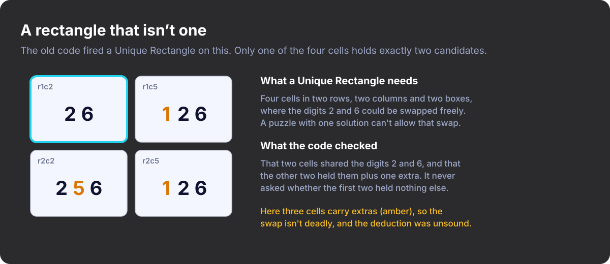
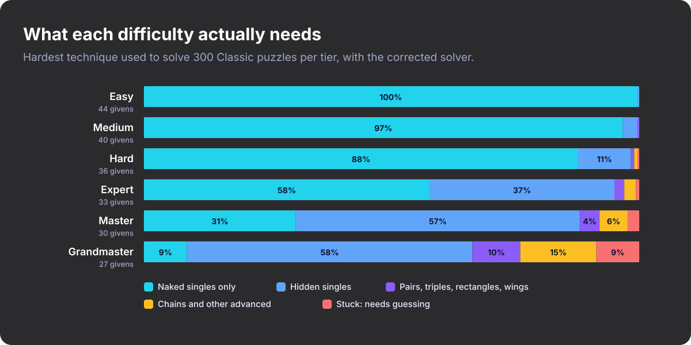
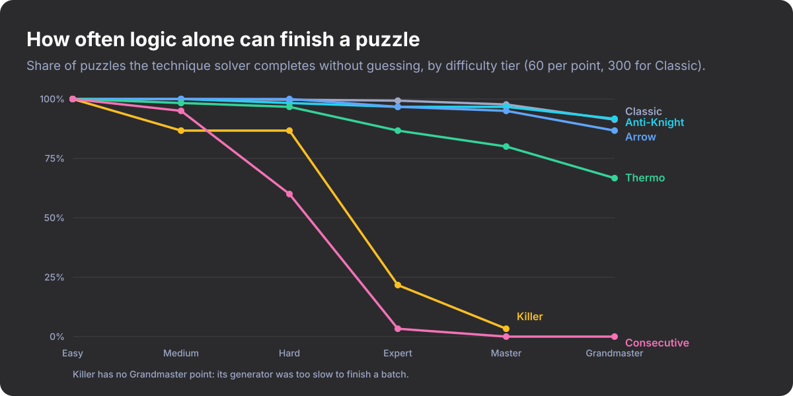

#+title: Sudoku Isn't One Game, Part Two
#+subtitle: The Solver That Was Wrong
#+date: <2026-11-17 09:00>
#+timezone: America/Port_of_Spain
#+language: en-GB
#+options: toc:nil num:nil
#+description: I tried to rate Sudoku difficulty by the techniques a puzzle needs. The first numbers were nonsense, because my solver was making wrong deductions. What I found, how I fixed it, and what clue counts really tell you.
#+hero: banner.svg
#+hero_alt: A Sudoku grid with four cells highlighted in amber, next to the title The solver was wrong
#+filetags: :puzzles:sudoku:gamedev:rust:

* Where I left off

At the end of [[file:../2026-10-27-sudoku-variants/index.org][the last post]] I admitted something about difficulty. When I
generate a Thermo puzzle, the main dial is the number of given digits. Fewer
givens usually means more to deduce, but I said it was a rough dial and not a
measure, because I didn't measure how much work the thermometers did.

That bothered me, and not only as a matter of tidiness. Ruta, my Sudoku game, has six difficulty tiers, and for Classic puzzles the only thing that separates them is how many digits are printed on the board. Easy has 44 givens and Grandmaster has 27. The game
also names the technique a hint uses, and it has a trainer that teaches those
techniques one lesson at a time. So I already own something much better than a
clue count: a solver that works like a person, one named technique at a time,
and records each step.

This post is about using it to measure difficulty properly. It turned into a
different story. The first numbers were nonsense, because the solver was
sometimes wrong, and finding out why took a while. I'll cover the
measuring idea first, then what went wrong, then the numbers I trust now. I
think the second half is more interesting than the first.

* A solver that explains itself

The game has two solvers, and they have different jobs. The first is the
backtracking search from last time. It guesses when it has to, and it's what
checks that a generated puzzle has exactly one solution. The second is
=solve_human=, which does something quite different. It never guesses. It works through its techniques in a fixed order, simplest first, applies the first one that makes progress, records what it did, and goes round again until it finishes or runs out of techniques.

Each step is a small record:

#+begin_src rust
pub struct HumanStep {
    pub technique: HumanTechnique,
    pub cells: Vec<CellId>,
    pub digits: Vec<u8>,
    pub placement: Option<(CellId, u8)>,
    pub eliminations: Vec<(CellId, u8)>,
}
#+end_src

A step either places a digit or removes candidates, and it says which technique
justified that. The technique list runs from naked and hidden singles through
pairs, triples, locked candidates, fish, wings and chains, to unique rectangles
and a few other patterns that lean on a puzzle having only one solution. The
result comes back with one of three statuses:

#+begin_src rust
pub enum HumanSolveStatus {
    Solved,
    Stalled,
    Invalid,
}
#+end_src

=Solved= means every cell was filled using only the techniques it knows.
=Stalled= means no technique could make progress, so a person using this list
would have to guess. Both are fine results. A hard puzzle can stall, and that
just means it needs something the solver doesn't have.

=Invalid= is different. It means the solver reached a position with a
contradiction in it, such as a cell with no candidates left. That should be
impossible. Every puzzle the generator produces has exactly one solution, and
a sound technique only removes candidates that can't be right. Starting from a
valid puzzle and applying sound logic, you can end up solved or stuck, but never
in a contradiction. If a puzzle ever comes back =Invalid=, some technique has
removed a digit that belongs.

The game already uses the technique records for something simple. A small function ranks each technique from 0 (naked single) up to 5 (chains and other advanced patterns), with 6 reserved for trial and error, and the hardest technique a solve needs is the puzzle's
rating. That's how the hand-picked Puzzle of the Week list is chosen, and it's
the same idea I wanted to apply to every difficulty tier and every variant.

Two other features lean on the same records. The hint button names the technique
and highlights the cells involved. The technique trainer plays a puzzle forward
with simple steps until the technique a lesson teaches is the next one waiting.
Both trust =solve_human= to be right. A wrong step there is more than a bad
statistic. It's a hint that tells a player to remove a digit that belongs, or a
lesson that teaches a pattern that isn't one.

* The plan, and the first numbers

The experiment was easy to describe. For each of the six tiers, generate 300
Classic puzzles using the game's own generator with the tier's clue count. Run
=solve_human= on each, and record the status and the hardest technique used. If
the tiers mean what their names say, harder tiers should need harder
techniques.

In code, the heart of it is only a few lines against the core crate's public
interface. The generator hands back the puzzle and its solution, and
=rank= is the small ranking function from earlier:

#+begin_src rust
let (puzzle, solution) = generate_classic_9x9(clues, seed);
let result = solve_human(&puzzle.board, puzzle.constraints());
let hardest = result
    .steps
    .iter()
    .map(|step| step.technique)
    .max_by_key(|t| rank(*t));
#+end_src

I ran it over every seed, and the =Solved= column looked plausible. The =Invalid=
column did not:

#+CAPTION: Classic puzzles ending in Invalid, per tier, with the solver as it stood. 300 puzzles each.
| Tier        | Givens | Ended Invalid | Share |
|-------------+--------+---------------+-------|
| Easy        |     44 |             0 |    0% |
| Medium      |     40 |             0 |    0% |
| Hard        |     36 |             2 |  0.7% |
| Expert      |     33 |             9 |    3% |
| Master      |     30 |            28 |  9.3% |
| Grandmaster |     27 |            83 |  27.7% |

More than a quarter of Grandmaster puzzles ended in a contradiction. The rate
rose as puzzles got sparser, which makes sense: sparse puzzles need the fancier
techniques, and it's the fancier techniques that were misfiring.

I first checked the obvious suspect, the generator. Maybe some of these puzzles
had more than one solution, and a technique that assumed uniqueness was
being misled. I ran the uniqueness check on all 900 puzzles from the three
hardest tiers. Every one had exactly one solution, so the puzzles were fine.

The next step was to find out which technique went wrong first. Each puzzle comes
with its known solution, so I could replay the solver's steps and stop at the
first one that removed a digit the solution actually contains. Of the 120
failures in those 900 puzzles:

- 82 were *Unique Rectangle Type 3B*.
- 28 were *Simple Colouring*.
- 10 were *Unique Rectangle Type 2*.

All of them were eliminations, and every one removed a true digit. So the solver
wasn't unlucky. Three techniques were unsound.

* The rectangle that wasn't

Unique Rectangles are the most delicate technique in the list, so I started
there. The idea is a bit like a proof by contradiction that costs nothing. Take
four cells that form a rectangle, in exactly two rows, two columns and two
boxes. Suppose they could all end up holding just the digits 2 and 6. Then you
could swap the 2s and 6s and get a second valid solution, and a puzzle with a
single solution can't allow that. So at least one of those cells must be
something else, and that lets you remove candidates.

The catch is that the argument only works when the pattern really is
deadly. Here's the position that tripped the old code, taken from a real puzzle:

#+CAPTION: A position where the old code applied a Unique Rectangle. Only the cell outlined in blue holds exactly two candidates.
#+ATTR_HTML: :alt Four cells in a rectangle with candidates 2 6, 1 2 6, 2 5 6 and 1 2 6, with the extra candidates in amber

Three of the four cells have a third candidate (the digits in amber). For the
swap argument to work, the 'floor' cells have to be exactly the pair, with
nothing else they could hold. If they can hold other digits, swapping 2 and 6
doesn't recreate a solution, and nothing has been proved. The old code only
checked that two of the cells shared the digits 2 and 6. It never checked that
they held nothing else. From that unproved pattern it then removed a 1 from
the cell at row 2, column 3, and the solution has a 1 there.

There was a second problem in the same block. When the two 'roof' cells carry
different extra digits, say a 1 in one and a 5 in the other, they act together
like a single cell holding {1, 5}. That only lets you eliminate 1 and 5 from
the rest of the row if some other cell in the row is exactly {1, 5}, which
makes a naked pair. The code skipped that requirement and removed the digits
from the whole row.

I fixed both, and the failures went from 120 to 119. One. That's a humbling result. The explanation was that the function contains the same block of logic twice. It looks like a copy left over from an
earlier edit, where an =if let= version and a =let ... else= version sit
one after the other, and I'd patched only the first. Fixing the second copy
removed every unique rectangle failure. The fix is two small pieces: the floor
must be exactly the pair, and different extras need a matching partner.

#+begin_src rust
// The floor must be exactly {a, b}: otherwise swapping a and b is
// not a deadly pattern and the deduction is unsound.
if pair_cells
    .iter()
    .any(|cell| candidates[cell.index(size)].len() != 2)
{
    continue;
}
#+end_src

* Colouring with invented links

Simple Colouring was next, and it had two separate faults. This technique looks
at one digit at a time. Wherever the digit can go in exactly two cells of a
row, column or box, those two cells are linked: one of them holds the digit and
the other doesn't. Follow the links and you can colour the cells in two
alternating colours. Exactly one colour is the true one.

That gives two ways to eliminate. If two cells of the same colour can see each
other, that colour can't be the true one, because two copies of a digit would sit
in the same group. So the digit is removed from every cell of that colour. And if
an uncoloured cell sees both colours, then whichever colour is true, the cell
loses the digit.

The old code built the links like this: for every group, it took the cells where
the digit could go and linked them in pairs with =chunks(2)=. That's right when
there are exactly two candidates, and it invents links when there are three or
four. A group with four candidate cells doesn't give you a strong link, because
the digit could be in any of them. Then, for the eliminations, the code
removed the digit from the /other/ cells of the group, not from the colour that
had been disproved. Those other cells included cells of the true colour.

With rectangles fixed, 90 of the 900 puzzles still failed, and 89 of those were Simple Colouring. I rewrote the function around the two rules above. The important line is the
check on the number of candidates:

#+begin_src rust
// Strong links: units where the digit fits in exactly two cells.
let inside: Vec<usize> = unit
    .iter()
    .filter_map(|c| position.get(c).copied())
    .collect();
if inside.len() == 2 {
    adjacency[inside[0]].push(inside[1]);
    adjacency[inside[1]].push(inside[0]);
}
#+end_src

The existing unit test for this technique had to go. It placed the digit 1 as the
only candidate in four cells of the same row, which can't happen on a real board,
and it expected the buggy elimination. A test that insists on a wrong answer is
worse than no test. I replaced it with one that runs the technique on real
puzzles and checks every elimination against the known solution.

* One more, and then a real puzzle test

After the colouring rewrite, 12 of the 900 puzzles still failed, and all 12 were the technique called Remote Pair. What the code builds is a pivot cell with two
cells that each see it, and it removes a digit from cells seen by two of them.
It chose the wrong two. The digit is in one of the outer cells, so the cells to
clear are the ones that see /both outer cells/. The code used the pivot and one
outer cell instead. The fix was a single line, swapping =&[second, third]= for
=&[*first, third]=.

After that, I ran the same check over 1,800 puzzles from the three hardest tiers:
no puzzle ended =Invalid= and no step removed a true digit. The check is now a
permanent test. For 60 seeds it solves a Classic puzzle and a Consecutive puzzle
and asserts two things on every step: a placed digit matches the solution, and
no eliminated digit does. I ran it against the old code first, to make sure it
fails there, and it does.

#+begin_src rust
for &(cell, digit) in &step.eliminations {
    assert_ne!(
        solution.get(cell),
        Some(digit),
        "{:?} removed the true digit",
        step.technique
    );
}
#+end_src

* Why the variants were worse

That Consecutive puzzle in the test is there for a reason. Classic puzzles were
only part of the picture, and the variants were much worse:

#+CAPTION: Puzzles ending in Invalid with the old solver, and with the fixed one. 60 per row.
| Variant and tier         | Old solver | Fixed |
|--------------------------+------------+-------|
| Consecutive, Hard        |        43% |    0% |
| Consecutive, Expert      |        92% |    0% |
| Killer, Expert           |        72% |    0% |
| Killer, Master           |        92% |    0% |
| Sudoku X, Grandmaster    |        15% |    0% |
| Arrow, Grandmaster       |        12% |    0% |
| Anti-Knight, Grandmaster |         8% |    0% |

Expert Consecutive puzzles ended in a contradiction 92% of the time with the old
solver. Most of that was the same three bugs, hit far more often. Variant puzzles
have fewer digits to work with, so the solver reaches for its advanced
techniques sooner, and those were the broken ones. Fixing the classic
techniques removed almost all of it.

Almost, but not all. I ran the fixed solver on 40 puzzles per tier of each of
three variants with nothing else changed. About one puzzle in forty, in Anti-Knight
and in Killer at its Expert tier, still ended in a contradiction. That was a
fourth problem, and it's a conceptual one rather than a typo. I traced an
Anti-Knight failure to BUG+1 and a Killer one to Unique Rectangle.

Unique Rectangles and BUG+1 rest on one assumption: that swapping two digits
inside a pattern gives another valid grid. In Classic that's true, because the
only rules are rows, columns and boxes, and a swap inside two rows, two columns
and two boxes breaks none of them. In a variant it isn't. Swap two digits in a
Killer cage and the cage sum may break. Swap two digits in an Anti-Knight grid
and a knight's move may now repeat. The pattern is no longer deadly, because the
extra rule rules the swapped grid out, and the deduction that 'this puzzle
can't have two solutions' doesn't follow.

So the uniqueness techniques are only safe when every rule is a group where each
digit appears once. I made =solve_human= check this before it starts, and skip
those two techniques otherwise:

#+begin_src rust
let uniqueness_safe = constraints
    .iter()
    .all(|c| matches!(c.name(), "row" | "column" | "region"));
#+end_src

That's deliberately conservative. Sudoku X, for example, probably has many
rectangles that would be fine, but a diagonal is one more rule that a swap can
break, so I'd rather lose a technique than keep an unsound one. With that gate in place, no variant puzzle in any batch I ran ended in a contradiction.

* What difficulty really looks like

With a solver I could trust, I ran the experiment I'd wanted all along: 300
Classic puzzles per tier, recording the hardest technique each one needs.

#+CAPTION: The hardest technique needed to solve 300 Classic puzzles at each tier. Percentages are shares of the 300.
#+ATTR_HTML: :alt Stacked bars for six difficulty tiers showing the share of puzzles needing naked singles only, hidden singles, pairs and rectangles, chains, or stuck

Here's what I take from it.

*Clue count does work as a dial.* The bars move steadily the right way. Almost
every Easy puzzle falls to naked singles alone, and by Grandmaster the mix has
shifted to hidden singles, with a tail of harder patterns. Nothing about the
tiers is upside down.

*The tiers overlap a lot.* At Grandmaster, with 27 givens, 26 of the 300 puzzles
(9%) need nothing but naked singles. They're as easy to finish as a typical Easy
puzzle, so a player who picked Grandmaster for a challenge got very little of one. At Expert,
58% of puzzles need only naked singles. That's the same technique that solves
nearly every Easy puzzle.

*Most of the climb is from naked to hidden singles.* Between Medium and
Grandmaster, the thing that changes most is how often you need a hidden single
instead of a naked one. Only about a quarter of Grandmaster puzzles need
anything beyond hidden singles, and another 9% defeat the solver entirely, so
they need techniques it doesn't have, or guessing. A tier name suggests a ladder
of techniques, and what the data shows is mostly the same two techniques in
different proportions.

*The bottom tier hides a big spread.* Grandmaster covers everything from
puzzles needing no more than naked singles to puzzles the solver can't finish.
That's what a clue count does: it controls how much is printed, and what the
puzzle demands comes from where the clues happen to fall.

None of this is a surprise to anyone who solves a lot of Sudoku. Still, it's a
different thing to see the shape of it. I'd guessed that the tiers were roughly
right, and they are, on average. The trouble is the variance within each tier.

* Counting the work as well as the technique

The hardest technique is a blunt measure, because two puzzles that both top out
at hidden singles can still be very different in length and feel. There's a
second number in the step records that I find more telling. The solver only
eliminates candidates when it can't place a digit, so a step that eliminates is
a moment where a straightforward run of placements has dried up. Counting those
moments says how often a solver is forced to stop placing and start reasoning.

#+CAPTION: Among the Classic puzzles each tier's solver finished, how many needed any elimination at all.
| Tier        | Givens | Needed no eliminations | Most eliminations in one puzzle |
|-------------+--------+------------------------+---------------------------------|
| Easy        |     44 |                   100% |                               0 |
| Medium      |     40 |                  99.7% |                               1 |
| Hard        |     36 |                  98.7% |                               6 |
| Expert      |     33 |                  95.6% |                               6 |
| Master      |     30 |                  90.1% |                               6 |
| Grandmaster |     27 |                  72.6% |                              12 |

The pattern is stark. At Master, nine puzzles in ten can be finished by placing
one digit after another, with no pencil-mark reasoning at all. Even at
Grandmaster, nearly three in four can. In those puzzles the hard part is
spotting the next placement, and the placements are always there to be found.
The remaining quarter is where the solver has to reason about candidates, and
there the work varies widely, from a single elimination to a dozen.

I think a rating that combines the two numbers would be much better than either
one. The hardest technique says what a puzzle asks of you at its peak, and the
elimination count says how often it asks. A puzzle that needs one X-Wing is a
different evening from one that needs six eliminations of several kinds.

* Stalled is not the same as hard

The same experiment on the variants was more interesting. I ran 60 puzzles per tier
for each, and counted how often the solver finished without guessing:

#+CAPTION: Share of puzzles the technique solver finishes without guessing, per tier. 60 puzzles per point, 300 for Classic.
#+ATTR_HTML: :alt Line chart of the share of puzzles solved by logic across six tiers for Classic, Anti-Knight, Arrow, Thermo, Killer and Consecutive

Classic, Anti-Knight and Arrow behave alike: nearly everything is solved at the
low tiers, with a gentle fall at Grandmaster. Thermo falls faster, to two
thirds by Grandmaster. Killer and Consecutive fall off a cliff. At Expert only
about one Killer puzzle in five is solved, and only two of 60 Consecutive
puzzles at Expert. By Master, Consecutive stalls every single time.

It would be easy to read that as 'Consecutive Master is much harder than Classic
Master'. I don't think that's what it says. The solver's techniques are all
about candidates and groups where a digit appears once. A Consecutive bar says
two neighbours differ by one. The solver can use that only when one of the two
cells already holds a digit; a bar between two empty cells tells it nothing. A
Killer cage is the same, with sums. Consecutive Master has about 4 givens, and
the bars carry most of the information, so the solver has very little to work
with, and it stalls.

So =Stalled= in these variants doesn't mean the puzzle is hard for a person. It
means the puzzle needs techniques that aren't in the list. A good Killer solver
knows that a two-cell cage summing to 3 must be {1, 2}, and that three cells
summing to 24 must be {7, 8, 9}. Those are the techniques of the variant, and I
haven't written them yet. Until I do, 'needs guessing' for Killer and
Consecutive really means 'outside what the solver knows'.

That's the same lesson as last time's remark about thermometers, in a sharper
form. A difficulty number belongs to a solver, not to a puzzle. A solver's
technique list defines what it can see, and anything outside that list shows up
as 'hard'. The ranks for Classic are trustworthy because the technique list for
Classic is long and well tested. The ranks for Killer would mostly measure how
much the solver doesn't know.

* What the fix did to the hand-picked lists

Ruta keeps 75 hand-picked puzzles: the Puzzle of the Week list and four sets for
different amounts of time. Each one is labelled with the hardest technique it
needs, and a test checks that every entry can be solved by logic alone. I wanted
to know what the fix did to them, so I re-ran every entry through the corrected
solver.

Sixty-eight of the 75 came out exactly as labelled. All the naked-single,
hidden-single and naked-pair entries held. The seven that changed were all
labelled 'Unique rectangle', and that label turned out to be unreliable: of 18
entries carrying it, only 11 survive. Four of the others need a different
technique, and three can't be finished by logic at all any more, so they'd need
guessing.

That's an uncomfortable result, because those lists exist to promise something:
this puzzle needs a named technique and never a guess. For seven puzzles the
promise rested on deductions that weren't valid. The table is generated by an
existing test, so regenerating it is routine, and the check that every entry is
logic-only now means something it didn't before.

* How I'd test the next technique

The lesson I'd keep from this is about what a test for a technique should look
like. Three habits would have caught every bug above.

The first is to test against ground truth, not against the code. Generated
puzzles come with their solutions, so every placement and elimination can be
checked against the real answer. That single assertion found all four problems.
A test written by hand from the technique's own description can only confirm
that the code does what its author thought it should.

The second is to use real positions. The old Simple Colouring fixture put a
digit in four cells of one row, a position no puzzle can reach. Positions from
real solves are always reachable, and they contain the awkward cases that
hand-drawn fixtures leave out, such as a rectangle where only some of the cells
are bivalue.

The third is to assert that the technique actually runs. A soundness test that
never fires the technique passes trivially. The new Simple Colouring test fails
if no puzzle in its batch uses the technique, so the check can't quietly stop
checking.

I'd add a fourth for variants: run every technique against every variant in the
game, not only Classic. That's the one that would have caught the uniqueness
assumption on day one.

* How far to trust these numbers

A few honest limits. The sample sizes are modest: 300 puzzles per Classic tier
and 60 per variant tier, drawn from a single run of consecutive seeds. The
percentages in the charts could move by a few points with different seeds, and
the small ones, like the 0.3% here and there, are single puzzles. Killer has no
Grandmaster point, because generating those puzzles was too slow to finish a
batch. Sudoku X, Jigsaw, Hyper and the other variants aren't in the charts at all.

The generator also carves down to an exact clue count, not to a minimal puzzle,
so a tier's givens are a target. And every statement about 'stalled' or
'needs guessing' is relative to this solver's technique list. A bigger list
would move the stalled share down, and for the variants, a list with the right
techniques would move it down dramatically. These numbers describe the solver
as it is now, and I'd expect them to change as it grows.

* What I'd do next

There's a clear order of work here. First, keep the soundness test and extend it
to every variant the game offers. A bug like these, in a technique, is silent:
the hint says something confident and wrong, and the player loses trust in the
game without knowing why. The only reliable defence is to check every step
against a known solution, and since the generator provides one for free, there's
no reason not to.

Second, teach the solver the variants. The Killer cage rules and the Consecutive
bar rules are good first targets, because those two variants stall earliest.
Each new technique should come with its own soundness check from day one.

Third, only then change how difficulty is chosen. The idea I like is to keep the
clue count for generating puzzles, as now, but to rate each generated puzzle by
the hardest technique it needs, and to reject or re-roll puzzles that land
outside their tier. A Grandmaster puzzle that falls to naked singles would be
thrown back. The game already does something like this for the hand-picked
lists, where every entry is verified to be solvable by logic alone. Extending
that to the daily puzzle is the natural next step.

* What I took away

*A solver that explains itself is a solver you can check.* The records of each
step are what let me find the problem. If =solve_human= had only returned a verdict, I'd have known something was wrong but not which technique, and I'd still be guessing. The =Invalid= status caught the wrong deductions that led to a contradiction. Any that didn't were presumably there too, but invisible.

*Measure the measuring tool.* I set out to measure puzzles and ended up
measuring the solver. The first set of numbers looked reasonable until I
looked at the column I wasn't interested in. It's worth checking the columns you
weren't planning to read.

*Tests should encode the truth, not the code.* The old Simple Colouring test passed all along, because it described what the code did, and what the code did
was wrong. The new test compares every step to a known solution. That's a much
harder test to fool.

*Assumptions travel badly between variants.* The uniqueness argument is lovely
in Classic and quietly false in Killer. The same thing will happen to every
technique I add: each one makes assumptions about the rules, and I need to write
those assumptions down, and check them.

I'm still finding variants I've never heard of, and I still want to play them
all. I just hope the next one gets a solver I can believe.
