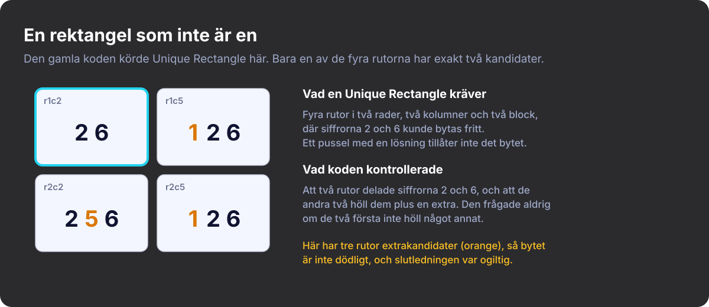
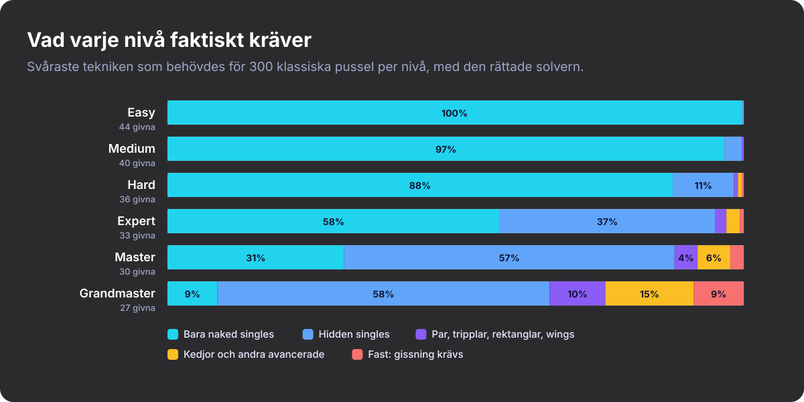
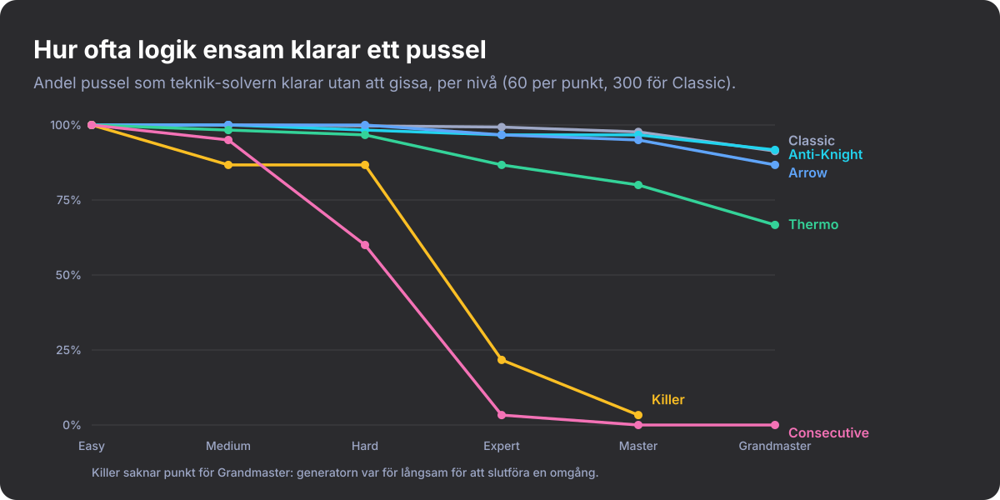

#+title: Sudoku är inte ett enda spel, del två
#+subtitle: Solvern som hade fel
#+date: <2026-11-17 09:00>
#+timezone: America/Port_of_Spain
#+language: sv
#+options: toc:nil num:nil
#+description: Jag försökte betygsätta sudokusvårighet efter vilka tekniker ett pussel kräver. De första siffrorna var nonsens, eftersom min solver drog felaktiga slutsatser. Vad jag hittade, hur jag rättade det och vad antalet givna siffror egentligen säger.
#+hero: banner.sv.svg
#+hero_alt: Ett sudokurutnät med fyra orangemarkerade rutor, bredvid titeln Solvern hade fel
#+filetags: :puzzles:sudoku:gamedev:rust:

* Där jag slutade

I slutet av [[file:../2026-10-27-sudoku-variants/index.org][förra inlägget]] erkände jag något om svårighet. När jag
genererar ett Thermo-pussel är det främsta reglaget antalet givna siffror. Färre
givna betyder oftast mer att dra slutsatser om, men jag sa att det var ett grovt
reglage och inte ett mått, eftersom jag inte hade mätt hur mycket arbete
termometrarna gjorde.

Det störde mig, och inte bara av ordningsskäl. Ruta, mitt sudokuspel, har sex
svårighetsnivåer, och för klassiska pussel skiljer de sig bara åt i hur många
siffror som är tryckta på brädet. Easy har 44 givna och Grandmaster 27. Spelet
anger också vilken teknik en ledtråd använder, och det har en tränare som lär ut
teknikerna lektion för lektion. Jag äger alltså redan något mycket bättre än ett
antal givna: en solver som arbetar som en människa, en namngiven teknik i taget, och
som loggar varje steg.

Det här inlägget handlar om att använda den för att mäta svårighet ordentligt. Det
blev en annan historia. De första siffrorna var nonsens, eftersom solvern ibland
hade fel, och att ta reda på varför tog en stund. Jag går först igenom
mätidén, sedan vad som gick fel och sedan siffrorna jag litar på nu. Jag tycker att
den andra halvan är mer intressant än den första.

* En solver som förklarar sig

Spelet har två solvers med olika uppgifter. Den första är backtracking-sökningen
från förra gången. Den gissar när den måste, och det är den som kontrollerar att
ett genererat pussel har exakt en lösning. Den andra är =solve_human=, som gör något
helt annat. Den gissar aldrig. Den går igenom sina tekniker i fast ordning, den
enklaste först, tillämpar den första som kommer framåt, loggar vad den gjorde och
börjar om, tills den är klar eller får slut på tekniker.

Varje steg är en liten post:

#+begin_src rust
pub struct HumanStep {
    pub technique: HumanTechnique,
    pub cells: Vec<CellId>,
    pub digits: Vec<u8>,
    pub placement: Option<(CellId, u8)>,
    pub eliminations: Vec<(CellId, u8)>,
}
#+end_src

Ett steg placerar antingen en siffra eller tar bort kandidater, och det anger vilken
teknik som motiverar det. Tekniklistan går från naked och hidden singles via par,
trippler, locked candidates, fish, wings och kedjor till unique rectangles och några
andra mönster som förutsätter att ett pussel bara har en lösning. Resultatet
kommer tillbaka med en av tre statusar:

#+begin_src rust
pub enum HumanSolveStatus {
    Solved,
    Stalled,
    Invalid,
}
#+end_src

=Solved= betyder att varje ruta fylldes med bara de tekniker den kan.
=Stalled= betyder att ingen teknik kom vidare, så en person med den här listan
skulle behöva gissa. Båda är bra utfall. Ett svårt pussel kan fastna, och det
betyder bara att det kräver något solvern inte har.

=Invalid= är annorlunda. Det betyder att solvern nådde en ställning med en
motsägelse, till exempel en ruta utan kandidater kvar. Det borde vara omöjligt.
Varje pussel generatorn gör har exakt en lösning, och en korrekt teknik tar bara
bort kandidater som inte kan stämma. Utgår man från ett giltigt pussel och drar
korrekta slutsatser kan man hamna i ett löst eller fastlåst läge, men aldrig i en motsägelse.
Om ett pussel någonsin kommer tillbaka som =Invalid= har någon teknik tagit bort en
siffra som hör dit.

Spelet använder redan teknikloggarna till något enkelt. En liten funktion rangordnar
varje teknik från 0 (naked single) till 5 (kedjor och andra avancerade mönster),
med 6 reserverat för trial and error, och den svåraste tekniken en lösning kräver
är pusslets betyg. Så väljs den handplockade listan för Veckans pussel, och
samma idé ville jag tillämpa på varje nivå och varje variant.

Två andra funktioner bygger på samma poster. Ledtrådsknappen anger tekniken och
markerar de berörda rutorna. Teknikträningen spelar ett pussel framåt med enkla
steg tills tekniken en lektion lär ut är nästa i tur. Båda litar på att
=solve_human= har rätt. Ett felaktigt steg där är mer än dålig statistik. Det är en
ledtråd som ber en spelare ta bort en siffra som hör dit, eller en lektion som lär
ut ett mönster som inte är ett.

* Planen och de första siffrorna

Experimentet var lätt att beskriva. För var och en av de sex nivåerna genererade jag
300 klassiska pussel med spelets egen generator och nivåns antal givna. Kör
=solve_human= på varje, och anteckna status och den svåraste använda tekniken. Om
nivåerna betyder det deras namn säger borde svårare nivåer kräva svårare tekniker.

I koden är kärnan bara några rader mot kärn-cratets publika gränssnitt. Generatorn
ger pusslet och dess lösning, och =rank= är den lilla rangfunktionen från tidigare:

#+begin_src rust
let (puzzle, solution) = generate_classic_9x9(clues, seed);
let result = solve_human(&puzzle.board, puzzle.constraints());
let hardest = result
    .steps
    .iter()
    .map(|step| step.technique)
    .max_by_key(|t| rank(*t));
#+end_src

Jag körde det över alla seeds, och kolumnen =Solved= såg rimlig ut. Kolumnen
=Invalid= gjorde det inte:

#+CAPTION: Klassiska pussel som slutade Invalid, per nivå, med solvern som den var då. 300 pussel vardera.
| Nivå        | Givna | Slutade Invalid | Andel |
|-------------+-------+-----------------+-------|
| Easy        |    44 |               0 |    0% |
| Medium      |    40 |               0 |    0% |
| Hard        |    36 |               2 |  0,7% |
| Expert      |    33 |               9 |    3% |
| Master      |    30 |              28 |  9,3% |
| Grandmaster |    27 |              83 | 27,7% |

Mer än en fjärdedel av Grandmaster-pusslen slutade i en motsägelse. Andelen steg
ju glesare pusslen blev, vilket är logiskt: glesa pussel kräver de mer avancerade
teknikerna, och det var de avancerade teknikerna som slog fel.

Jag kontrollerade först den främsta misstänkte, generatorn. Kanske hade några
pussel mer än en lösning, och en teknik som förutsätter entydighet vilseleddes. Jag
körde entydighetskontrollen på alla 900 pussel från de tre svåraste nivåerna. Varje
pussel hade exakt en lösning, så pusslen var i sin ordning.

Nästa steg var att ta reda på vilken teknik som gick fel först. Varje pussel har sin
kända lösning, så jag kunde spela upp solverns steg och stanna vid det första som
tog bort en siffra som lösningen faktiskt innehåller. Av de 120 felen i de 900
pusslen var:

- 82 *Unique Rectangle Type 3B*.
- 28 *Simple Colouring*.
- 10 *Unique Rectangle Type 2*.

Alla var elimineringar, och var och en tog bort en sann siffra. Solvern var alltså inte
bara otursförföljd. Tre tekniker var ogiltiga.

* Rektangeln som inte var en

Unique Rectangles är den mest ömtåliga tekniken i listan, så jag började där. Idén
liknar ett motsägelsebevis som inte kostar något. Ta fyra rutor som bildar en
rektangel, i exakt två rader, två kolumner och två block. Anta att de till slut
kunde innehålla bara siffrorna 2 och 6. Då kunde man byta 2:orna och 6:orna och få
en andra giltig lösning, och ett pussel med en enda lösning tillåter inte det. Alltså
måste minst en av rutorna vara något annat, och då kan man ta bort kandidater.

Haken är att argumentet bara fungerar när mönstret verkligen är dödligt. Här är
ställningen som fick den gamla koden att snubbla, hämtad från ett riktigt pussel:

#+CAPTION: En ställning där den gamla koden tillämpade en Unique Rectangle. Bara rutan med blå kant har exakt två kandidater.
#+ATTR_HTML: :alt Fyra rutor i en rektangel med kandidaterna 2 6, 1 2 6, 2 5 6 och 1 2 6, med de extra kandidaterna i orange

Tre av de fyra rutorna har en tredje kandidat (siffrorna i orange). För att
bytesargumentet ska fungera måste "golv"-rutorna vara exakt paret, utan något annat
de skulle kunna hålla. Kan de hålla andra siffror återskapar inte ett byte av 2 och
6 någon lösning, och inget är bevisat. Den gamla koden kontrollerade bara att två av
rutorna delade siffrorna 2 och 6. Den kontrollerade aldrig att de inte höll något
annat. Från det obevisade mönstret tog den sedan bort en 1 från rutan i rad 2,
kolumn 3, och lösningen har en 1 där.

Det fanns ett andra problem i samma block. När de två "tak"-rutorna bär olika
extrasiffror, säg en 1 i den ena och en 5 i den andra, fungerar de tillsammans som
en enda ruta med {1, 5}. Det ger bara rätt att ta bort 1 och 5 från resten av raden om
någon annan ruta i raden är exakt {1, 5}, vilket ger ett naked pair. Koden hoppade
över det kravet och tog bort siffrorna från hela raden.

Jag rättade båda, och felen gick från 120 till 119. Ett. Det är ett ödmjukande
resultat. Förklaringen var att funktionen innehåller samma logikblock två gånger.
Det ser ut som en kopia kvar från en tidigare ändring, där en =if let=-version och
en =let ... else=-version ligger efter varandra, och jag hade bara lagat den första.
Att laga den andra kopian tog bort varje unique rectangle-fel. Rättelsen består av
två små delar: golvet måste vara exakt paret, och olika extrasiffror kräver en
matchande partner.

#+begin_src rust
// The floor must be exactly {a, b}: otherwise swapping a and b is
// not a deadly pattern and the deduction is unsound.
if pair_cells
    .iter()
    .any(|cell| candidates[cell.index(size)].len() != 2)
{
    continue;
}
#+end_src

* Färgläggning med påhittade länkar

Simple Colouring var näst på tur, och den hade två separata fel. Tekniken tittar på
en siffra i taget. Där siffran kan stå i exakt två rutor i en rad, kolumn eller ett
block är de två rutorna länkade: i en av dem står siffran och i den andra inte. Följer
man länkarna kan man färga rutorna i två omväxlande färger. Exakt en färg är den
sanna.

Det ger två sätt att eliminera. Om två rutor av samma färg ser varandra kan den
färgen inte vara den sanna, eftersom två exemplar av en siffra då skulle stå i
samma grupp. Då tas siffran bort från varje ruta av den färgen. Och om en ofärgad
ruta ser båda färgerna förlorar rutan siffran, oavsett vilken färg som är sann.

Den gamla koden byggde länkarna så här: för varje grupp tog den rutorna där siffran
kunde stå och länkade dem parvis med =chunks(2)=. Det är rätt när det finns exakt två
kandidater, och det hittar på länkar när det finns tre eller fyra. En grupp med fyra
kandidatrutor ger ingen stark länk, eftersom siffran kan stå i vilken som helst av
dem. Dessutom tog koden vid elimineringarna bort siffran från gruppens /andra/ rutor,
inte från den färg som hade motbevisats. Bland de andra rutorna fanns rutor av den
sanna färgen.

Med rektanglarna rättade föll fortfarande 90 av de 900 pusslen, och 89 av dem var
Simple Colouring. Jag skrev om funktionen kring de två reglerna ovan. Den viktiga
raden är kontrollen av antalet kandidater:

#+begin_src rust
// Strong links: units where the digit fits in exactly two cells.
let inside: Vec<usize> = unit
    .iter()
    .filter_map(|c| position.get(c).copied())
    .collect();
if inside.len() == 2 {
    adjacency[inside[0]].push(inside[1]);
    adjacency[inside[1]].push(inside[0]);
}
#+end_src

Det befintliga enhetstestet för tekniken fick gå. Det placerade siffran 1 som enda
kandidat i fyra rutor i samma rad, vilket inte kan hända på ett riktigt bräde, och
det förväntade sig den felaktiga elimineringen. Ett test som insisterar på ett fel
svar är värre än inget test. Jag ersatte det med ett som kör tekniken på riktiga
pussel och kontrollerar varje eliminering mot den kända lösningen.

* En till, och sedan ett test med riktiga pussel

Efter omskrivningen av färgläggningen föll fortfarande 12 av de 900 pusslen, och alla
12 var tekniken Remote Pair. Det koden bygger är en pivotruta med två rutor som
båda ser den, och den tar bort en siffra från rutor som ses av två av dem. Den valde
fel två. Siffran står i en av de yttre rutorna, så rutorna att rensa är de som ser
/båda yttre rutorna/. Koden använde i stället pivoten och en yttre ruta. Rättningen
var en enda rad: =&[second, third]= blev =&[*first, third]=.

Efter det körde jag samma kontroll över 1 800 pussel från de tre svåraste nivåerna:
inget pussel slutade =Invalid= och inget steg tog bort en sann siffra. Kontrollen är
nu ett permanent test. För 60 seeds löser det ett klassiskt pussel och ett
Consecutive-pussel och kontrollerar två saker vid varje steg: en placerad siffra
stämmer med lösningen, och ingen eliminerad siffra gör det. Jag körde det mot den
gamla koden först, för att se till att det felar där, och det gör det.

#+begin_src rust
for &(cell, digit) in &step.eliminations {
    assert_ne!(
        solution.get(cell),
        Some(digit),
        "{:?} removed the true digit",
        step.technique
    );
}
#+end_src

* Varför varianterna var värre

Consecutive-pusslet i testet finns där av en anledning. Klassiska pussel var bara en
del av bilden, och varianterna var mycket värre:

#+CAPTION: Pussel som slutade Invalid med den gamla solvern och med den rättade. 60 per rad.
| Variant och nivå         | Gammal solver | Rättad |
|--------------------------+---------------+--------|
| Consecutive, Hard        |           43% |     0% |
| Consecutive, Expert      |           92% |     0% |
| Killer, Expert           |           72% |     0% |
| Killer, Master           |           92% |     0% |
| Sudoku X, Grandmaster    |           15% |     0% |
| Arrow, Grandmaster       |           12% |     0% |
| Anti-Knight, Grandmaster |            8% |     0% |

Consecutive-pussel på Expert slutade i en motsägelse 92 % av gångerna med den gamla
solvern. Det mesta var samma tre fel, bara träffade mycket oftare. Variantpussel har
färre siffror att arbeta med, så solvern tar till sina avancerade tekniker
tidigare, och det var de som var trasiga. Att rätta de klassiska teknikerna tog bort
nästan allt.

Nästan, men inte allt. Jag körde den rättade solvern på 40 pussel per nivå för tre
varianter utan att ändra något annat. Ungefär ett pussel av fyrtio, i Anti-Knight
och i Killer på Expert, slutade fortfarande i en motsägelse. Det var ett fjärde
problem, och det är ett begreppsligt snarare än ett skrivfel. Jag spårade ett
Anti-Knight-fel till BUG+1 och ett Killer-fel till Unique Rectangle.

Unique Rectangles och BUG+1 vilar på ett antagande: att ett byte av två siffror
inom ett mönster ger ytterligare ett giltigt rutnät. I klassisk sudoku stämmer det,
eftersom de enda reglerna är rader, kolumner och block, och ett byte inom två rader,
två kolumner och två block bryter ingen av dem. I en variant stämmer det inte. Byter
man två siffror i en Killer-bur kan bursumman brytas. Byter man två siffror i ett
Anti-Knight-rutnät kan ett springarhopp nu upprepa sig. Mönstret är inte längre
dödligt, eftersom den extra regeln utesluter det bytta rutnätet, och slutsatsen att
"det här pusslet kan inte ha två lösningar" följer inte.

Entydighetsteknikerna är alltså bara säkra när varje regel är en grupp där varje siffra
förekommer en gång. Jag lät =solve_human= kontrollera det innan den startar, och hoppa
över de två teknikerna annars:

#+begin_src rust
let uniqueness_safe = constraints
    .iter()
    .all(|c| matches!(c.name(), "row" | "column" | "region"));
#+end_src

Det är medvetet försiktigt. Sudoku X har till exempel troligen många rektanglar som
vore i sin ordning, men en diagonal är ännu en regel ett byte kan bryta, och jag
förlorar hellre en teknik än behåller en ogiltig. Med den spärren på plats slutade
inget variantpussel i någon körning jag gjorde i en motsägelse.

* Hur svårighet egentligen ser ut

Med en solver jag kunde lita på körde jag experimentet jag velat ha hela tiden: 300
klassiska pussel per nivå, och för varje den svåraste teknik som krävs.

#+CAPTION: Den svåraste tekniken som behövdes för att lösa 300 klassiska pussel på varje nivå. Procenttalen är andelar av de 300.
#+ATTR_HTML: :alt Staplade staplar för sex svårighetsnivåer som visar andelen pussel som kräver bara naked singles, hidden singles, par och rektanglar, kedjor, eller som fastnar

Det här tar jag med mig.

*Antalet givna fungerar som reglage.* Staplarna rör sig stadigt åt rätt håll. Nästan
varje Easy-pussel faller på bara naked singles, och vid Grandmaster har blandningen
förskjutits mot hidden singles, med en svans av svårare mönster. Inget med nivåerna
är upp och ned.

*Nivåerna överlappar mycket.* På Grandmaster, med 27 givna, kräver 26 av de 300
pusslen (9 %) inget annat än naked singles. De är lika lätta att göra klart som ett
typiskt Easy-pussel, så en spelare som valde Grandmaster för utmaningens skull fick
väldigt lite av den. På Expert kräver 58 % av pusslen bara naked singles. Det är
samma teknik som löser nästan alla Easy-pussel.

*Det mesta av klättringen är från naked till hidden singles.* Mellan Medium och
Grandmaster är det som ändras mest hur ofta man behöver en hidden single i stället
för en naked. Bara ungefär en fjärdedel av Grandmaster-pusslen kräver något utöver
hidden singles, och ytterligare 9 % besegrar solvern helt, så de kräver tekniker den
inte har, eller gissning. Ett nivånamn antyder en stege av tekniker, och vad datan
visar är mest samma två tekniker i olika proportioner.

*Den understa nivån döljer en stor spridning.* Grandmaster omfattar allt från pussel
som kräver högst naked singles till pussel solvern inte kan klara. Det är vad ett
antal givna gör: det styr hur mycket som är tryckt, och vad pusslet kräver kommer av
var de givna råkar hamna.

Inget av detta är en överraskning för den som löser mycket sudoku. Ändå är det något
annat att se formen på det. Jag hade gissat att nivåerna var ungefär rätt, och det är
de i genomsnitt. Problemet är variansen inom varje nivå.

* Att räkna arbetet, inte bara tekniken

Den svåraste tekniken är ett trubbigt mått, eftersom två pussel som båda toppar på
hidden singles ändå kan vara mycket olika i längd och känsla. Det finns ett andra tal
i steg-posterna som jag tycker säger mer. Solvern eliminerar bara kandidater när den
inte kan placera en siffra, så ett steg som eliminerar är ett ögonblick då en rak följd
av placeringar har sinat. Att räkna de ögonblicken säger hur ofta en solver tvingas
sluta placera och börja resonera.

#+CAPTION: Av de klassiska pussel som varje nivås solver klarade: hur många som alls behövde en eliminering.
| Nivå        | Givna | Krävde inga elimineringar | Flest elimineringar i ett pussel |
|-------------+-------+---------------------------+----------------------------------|
| Easy        |    44 |                      100% |                                0 |
| Medium      |    40 |                     99,7% |                                1 |
| Hard        |    36 |                     98,7% |                                6 |
| Expert      |    33 |                     95,6% |                                6 |
| Master      |    30 |                     90,1% |                                6 |
| Grandmaster |    27 |                     72,6% |                               12 |

Mönstret är tydligt. På Master kan nio pussel av tio klaras genom att placera en
siffra efter en annan, utan något resonemang om pennanteckningar alls. Även på
Grandmaster kan nästan tre av fyra det. I de pusslen är det svåra att upptäcka nästa
placering, och placeringarna finns alltid där att hitta. Den återstående
fjärdedelen är där solvern måste resonera om kandidater, och där varierar arbetet
stort, från en enda eliminering till ett dussin.

Jag tror att ett betyg som kombinerar de två talen vore mycket bättre än vart och ett
för sig. Den svåraste tekniken säger vad ett pussel kräver av en på sin topp, och
antalet elimineringar säger hur ofta det kräver det. Ett pussel som behöver en
X-Wing är en annan kväll än ett som behöver sex elimineringar av flera slag.

* Stalled är inte samma sak som svårt

Samma experiment på varianterna var mer intressant. Jag körde 60 pussel per nivå för
var och en och räknade hur ofta solvern blev klar utan att gissa:

#+CAPTION: Andel pussel som teknik-solvern klarar utan att gissa, per nivå. 60 pussel per punkt, 300 för Classic.
#+ATTR_HTML: :alt Linjediagram över andelen pussel lösta med logik över sex nivåer för Classic, Anti-Knight, Arrow, Thermo, Killer och Consecutive

Classic, Anti-Knight och Arrow beter sig lika: nästan allt löses på de låga nivåerna,
med ett milt fall vid Grandmaster. Thermo faller snabbare, till två tredjedelar vid
Grandmaster. Killer och Consecutive störtdyker. På Expert löses bara ungefär ett
Killer-pussel av fem, och bara två av 60 Consecutive-pussel. På Master fastnar
Consecutive varje gång.

Det vore lätt att läsa det som "Consecutive Master är mycket svårare än Classic
Master". Jag tror inte att det är vad det säger. Solverns tekniker handlar alla om
kandidater och grupper där en siffra förekommer en gång. Ett Consecutive-streck
säger att två grannar skiljer sig med ett. Solvern kan bara använda det när en av de
två rutorna redan har en siffra; ett streck mellan två tomma rutor ger den ingenting.
En Killer-bur är likadan, med summor. Consecutive Master har ungefär 4 givna, och
strecken bär det mesta av informationen, så solvern har mycket lite att arbeta med
och fastnar.

=Stalled= i de här varianterna betyder alltså inte att pusslet är svårt för en
människa. Det betyder att pusslet kräver tekniker som inte finns i listan. En bra
Killer-lösare vet att en bur med två rutor och summan 3 måste vara {1, 2}, och att
tre rutor med summan 24 måste vara {7, 8, 9}. Det är variantens tekniker, och jag
har inte skrivit dem än. Tills jag gör det betyder "kräver gissning" för Killer och
Consecutive egentligen "utanför det solvern kan".

Det är samma lärdom som förra gångens anmärkning om termometrar, i skarpare form. Ett
svårighetstal tillhör en solver, inte ett pussel. En solvers teknikplista definierar
vad den kan se, och allt utanför listan framstår som "svårt". Rangerna för Classic
är pålitliga eftersom tekniklistan för Classic är lång och väl testad. Rangerna för
Killer skulle mest mäta hur mycket solvern inte vet.

* Vad rättelsen gjorde med de handplockade listorna

Ruta har 75 handplockade pussel: listan för Veckans pussel och fyra uppsättningar för
olika mängd tid. Varje pussel är märkt med den svåraste teknik det kräver, och ett test
kontrollerar att varje post går att lösa enbart med logik. Jag ville veta vad
rättelsen gjorde med dem, så jag körde om varje post genom den rättade solvern.

Sextioåtta av de 75 kom ut exakt som märkta. Alla poster med naked single, hidden
single och naked pair höll. De sju som ändrades var alla märkta "Unique rectangle",
och den etiketten visade sig vara opålitlig: av 18 poster som bär den överlever bara
11. Fyra av de andra kräver en annan teknik, och tre kan inte alls göras klara med
logik längre, så de skulle kräva gissning.

Det är ett obehagligt resultat, eftersom de listorna finns för att lova något: det
här pusslet kräver en namngiven teknik och aldrig en gissning. För sju pussel vilade
löftet på slutledningar som inte var giltiga. Tabellen genereras av ett befintligt
test, så att generera om den är rutin, och kontrollen att varje post är rent
logisk betyder nu något den inte gjorde förut.

* Hur jag skulle testa nästa teknik

Lärdomen jag skulle behålla gäller hur ett test för en teknik bör se ut. Tre vanor
hade fångat varje fel ovan.

Den första är att testa mot facit, inte mot koden. Genererade pussel kommer med sina
lösningar, så varje placering och eliminering kan kontrolleras mot det riktiga
svaret. Det enda påståendet hittade alla fyra problemen. Ett test skrivet för hand
utifrån teknikens egen beskrivning kan bara bekräfta att koden gör det dess författare
trodde att den skulle.

Den andra är att använda riktiga ställningar. Den gamla fixturen för Simple Colouring
satte en siffra i fyra rutor i en rad, en ställning inget pussel kan nå. Ställningar
från riktiga lösningar är alltid nåbara, och de innehåller de knepiga fall som
handritade fixturer utelämnar, som en rektangel där bara några av rutorna har två
kandidater.

Den tredje är att försäkra sig om att tekniken faktiskt körs. Ett korrekthetstest som
aldrig utlöser tekniken går trivialt igenom. Det nya testet för Simple Colouring
felar om inget pussel i dess omgång använder tekniken, så kontrollen kan inte tyst
sluta kontrollera.

En fjärde skulle jag lägga till för varianter: kör varje teknik mot varje variant i
spelet, inte bara Classic. Det är den som hade fångat entydighetsantagandet första
dagen.

* Hur mycket man ska lita på siffrorna

Några ärliga gränser. Urvalen är måttliga: 300 pussel per klassisk nivå och 60 per
variantnivå, från en enda körning av på varandra följande seeds. Procenttalen i
diagrammen kan flytta sig några punkter med andra seeds, och de små, som 0,3 % här
och där, är enstaka pussel. Killer har ingen Grandmaster-punkt, eftersom det var
för långsamt att generera de pusslen för att slutföra en omgång. Sudoku X, Jigsaw,
Hyper och de andra varianterna finns inte med i diagrammen alls.

Generatorn skär dessutom ned till ett exakt antal givna, inte till ett minimalt
pussel, så en nivås givna är ett mål. Och varje påstående om "fast" eller "kräver
gissning" är relativt den här solverns tekniklista. En större lista skulle sänka
andelen fastnade, och för varianterna skulle en lista med rätt tekniker sänka den
dramatiskt. Siffrorna beskriver solvern som den är nu, och jag förväntar mig att de
ändras när den växer.

* Vad jag skulle göra härnäst

Det finns en tydlig arbetsordning. Först: behåll korrekthetstestet och utvidga det
till varje variant spelet erbjuder. Ett fel som de här, i en teknik, är tyst:
ledtråden säger något självsäkert och fel, och spelaren tappar förtroendet för
spelet utan att veta varför. Det enda pålitliga försvaret är att kontrollera varje
steg mot en känd lösning, och eftersom generatorn ger en gratis finns det ingen
anledning att låta bli.

För det andra: lär solvern varianterna. Reglerna för Killer-burar och
Consecutive-streck är bra första mål, eftersom de två varianterna fastnar tidigast.
Varje ny teknik bör komma med sin egen korrekthetskontroll från dag ett.

För det tredje, först då, ändra hur svårighet väljs. Idén jag gillar är att behålla
antalet givna för att generera pussel, som nu, men att betygsätta varje genererat
pussel efter den svåraste teknik det kräver, och slumpa fram nya pussel i stället för dem som
hamnar utanför sin nivå. Ett Grandmaster-pussel som faller på naked singles skulle
kastas tillbaka. Spelet gör redan något liknande för de handplockade listorna, där
varje post verifieras vara lösbar enbart med logik. Att utvidga det till dagens
pussel är nästa naturliga steg.

* Vad jag tog med mig

*En solver som förklarar sig är en solver man kan kontrollera.* Posterna för varje
steg är det som lät mig hitta problemet. Hade =solve_human= bara returnerat en dom
hade jag vetat att något var fel men inte vilken teknik, och jag skulle fortfarande
gissa. Statusen =Invalid= fångade de felaktiga slutsatser som ledde till en
motsägelse. De som inte gjorde det fanns förmodligen också, men osynliga.

*Mät mätverktyget.* Jag gav mig ut för att mäta pussel och slutade med att mäta
solvern. Den första uppsättningen siffror såg rimlig ut tills jag tittade på
kolumnen jag inte var intresserad av. Det är värt att kontrollera kolumnerna man
inte tänkt läsa.

*Tester ska uttrycka sanningen, inte koden.* Det gamla testet för Simple Colouring
gick igenom hela tiden, eftersom det beskrev vad koden gjorde, och vad koden gjorde
var fel. Det nya testet jämför varje steg med en känd lösning. Det är ett mycket
svårare test att lura.

*Antaganden reser illa mellan varianter.* Entydighetsargumentet är underbart i Classic
och tyst falskt i Killer. Samma sak kommer att hända varje teknik jag lägger till:
var och en gör antaganden om reglerna, och jag måste skriva ner dem och kontrollera
dem.

Jag hittar fortfarande varianter jag aldrig hört talas om, och jag vill fortfarande
spela alla. Jag hoppas bara att nästa får en solver jag kan tro på.
